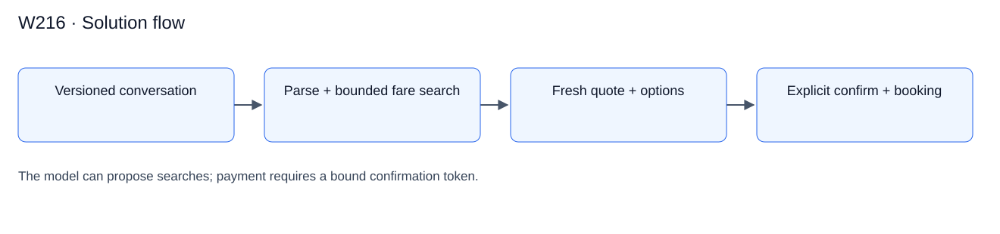

# W216. Design an LLM Flight Search and Booking Agent

**Priority group:** Third 100 — broader practice

**Category:** RAG, agents and application security

**Study position:** 216 of 547

[Group list](../THIRD_100.md) · [All categories](../ALL_CATEGORIES.md) · [Chapter guide](../README.md)

## Question

Design a chat agent that helps people find, book and follow the price of flights. A user types requests in plain language, and the agent turns them into real flight searches, explains the options, and keeps watching fares for the user. Many requests are open-ended and name no destination.

### Requirements

1. Chat and booking: a user chats with the agent to search for flights and to book one. The agent keeps the conversation state across turns, for example "make it cheaper" or "what about the week after".
2. Open-ended search: requests such as "I want to go somewhere in Europe next year" have no explicit destination, date or length of stay. The agent must still produce a short, useful list of options and ask only the questions that matter.
3. Connections: itineraries with stops must be considered, not only direct flights, because they are often much cheaper or the only option.
4. Price following: a user can ask the agent to follow the lowest price for a route or a trip idea, and is notified when the price drops or a good deal appears.
5. Scale: 30 million daily active users.
6. Safety: the agent must never charge a user, or change a booking, because of a misunderstood sentence.

### Assumptions

Latency: a response should start appearing within about 4 seconds at the 95th percentile.
Deliverables
1. The architecture from the chat client to the flight data sources, including where the language model is called and what it is allowed to do.
2. How a free-form message becomes a structured search, and how an open-ended request becomes a bounded set of candidate itineraries.
3. The price tracking design: what is stored, how fares are refreshed, and how alerts are triggered without overloading the data sources.
4. Capacity, latency and cost estimates from stated assumptions, including the language model calls (parsing and explanation) and the per-call cost of the partner data.
5. How you evaluate the agent offline and online, and how you detect regressions.
6. Failure and safety behaviour: unavailable fare data, model errors, ambiguous requests, and the booking step.

### Examples

"Cheapest way to Tokyo in March, I can leave any weekday" has a destination but flexible dates. The agent searches a date range and shows the lowest fares.
"A week somewhere warm in January under 900 dollars" has neither a destination nor exact dates. The agent proposes a handful of destinations with the cheapest dates for each.
"Tell me if this gets cheaper" after a search. The agent creates a price watch for that trip and confirms its terms.

### Constraints

Flight prices come from external partners with rate limits and per-call costs; prices change and may be stale.

## Worked solution

### Bound search; authorize booking separately

The architecture is chat client → auth/session service → intent parser → deterministic search planner → cached fare discovery/partner adapters → ranking → grounded explanation. A separate booking service owns quote revalidation, traveler details, explicit confirmation and payment. The LLM may propose a typed `SearchIntent`; it cannot charge a card or change a reservation. Conversation state stores origin, destination set, date range, duration, budget, travelers, currency and the selected option with a revision. “Week after” applies a typed patch to that state; conflicting turns require revision checks.

`POST /sessions/{id}/turns` returns a streamed response and structured options. `POST /watches` stores a normalized search, baseline, alert threshold, expiry and notification consent. `POST /bookings/quote` obtains a fresh partner quote; `POST /bookings/confirm` requires a signed, short-lived confirmation token bound to user, itinerary, passengers, price/currency and quote version plus an idempotency key. A changed fare requires new confirmation. Model-produced “yes” is never itself payment authorization; a deliberate confirmation UI shows the exact purchase.

For “somewhere warm in January under USD 900”, ask origin and whether USD 900 covers flights or the whole trip if absent. Assume a seven-day return journey only after communicating the assumption. Use climate/visa/airport metadata and cached fare summaries to shortlist, for example, five destinations × three departure windows, not every airport/day pair. Include connecting itineraries from partners with minimum connection times, airport changes, overnight stops, baggage and ticketing protection visible. Never assemble an apparently cheap impossible connection. Flexible Tokyo dates similarly use a date-grid endpoint or bounded batched calls. Rank total price and duration/connection quality, then explain using returned fare facts and timestamps.

**Sizing assumptions.** With 30 million DAU and two turns/day there are 60 million turns/day, about 694/s average and 6,944/s at a 10× peak. Assume one USD 0.0003 parsing call/turn and one USD 0.001 explanation on half the turns: about USD 48,000/day in LLM calls. If 25% of turns search, 80% use cached discovery and each remaining search makes three partner calls, that is 9 million calls/day. At an assumed USD 0.002/call, search costs USD 18,000/day before booking/revalidation. These prices are illustrative; negotiate or measure actual partner economics. Even a modest fan-out multiplier is expensive at this scale.

For first response p95 under four seconds, allocate 200 ms session/auth, 500 ms parse, 200 ms planning, 2 seconds bounded partner search and 600 ms explanation-to-first-token with 500 ms margin. Stream an honest searching status early, then options as available; measure time to useful result separately. Cache by normalized query, passenger/fare class, partner and freshness, but revalidate before booking.

**Watches.** Deduplicate identical searches across users, shard due searches by normalized key, and use a priority queue with refresh interval based on departure distance, volatility and partner budget. Ten million unique watches refreshed four times/day need 40 million refreshes/day; at USD 0.002 that is USD 80,000/day before batching/caching, so watch frequency is a product/cost decision. Store timestamped fare observations and alert history. Trigger only on a fresh comparable fare below the user's threshold; use cooldown/hysteresis and an idempotent `(watch, fare_version, threshold)` notification key. Backoff and jitter partner retries and expire obsolete watches.

Validate parsing on annotated multi-turn/ambiguous cases, itinerary feasibility, quote freshness, unsupported explanation claims and accidental-side-effect attempts. Online monitor search success, booking completion, cancellations/complaints, stale prices, partner cost and tail latency, with experiments guarding safety. Partner outages return partial results labeled with freshness or an unavailable state. A booking timeout is “pending reconciliation”, not “failed, try paying again”: query the partner by idempotency/reference before retrying. Audit every state transition and restrict payment data to the booking service.

### Follow the diagram

Read the arrows from left to right: Versioned conversation → Parse + bounded fare search → Fresh quote + options → Explicit confirm + booking. The model can propose searches; payment requires a bound confirmation token.

### Further study

- [F188: Design a flight-search and booking agent.](../19_product_ml_case_studies.md#f188)
