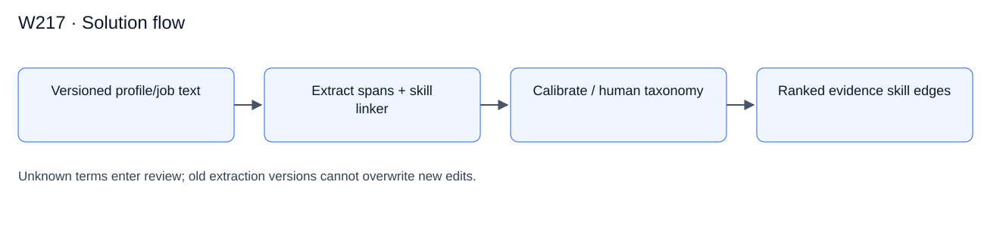

# W217. Design LinkedIn's Skills Extraction & Taxonomy Pipeline

**Priority group:** Third 100 — broader practice

**Category:** RAG, agents and application security

**Study position:** 217 of 547

[Group list](../THIRD_100.md) · [All categories](../ALL_CATEGORIES.md) · [Chapter guide](../README.md)

## Question

Design the pipeline behind LinkedIn's Skills graph: how skill phrases are extracted from resumes and job posts, normalized into a canonical taxonomy, ranked per profile, and continually updated as new skills emerge. The round is graded as much on data collection / labeling strategy as on modeling.

Functional

Build and maintain the canonical skills taxonomy (Java, Kubernetes, LLM Fine-Tuning, ...).
For each profile, output a ranked list of skills with confidence scores.
For each job posting, extract required and preferred skills.
New skills must surface as the language evolves — "RAG", "MoE", "Vector DB" did not exist five years ago.

Non-functional

Profile coverage: a billion+ profiles, incremental updates as users edit content.
Job posting coverage: tens of millions live, refreshed daily.
Precision matters more than recall — false skill claims hurt user trust.

## Worked solution

### Extract evidence, then link to a versioned skill graph

Assume one billion profiles with 1% edited/day and 30 million live jobs refreshed daily: roughly 463 documents/s average across 40 million daily documents, or 4,630/s at 10× peak. Full backfills run separately from interactive edits. A billion profiles with 30 skill edges at 40 bytes/edge is about 1.2 TB raw before indexes, evidence text and replication; do not send the whole population through an LLM per refresh.

Store `Skill(id,canonical_name,status,taxonomy_version)`, `Alias(text,language,skill_id,context_rule)`, typed graph edges such as broader-than/related-to, and `Evidence(doc_id,version,span,skill_id,confidence,model_version)`. Profile output is `ProfileSkill(profile_id,skill_id,score,evidence_ids,source_version)`. Job output includes required/preferred/negated/context labels. `GET /profiles/{id}/skills` serves ranked evidence-backed skills; admin APIs review merge/split/deprecate proposals. Never silently reuse a deleted skill ID for a different meaning.

Collect consented profile/job text, explicit user-entered skills and recruiter/subject-matter annotations. Human labels mark spans, canonical IDs, negation (“no Java required”), required/preferred status and ambiguous phrases. Sample languages, industries, seniorities and emerging terms, and audit agreement. Explicit listed skills are useful weak labels but are not a complete gold set. Split by document family, employer and time to prevent copied job templates leaking across train/test. Label absence is not always a negative skill claim.

The flow is versioned document edit → language/section detection → high-precision dictionary plus span model → candidate skill retrieval → contextual entity linker → calibrated threshold/abstention → evidence edges → profile ranking. “Java” near JVM is a programming language; the same token in a travel history is not. A profile saying “led a team using Kubernetes” supports exposure differently from a recent detailed implementation. Rank using evidence strength, explicitness, recency and corroboration; do not infer sensitive or unsupported skills from demographics, titles or associations alone. Let users inspect/correct skills and separate self-asserted from inferred ones.

Emerging terms enter an unknown-phrase stream. Cluster contextual embeddings, check frequency/growth across independent authors, detect aliases versus novel concepts, and submit proposals to taxonomy reviewers. “RAG” needs contextual disambiguation; a spike from duplicated spam is not evidence for a new canonical skill. Reviewers merge or create IDs with aliases and migration mappings, then replay only affected documents. Keep old taxonomy versions queryable for reproducible model evaluation.

Version-check consumers prevent a slow old extraction from overwriting a recent edit; tombstones remove deleted evidence. Monitor precision@k, coverage, calibration, required/preferred F1, unknown-term lag and user corrections by slice. Prefer abstention at low confidence because false skill claims harm trust. Incremental CPU models handle common text; route uncertain novel phrases to costlier models/humans. A queue/backfill outage leaves a visible stale version rather than fabricating a skill list.

### Follow the diagram

Read the arrows from left to right: Versioned profile/job text → Extract spans + skill linker → Calibrate / human taxonomy → Ranked evidence skill edges. Unknown terms enter review; old extraction versions cannot overwrite new edits.

### Further study

- [F071: Design a minimal retrieval-augmented question-answering system.](../08_rag_and_agents.md#f071)
- [F077: Design tool schemas and validate LLM outputs.](../08_rag_and_agents.md#f077)
- [F088: Design an LLM evaluation and annotation platform.](../09_ml_system_design.md#f088)
