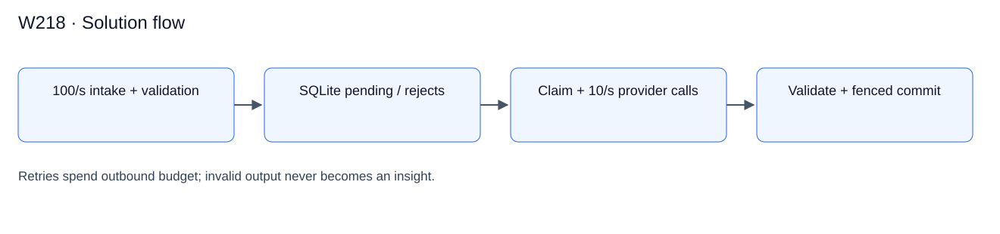

# W218. Tweet Insight Pipeline with Rate-Limited LLM Classification

**Priority group:** Third 100 — broader practice

**Category:** RAG, agents and application security

**Study position:** 218 of 547

[Group list](../THIRD_100.md) · [All categories](../ALL_CATEGORIES.md) · [Chapter guide](../README.md)

<span class="practice-page"></span>

## Question

Tweet Insight Pipeline with Rate-Limited LLM Classification

Build a small containerized pipeline that loads tweet records from a dataset file, validates them, stores them in a database, and uses an LLM API to classify each stored tweet. Two rate limiters protect the system: one on how fast records are accepted, one on how fast the LLM API is called.

What to build
1. Ingester. Read a CSV or JSON dump of tweets. Validate every record against a Pydantic model (id, text, author, created_at) and insert valid records into a local database (SQLite, or Postgres in Docker) with status pending. Count and quarantine invalid records; never drop them silently.
2. Inference worker. Claim pending tweets, call the LLM API for each one, and store a classification (sentiment and topic, with a confidence score) in an insights table. Mark the tweet done or failed.
3. Output validation. Validate every LLM response against a schema (sentiment from a fixed set, topic string, confidence in [0, 1]) and apply a confidence threshold. Retry or mark failed when the response does not parse or falls below the threshold; never store an unvalidated insight.
4. Inbound rate limiter. Cap how fast new tweets are accepted at about 100 requests per second.
5. Outbound rate limiter. Cap calls to the LLM API at about 10 requests per second, independently of the inbound limiter.
6. Containerization. A single docker compose up must start the database, the ingester and the worker.

### Rules

The two limiters are independent: a burst on the inbound side must not change the outbound call rate.
Status transitions (pending, processing, done, failed) must be idempotent so the system can restart safely and several workers never process the same tweet twice.
Secrets such as the API key come from environment variables, never from source code.
Example

An input file with 1,000 tweets, 20 of which have empty text, produces 980 stored tweets, a reject count of 20, and an insight row for every tweet that passed both validation steps. With the ingester running faster than the outbound rate, the worker's LLM calls stay near 10 per second while pending rows accumulate.

### Constraints

Input size: up to a few hundred thousand records.
text is 1 to 1000 characters; confidence is a float between 0 and 1.
The LLM API can return transient 429 and 5xx errors; handle them with backoff under the same limiter.

## Worked solution

### Runnable pipeline and explicit delivery guarantees

The input file and LLM provider contract were not supplied. The checked-in [local pipeline](../tweet_pipeline_201_250/app.py), [Compose file](../tweet_pipeline_201_250/compose.yaml) and [demo input](../tweet_pipeline_201_250/demo.json) supply a clearly labeled fixture. From `tweet_pipeline_201_250`, run `docker compose up --build`. SQLite is an embedded database, so the `database` service initializes a shared local volume and exits; ingester and worker then open that durable file. The default `MOCK_LLM=1` returns a demo classification. For real inference, set `MOCK_LLM=0`, `LLM_URL` and `LLM_API_KEY`; the adapter expects a JSON Insight response, not a provider-specific chat envelope.

The flow is file → inbound limiter → Tweet validation → SQLite pending row → atomic worker claim → outbound limiter → provider → Insight validation/threshold → transaction committing insight plus done. Invalid records go to `rejects(source_hash,line,raw,reason)`, not just a log counter. The demo has two valid rows and one empty-text rejection. Rerunning the same file inserts no duplicate tweets or reject rows. Treat input IDs as immutable; production ingestion should quarantine a repeated ID with different content instead of overwriting it.

Pydantic validates `id,text,author,created_at`, nonblank text of length 1–1000 and a fixed sentiment set, nonblank topic and finite confidence in [0,1]. Responses below the configured threshold (default .7) never enter `insights`. The worker bounds attempts at three, persists errors and retry time, backs off with jitter and honors numeric Retry-After. Every attempted provider call, including retries, consumes the outbound budget. A permanent 4xx should be classified as nonretryable by a production adapter.

The two named database limiter rows implement independent paced admissions at 100/s inbound and 10/s outbound. `BEGIN IMMEDIATE` serializes only short claims/reservations; no network call or sleep holds a database transaction. Multiple local workers share the same limiter state. This is local-host SQLite WAL storage, not a network-filesystem database cluster. In steady state a 100/s input and 10/s worker grows the backlog by 90/s: 1,000 valid tweets need roughly 100 seconds of provider time, before retries.

A claim increments a fencing version and sets a 60-second lease. A crash allows later reclaim; stale workers cannot commit over a newer claim. Exactly one insight row per tweet is enforced by its primary key and the fenced transaction. **Exactly-once external API execution cannot be guaranteed after an ambiguous network failure** without provider idempotency. A stable `Idempotency-Key` is sent, but the provider must honor it. Add lease heartbeats for slow calls and reconcile uncertain provider results; the demo's 20-second HTTP timeout is below the lease. This distinction is necessary to interpret “never process twice” honestly.

The implementation is included below. Tests exercise validation, quarantine, rerun idempotency, invalid/low-confidence output rejection, retry completion and stale-claim fencing. The Python behavior was run locally; a Docker daemon was not available to prove an actual Compose launch.

```python
"""W218 runnable local SQLite pipeline. Demo LLM is opt-in via MOCK_LLM=1."""
import csv
import hashlib
import json
import os
import random
import sqlite3
import sys
import time
import urllib.error
import urllib.request
from datetime import datetime
from typing import Literal
from pydantic import BaseModel, ConfigDict, Field, ValidationError, field_validator

DB = os.environ.get('DB_PATH', '/data/tweets.db')
THRESHOLD = float(os.environ.get('CONFIDENCE_THRESHOLD', '.7'))
LEASE = 60

class Tweet(BaseModel):
    model_config = ConfigDict(extra='forbid')
    id: str = Field(min_length=1)
    text: str = Field(min_length=1, max_length=1000)
    author: str = Field(min_length=1)
    created_at: datetime

    @field_validator('text', 'author')
    @classmethod
    def nonblank(cls, value):
        if not value.strip():
            raise ValueError('blank text/author')
        return value

class Insight(BaseModel):
    model_config = ConfigDict(extra='forbid', allow_inf_nan=False)
    sentiment: Literal['positive', 'neutral', 'negative']
    topic: str = Field(min_length=1, max_length=200)
    confidence: float = Field(ge=0, le=1)

    @field_validator('topic')
    @classmethod
    def nonblank(cls, value):
        if not value.strip(): raise ValueError('blank topic')
        return value

def connect():
    db = sqlite3.connect(DB, timeout=30, isolation_level=None)
    db.execute('PRAGMA busy_timeout=30000')
    db.execute('PRAGMA synchronous=FULL')
    db.row_factory = sqlite3.Row
    return db

def init():
    os.makedirs(os.path.dirname(os.path.abspath(DB)), exist_ok=True)
    with connect() as db:
        db.execute('PRAGMA journal_mode=WAL')
        db.executescript('''
        CREATE TABLE IF NOT EXISTS tweets (
          id TEXT PRIMARY KEY, payload TEXT NOT NULL, status TEXT NOT NULL DEFAULT 'pending',
          attempts INTEGER NOT NULL DEFAULT 0, lease_until REAL, fence INTEGER NOT NULL DEFAULT 0,
          next_try REAL NOT NULL DEFAULT 0, error TEXT);
        CREATE INDEX IF NOT EXISTS pending_idx ON tweets(status,next_try);
        CREATE TABLE IF NOT EXISTS insights (
          tweet_id TEXT PRIMARY KEY REFERENCES tweets(id), sentiment TEXT, topic TEXT, confidence REAL);
        CREATE TABLE IF NOT EXISTS rejects (
          source TEXT, line INTEGER, raw TEXT, reason TEXT, PRIMARY KEY(source,line));
        CREATE TABLE IF NOT EXISTS limits (name TEXT PRIMARY KEY, next_at REAL NOT NULL);
        ''')

def acquire(name, per_second):
    """Database-coordinated leaky admissions, independent by name, no bursts."""
    while True:
        with connect() as db:
            db.execute('BEGIN IMMEDIATE')
            now = time.time()
            row = db.execute('SELECT next_at FROM limits WHERE name=?', (name,)).fetchone()
            due = row[0] if row else now
            if due <= now:
                db.execute('INSERT INTO limits VALUES (?,?) ON CONFLICT(name) DO UPDATE SET next_at=excluded.next_at',
                           (name, now + 1 / per_second))
                db.commit(); return
            db.rollback()
        time.sleep(min(due - now, .1))

def records(path):
    with open(path, encoding='utf-8', newline='') as stream:
        if path.endswith('.csv'):
            yield from enumerate(csv.DictReader(stream), 2)
        elif path.endswith('.jsonl'):
            for i, line in enumerate(stream, 1):
                try: yield i, json.loads(line)
                except json.JSONDecodeError: yield i, {'_malformed_json': line}
        else:
            data = json.load(stream)
            if not isinstance(data, list): raise ValueError('JSON input must be a list')
            yield from enumerate(data, 1)

def ingest(path):
    valid, rejected = 0, 0
    digest = hashlib.sha256()
    with open(path, 'rb') as raw_file:
        for block in iter(lambda: raw_file.read(1024 * 1024), b''):
            digest.update(block)
    source = digest.hexdigest()
    for line, raw in records(path):
        acquire('inbound', 100)
        try:
            tweet = Tweet.model_validate(raw)
        except ValidationError as exc:
            rejected += 1
            with connect() as db:
                db.execute('INSERT OR REPLACE INTO rejects VALUES (?,?,?,?)',
                           (source,line,json.dumps(raw),str(exc)))
            continue
        with connect() as db:
            cur = db.execute('INSERT OR IGNORE INTO tweets(id,payload) VALUES (?,?)',
                             (tweet.id, tweet.model_dump_json()))
            valid += cur.rowcount
    return {'inserted': valid, 'rejected_this_scan': rejected}

def claim():
    with connect() as db:
        db.execute('BEGIN IMMEDIATE')
        now = time.time()
        db.execute("UPDATE tweets SET status='pending' WHERE status='processing' AND lease_until < ?", (now,))
        row = db.execute("SELECT * FROM tweets WHERE status='pending' AND next_try<=? ORDER BY id LIMIT 1", (now,)).fetchone()
        if not row:
            db.commit(); return None
        db.execute("UPDATE tweets SET status='processing', attempts=attempts+1, fence=fence+1, lease_until=? WHERE id=?",
                   (now+LEASE,row['id']))
        fresh = db.execute('SELECT * FROM tweets WHERE id=?', (row['id'],)).fetchone()
        db.commit(); return dict(fresh)

def classify(tweet):
    if os.environ.get('MOCK_LLM') == '1':
        return {'sentiment': 'neutral', 'topic': 'demo', 'confidence': .95}
    endpoint, secret = os.environ['LLM_URL'], os.environ['LLM_API_KEY']
    # Adapter contract: POST a tweet; provider returns exactly Insight JSON.
    request = urllib.request.Request(endpoint, data=tweet['payload'].encode(), headers={
        'Content-Type': 'application/json', 'Authorization': 'Bearer '+secret,
        'Idempotency-Key': 'tweet-insight-v1:'+tweet['id']})
    with urllib.request.urlopen(request, timeout=20) as response:
        return json.load(response)

def process_one(call=classify):
    row = claim()
    if row is None: return False
    try:
        acquire('outbound', 10)  # retries enter through here too
        insight = Insight.model_validate(call(row))
        if insight.confidence < THRESHOLD:
            raise ValueError('confidence below threshold')
        with connect() as db:
            db.execute('BEGIN IMMEDIATE')
            owner = db.execute("SELECT 1 FROM tweets WHERE id=? AND fence=? AND status='processing'",
                               (row['id'],row['fence'])).fetchone()
            if owner:
                db.execute('INSERT OR REPLACE INTO insights VALUES (?,?,?,?)',
                           (row['id'],insight.sentiment,insight.topic,insight.confidence))
                db.execute("UPDATE tweets SET status='done',error=NULL,lease_until=NULL WHERE id=?", (row['id'],))
            db.commit()
    except Exception as exc:
        attempts = row['attempts']
        # All failures are bounded; 429/5xx and parse failures share rate control.
        delay = min(60, 2 ** attempts) + random.random()
        if isinstance(exc, urllib.error.HTTPError):
            try: delay = max(delay, float(exc.headers.get('Retry-After', 0)))
            except ValueError: pass
        status = 'failed' if attempts >= 3 else 'pending'
        with connect() as db:
            db.execute("UPDATE tweets SET status=?,next_try=?,lease_until=NULL,error=? WHERE id=? AND fence=? AND status='processing'",
                       (status,time.time()+delay,type(exc).__name__+': '+str(exc)[:500],row['id'],row['fence']))
    return True

def worker():
    while True:
        if not process_one(): time.sleep(.1)

if __name__ == '__main__':
    init()
    if sys.argv[1] == 'ingest': print(json.dumps(ingest(sys.argv[2])))
    elif sys.argv[1] == 'worker': worker()
    elif sys.argv[1] != 'init': raise SystemExit('init | ingest FILE | worker')
```

### Follow the diagram



Read the arrows from left to right: 100/s intake + validation → SQLite pending / rejects → Claim + 10/s provider calls → Validate + fenced commit. Retries spend outbound budget; invalid output never becomes an insight.

### Further study

- [F090: Design a rate-limited LLM classification pipeline.](../09_ml_system_design.md#f090)
