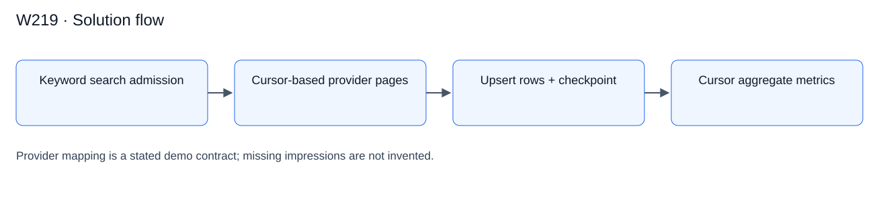

# W219. Twitter Insight Platform with Rate Limiting and Dockerization

**Priority group:** Third 100 — broader practice

**Category:** RAG, agents and application security

**Study position:** 219 of 547

[Group list](../THIRD_100.md) · [All categories](../ALL_CATEGORIES.md) · [Chapter guide](../README.md)

<span class="practice-page"></span>

## Question

Twitter Insight Platform with Rate Limiting and Dockerization

You need to build a Twitter Insight platform that extracts data from the Twitter API and provides insights. The task includes the following features:

Implement a feature that retrieves tweets related to a given keyword and analyzes them for user engagement metrics such as likes, retweets, and comments.
Add an inbound/outbound rate limiter to ensure API requests do not exceed the allowed system limits.
Containerize the application using Docker for build and deploy.

Note: Use the cursor module to ensure efficient data processing.

Example

### Input

python

## Worked solution

### Clarify the missing API and cursor contract

The prompt ends at “Input python”; it supplies no API credentials, dataset, output contract or definition/package version for the “cursor module.” Do not guess which package the interviewer meant. The implementation below is a **runnable demonstration** with an injected `fetch_page(keyword,cursor)` adapter. A real Twitter/X adapter must map the authorized provider's current authentication, pagination and metric fields into this contract. A database cursor is used for aggregation; it is not a claim that an unspecified third-party cursor module has been installed.

The demo page format is `{items:[{id,text,likes,retweets,comments}], next_cursor: string|null}`. Stream one page at a time, upsert `(keyword,id)` to avoid duplicate counting across pages/retries, and commit the next cursor in the same transaction. A restart resumes the last committed page. A finished snapshot remains finished; start a new snapshot/checkpoint for a later refresh rather than silently treating old counts as live. Metrics are summed likes/retweets/comments and average observed engagement per tweet. An impression-based engagement rate cannot be computed without impressions; zero tweets gives average zero.

Separate inbound search admission (100/s demonstration policy) from outbound page attempts (10/s). The example limiters pace a single sequential process; a REST/multi-worker deployment must share per-tenant and global limits atomically, bound its work queue and return 429/Retry-After on admission failure. Retry transient failures with jitter and provider Retry-After; the demo uses bounded generic backoff, so an adapter should classify 4xx versus 429/5xx. Do not expose tokens in logs. Store fetch time and metric observation time in a production schema because engagement changes.

```python
"""W219 demonstration adapter: provider contract must be mapped explicitly."""

import json
import os
import sqlite3
import time
import urllib.parse
import urllib.request


class SpacedLimiter:
    def __init__(self, rate):
        self.period, self.next_at = 1 / rate, 0.0

    def wait(self):
        delay = self.next_at - time.monotonic()
        if delay > 0:
            time.sleep(delay)
        self.next_at = time.monotonic() + self.period


def fetch_http(keyword, cursor):
    # This is an INTERNAL adapter endpoint contract, not a claim about a live API.
    params = urllib.parse.urlencode({"keyword": keyword, "cursor": cursor or ""})
    request = urllib.request.Request(
        os.environ["API_URL"] + "?" + params,
        headers={"Authorization": "Bearer " + os.environ["API_TOKEN"]},
    )
    with urllib.request.urlopen(request, timeout=15) as response:
        return json.load(response)


def analyze(keyword, fetch_page, db_path="engagement.db", inbound=None, outbound=None):
    """Page contract: {items:[{id,text,likes,retweets,comments}], next_cursor}."""
    inbound = inbound or SpacedLimiter(100)
    outbound = outbound or SpacedLimiter(10)
    inbound.wait()  # each accepted search, not each API page
    db = sqlite3.connect(db_path)
    db.executescript(
        """CREATE TABLE IF NOT EXISTS engagement(
       keyword TEXT,id TEXT,text TEXT,likes INTEGER,retweets INTEGER,comments INTEGER,
       PRIMARY KEY(keyword,id));
       CREATE TABLE IF NOT EXISTS checkpoints(keyword TEXT PRIMARY KEY,cursor TEXT,done INTEGER);"""
    )
    row = db.execute(
        "SELECT cursor,done FROM checkpoints WHERE keyword=?", (keyword,)
    ).fetchone()
    cursor, done = (row[0], bool(row[1])) if row else (None, False)
    while not done:
        for attempt in range(4):
            outbound.wait()  # every attempt spends from the outbound rate budget
            try:
                page = fetch_page(keyword, cursor)
                break
            except Exception:
                if attempt == 3:
                    db.close()
                    raise
                time.sleep(min(8, 2**attempt))
        next_cursor = page.get("next_cursor")
        if next_cursor is not None and next_cursor == cursor:
            db.close()
            raise ValueError("non-advancing cursor")
        with db:
            for item in page["items"]:
                counts = [item[k] for k in ("likes", "retweets", "comments")]
                if any(not isinstance(v, int) or v < 0 for v in counts):
                    raise ValueError("invalid engagement count")
                db.execute(
                    "INSERT OR REPLACE INTO engagement VALUES (?,?,?,?,?,?)",
                    (keyword, str(item["id"]), item["text"], *counts),
                )
            done = next_cursor is None
            db.execute(
                "INSERT OR REPLACE INTO checkpoints VALUES (?,?,?)",
                (keyword, next_cursor, int(done)),
            )
        cursor = next_cursor
    # A DB cursor streams rows rather than materializing every tweet in Python.
    cur = db.cursor()
    cur.execute(
        "SELECT COUNT(*),COALESCE(SUM(likes),0),COALESCE(SUM(retweets),0),COALESCE(SUM(comments),0) FROM engagement WHERE keyword=?",
        (keyword,),
    )
    n, likes, retweets, comments = cur.fetchone()
    db.close()
    return dict(
        tweets=n,
        likes=likes,
        retweets=retweets,
        comments=comments,
        engagement_per_tweet=(likes + retweets + comments) / n if n else 0.0,
    )


if __name__ == "__main__":
    print(
        json.dumps(
            analyze(
                os.environ.get("KEYWORD", "demo"),
                fetch_http,
                os.environ.get("DB_PATH", "/data/engagement.db"),
            )
        )
    )
```

For a minimal demonstration image (standard library only), place this Dockerfile beside the module:

```dockerfile
FROM python:3.11-slim
WORKDIR /app
COPY tweet_engagement_201_250.py app.py
CMD ["python", "app.py"]
```

Mount a writable `/data` volume and supply `API_URL`, `API_TOKEN`, `KEYWORD`, `DB_PATH=/data/engagement.db` through environment/secrets. `API_URL` is the internal adapter described above, not a verified live endpoint. The two-page fixture in the batch tests checks deduplication, checkpoint restart and sums; no unknown sample or live API success is claimed.

### Follow the diagram



Read the arrows from left to right: Keyword search admission → Cursor-based provider pages → Upsert rows + checkpoint → Cursor aggregate metrics. Provider mapping is a stated demo contract; missing impressions are not invented.

### Further study

- [F090: Design a rate-limited LLM classification pipeline.](../09_ml_system_design.md#f090)
