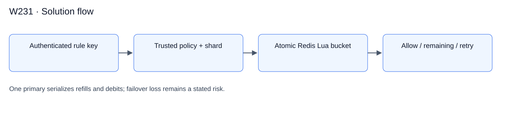

# W231. Design a Distributed Rate Limiter with Redis Lua

**Priority group:** Third 100 — broader practice

**Category:** API limits, quotas and overload

**Study position:** 231 of 547

[Group list](../THIRD_100.md) · [All categories](../ALL_CATEGORIES.md) · [Chapter guide](../README.md)

<span class="practice-page"></span>

## Question

Design a distributed rate limiter.

Functional requirements:
1. Limit requests by user, IP, API key, or service identity.
2. Support configurable limits per endpoint or tier.
3. Reject or throttle requests consistently across multiple application servers.
4. Return a clear allow / deny decision with enough metadata for callers.

Scale / constraints:

The limiter must work across a fleet, not just inside one process.
Keep request-path latency low.

Discuss: token bucket vs fixed window vs sliding window; in-process vs sidecar vs gateway vs dedicated service; Redis shared state, sharding, hot keys, availability, atomic updates; fail-open vs fail-closed during a limiter outage.

## Worked solution

### Atomic token buckets shared across the fleet

Assume 100,000 checks/s, 10 million active identity/rule pairs and a 3-ms regional p99 target. At an estimated 150 bytes of logical state per active key, state alone is 1.5 GB before Redis allocator/hash/key overhead and replicas; measure actual key memory and peak hot-key rate. Hash `(tenant,identity_type,identity,endpoint_rule)` to a Redis shard. Authentication determines the identity; never trust a client-supplied “paid tier” header.

Expose `Check(identity,rule,cost,request_id) -> {allowed,remaining,retry_after,policy_version}`. A gateway/dedicated limiter validates policy and executes one atomic script on the owning shard. The script reads the balance, refills by elapsed server time, conditionally debits and writes the timestamp. A separate read then increment has a double-spend race. The [runnable Lua script](../token_bucket_201_250.lua) implements one bucket:

```lua
-- Trusted caller supplies policy; one Redis key per identity/rule.
-- ARGV: capacity, refill tokens/sec, cost. Returns allowed, remaining, retry_ms.
local capacity = tonumber(ARGV[1])
local rate = tonumber(ARGV[2])
local cost = tonumber(ARGV[3])
if capacity <= 0 or rate <= 0 or cost <= 0 or cost > capacity then
  return redis.error_reply('invalid policy or cost')
end
local clock = redis.call('TIME')
local now = tonumber(clock[1]) + tonumber(clock[2]) / 1000000
local row = redis.call('HMGET', KEYS[1], 'tokens', 'updated')
local tokens = tonumber(row[1]) or capacity
local updated = tonumber(row[2]) or now
now = math.max(now, updated) -- do not mint tokens from a backward wall-clock step
-- Clamp balance when a policy lowers capacity.
tokens = math.min(capacity, tokens + (now-updated) * rate)
local allowed = 0
local retry = 0
if tokens >= cost then
  tokens = tokens-cost
  allowed = 1
else
  retry = math.ceil((cost-tokens)/rate*1000)
end
redis.call('HSET', KEYS[1], 'tokens', tokens, 'updated', now)
redis.call('PEXPIRE', KEYS[1], math.ceil(capacity/rate*1000)+1000)
return {allowed, math.floor(tokens), retry}

```

A capacity-10, refill-2/s bucket admits ten immediate unit requests; the eleventh returns about 500 ms retry-after. The TTL exceeds the full-refill time, so forgotten idle state can safely restart full. Policy changes are trusted input; clamping lowers capacity, but a refill-rate change needs a policy-version migration if exact historic refill semantics matter. Lua prevents interleaving on one primary, not data loss during asynchronous failover. A timed-out debit is ambiguous: blindly repeating may spend twice. Conservative overthrottling or a bounded idempotency-result cache is needed if exact retry semantics matter.

Fixed windows store one counter but can admit 2N at a boundary. Sliding logs enforce exact recent-N semantics with memory proportional to accepted traffic; sliding counters approximate that boundary. Token buckets allow a deliberate burst and bound long-run average, which is a different contract from exact sliding windows. A leaky queue smooths departures but adds waiting and needs a maximum queue.

Gateways give early rejection; sidecars reduce app coupling; a dedicated service centralizes policy at a network-hop cost. Local-only counters multiply quota by fleet size; token leases reduce shared calls but spend an explicit error budget. Hot identities stay serialized on their shard: split by leased sub-budgets only if bounded approximation is acceptable. Multi-rule all-or-none checks need co-located keys and one script or another transaction design; separate scripts can consume one budget before the other rejects. Use versioned dynamic config, 429/Retry-After, jittered clients and metrics by rule. Choose fail-closed for expensive/security-sensitive calls; a bounded emergency local budget may be preferable for availability-focused reads. Do not describe Redis async replication as strict global enforcement.

### Follow the diagram



Read the arrows from left to right: Authenticated rule key → Trusted policy + shard → Atomic Redis Lua bucket → Allow / remaining / retry. One primary serializes refills and debits; failover loss remains a stated risk.

### Further study

- [F166: Design a token-bucket rate limiter.](../17_distributed_systems_depth.md#f166)
- [F169: Explain backpressure in a multi-stage data pipeline.](../17_distributed_systems_depth.md#f169)
