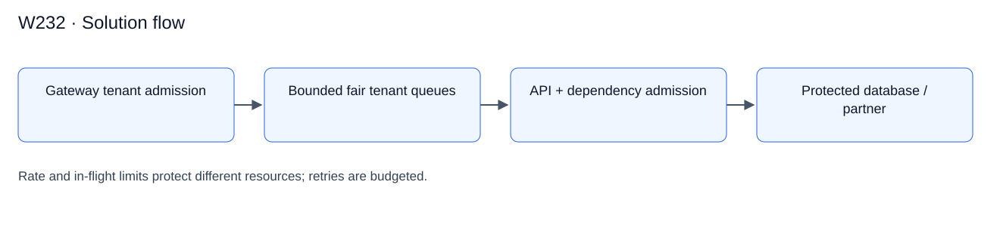

# W232. Design a Network Throttling / Rate-Limiting System

**Priority group:** Third 100 — broader practice

**Category:** API limits, quotas and overload

**Study position:** 232 of 547

[Group list](../THIRD_100.md) · [All categories](../ALL_CATEGORIES.md) · [Chapter guide](../README.md)

## Question

Design a throttling (rate-limiting) system for a large serving infrastructure handling both internal teams and external users. Current path: Client → HTTP Gateway → API Server → Database / 3rd-party / other API server. A recent traffic burst caused a cascading failure.

Goals

Incoming: limit requests from users at the Gateway (per-user, per-tier free/paid, per-endpoint).
Outgoing: limit requests API servers send to databases / third-party services (protect dependencies, stop cascading failures).
Multi-tenant limits, graceful degradation (HTTP 429), dynamic config without restarts.

Non-functional: throttle check &lt; 5ms, high availability (the limiter itself must not crash), ~99% accuracy acceptable, observability, and fairness (one user can't starve others).

Discuss: distributed rate limiting across many gateways, per-user resource isolation, algorithm choice (token bucket / leaky bucket / sliding window), backpressure, and avoiding the thundering-herd / retry storm problem.

## Worked solution

### Protect both the front door and each dependency

Assume 1 million peak inbound requests/s across 100 gateways, 100,000 active tenants and 10 downstream services. A local admission check should take microseconds; occasional regional quota refreshes must keep p99 under the 5-ms check budget. The acceptable 99% accuracy needs a definition: for example, at most 1% excess accepted traffic per tenant over a one-minute interval. Approximation is not permission for unbounded overshoot during a partition.

The flow is client → gateway per-identity/per-endpoint admission → bounded tenant queue → API service → dependency-specific outbound admission/concurrency guard → database/partner. These are distinct budgets. A request may fan out to three partner calls, so count their actual weighted cost at the outbound boundary. Gateway policies contain tenant/tier, endpoint cost, burst, refill and concurrency maximum. A control plane publishes versioned policies with atomic activation; cached old versions have an expiry and a documented outage policy.

Use token buckets for rate/bursts and in-flight limits for long requests. At 5,000 dependency calls/s with 100-ms service time, expect about 500 concurrent calls before headroom; if latency rises to one second, the same arrival rate demands 5,000 slots and can cause collapse. A concurrency cap plus a short bounded queue prevents that positive feedback. Weighted fair/deficit round-robin tenant queues and per-tenant caps prevent one customer occupying every slot. Return 429 and Retry-After for quota admission, 503 for temporary dependency unavailability, and a degraded cached response only where product semantics allow.

For fleet enforcement, a regional shared authority shards by identity/dependency. Gateways can lease small token blocks and spend them locally. Bound outstanding unused leases so worst-case overshoot is within the explicit 1% budget; a small tenant may need centralized checks because one token already exceeds 1%. A gateway cannot invent new leases while disconnected. Dependency global limits require all API instances, background jobs and retries to use the same authority. Replica failover can lose debits; use conservative leases or stronger persistence if the bound matters.

Circuit breakers stop calls to a failing dependency; retry budgets, exponential backoff with jitter and deadline propagation prevent storms. Permit at most one retry layer, not multiplicative retries at gateway, API and worker. Isolate limiter CPU/memory and connection pools, cap state cardinality, expire idle buckets, and reserve control-plane capacity. Monitor admitted/rejected by tenant and reason, dependency saturation, queue age/depth, lease utilization, latency and policy age. A limiter outage uses a predetermined bounded fallback; strict expensive writes may fail closed. Reproduce the original burst in a load drill and verify that rejection rises while downstream latency and healthy tenants stay stable.

### Follow the diagram

Read the arrows from left to right: Gateway tenant admission → Bounded fair tenant queues → API + dependency admission → Protected database / partner. Rate and in-flight limits protect different resources; retries are budgeted.

### Further study

- [F166: Design a token-bucket rate limiter.](../17_distributed_systems_depth.md#f166)
- [F169: Explain backpressure in a multi-stage data pipeline.](../17_distributed_systems_depth.md#f169)
