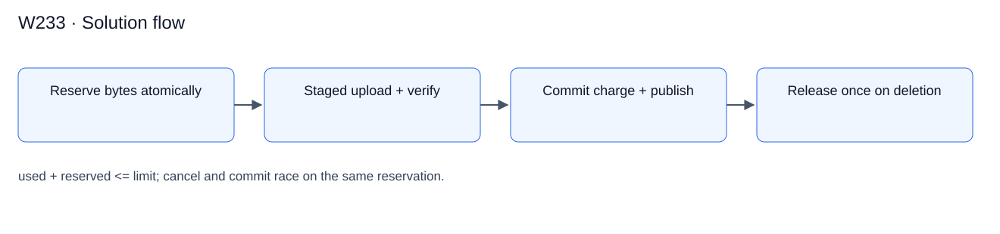

# W233. Design a Quota System

**Priority group:** Third 100 — broader practice

**Category:** API limits, quotas and overload

**Study position:** 233 of 547

[Group list](../THIRD_100.md) · [All categories](../ALL_CATEGORIES.md) · [Chapter guide](../README.md)

## Question

Design a quota management system that tracks and enforces resource usage limits across multiple backend services — e.g. Google storage shared between Drive, Photos, and Gmail. Every upload must check whether the user has enough space. The hard part is strict enforcement under high concurrency: a user must never exceed their limit, yet the check must be fast.

Functional requirements: use quota, free up quota, cancel a request, check usage. Assume one global limit per user.

Non-functional: strict consistency (no overdraft ever — two simultaneous 2 GB uploads with 2 GB left must not both succeed), P99 latency &lt; 50 ms, 99.99% availability, high throughput (~23,000 QPS, peak higher). Data is tiny (~100 bytes/user, ~1 GB total) — this is compute-heavy, not storage-heavy.

## Worked solution

### Reserve first; a check followed by a write is unsafe

Keep one authoritative row per user: `Quota(user_id,limit_bytes,used_bytes,reserved_bytes,version)`, with invariant `used + reserved <= limit`. Store `Reservation(id,user,request_key,bytes,state,expires_at)` and `ObjectCharge(object_id,user,bytes,released)` in the same user partition. A unique `(user,request_key)` makes retries idempotent. Usage reads may be cached for dashboards; enforcement must use the authority, not a stale cache.

APIs are `Reserve(user,key,bytes) -> reservation_id|exceeded`, `Commit(reservation,object_id,actual_bytes)`, `Cancel(reservation)`, `Release(object_id)` and `GetUsage(user)`. Reserve atomically checks available bytes and increments reserved. Two simultaneous 2-GB reserves with 2 GB available serialize: one succeeds and one rejects. A plain GET followed by INCR would admit both.

Upload flow: reserve → upload staged object → verify bytes/checksum → commit charge → publish object. Commit moves reserved bytes to used and records the object uniquely in one transaction. If actual bytes exceed reservation, atomically reserve the delta before commit or reject; never publish an uncharged oversized object. A smaller final object releases the remainder. Cancel and expiry release only a still-active reservation. Commit versus cancel locks the same row/state; only one transition wins. An expired upload token cannot later finalize, and cleanup deletes its staged object. Release uses object ID and a released flag, so duplicate delete notifications cannot subtract usage twice.

For the stated 23,000 QPS and approximately 100-byte quota rows, storage is small, but reservation/audit history is extra and can be much larger than the 1-GB active-state estimate. Partition by user across, for example, 16 leaders: about 1,438 operations/s average per shard before headroom. Benchmark actual transaction and replication costs, especially hot shared accounts. Each shard replicates synchronously to a regional quorum, with one owner per user. Cross-region callers route to the owner or a consensus group; a partitioned region cannot independently grant capacity and preserve no-overdraft. The 99.99% target is an availability objective, not a reason to violate the invariant during loss of quorum.

Use a durable transaction log, idempotent commands and an outbox for audit/publication. If quota commit succeeds but publication fails, retry publication; if upload succeeds but quota commit is unknown, query reservation state before retrying. Reconcile staged objects, charges and counters, while preventing a reconciler from racing active transactions. Bound reservation TTLs but renew valid long uploads. A p99 <50-ms budget is credible within a region with short transactions; distant global round trips need a placement assumption or a relaxed latency target. Distinguish approximate “usage display” from strict “permission to allocate.”

### Follow the diagram

Read the arrows from left to right: Reserve bytes atomically → Staged upload + verify → Commit charge + publish → Release once on deletion. used + reserved <= limit; cancel and commit race on the same reservation.

### Further study

- [F166: Design a token-bucket rate limiter.](../17_distributed_systems_depth.md#f166)
- [F169: Explain backpressure in a multi-stage data pipeline.](../17_distributed_systems_depth.md#f169)
