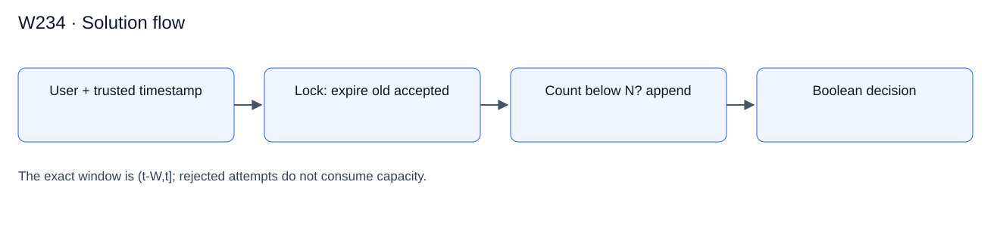

# W234. Design an API Rate Limiter

**Priority group:** Third 100 — broader practice

**Category:** API limits, quotas and overload

**Study position:** 234 of 547

[Group list](../THIRD_100.md) · [All categories](../ALL_CATEGORIES.md) · [Chapter guide](../README.md)

<span class="practice-page"></span>

## Question

Implement a rate limiter for an API. Expose allow(user_id, timestamp) -&gt; bool that returns true if the user is under the rate limit at this timestamp, else false.

Default policy: at most N requests per W-second sliding window per user.

Follow-ups:

Support multiple users with different limits.
Support dynamic / per-endpoint rules.
Distributed setting (multiple instances behind a load balancer).

## Worked solution

### Exact accepted-request sliding windows

Choose the interval `(timestamp-W, timestamp]`: a request exactly W seconds old no longer counts. Count accepted requests only; rejected attempts do not prolong the ban. The API assumes nondecreasing timestamps per user, supplied by a trusted clock; out-of-order event-time enforcement needs a different ordered data structure and a policy for decisions already made. A lock makes prune/check/append atomic.

```python
from collections import deque
import threading
import time

class SlidingWindowLimiter:
    """Accepted requests in (timestamp - window, timestamp]; monotonic per key."""
    def __init__(self, limit, window):
        if limit <= 0 or window <= 0:
            raise ValueError('positive limit/window required')
        self.limit, self.window = limit, window
        self.events, self.last = {}, {}
        self.lock = threading.Lock()

    def allow(self, user_id, timestamp):
        with self.lock:
            if timestamp < self.last.get(user_id, -float('inf')):
                raise ValueError('timestamps must not go backward per user')
            self.last[user_id] = timestamp
            q = self.events.setdefault(user_id, deque())
            while q and q[0] <= timestamp - self.window:
                q.popleft()
            if len(q) >= self.limit:
                return False
            q.append(timestamp)
            return True

    def expire_idle(self, now):
        """Call periodically with the same monotonic clock as allow()."""
        with self.lock:
            for key in list(self.last):
                if self.last[key] <= now - self.window:
                    self.last.pop(key)
                    self.events.pop(key, None)
```

For N=2,W=10, calls at 0 and 1 pass, at 9 fail, at 10 pass because time 0 expires. Each accepted timestamp enters/leaves once, so amortized processing is O(1), with at most O(N) timestamps per active user. The explicit idle sweep is O(active users); at large scale use an expiry heap/timing wheel and versioned expiry entries. Do not evict a nonempty live window to save memory or the quota resets early.

Different users/endpoints use separate keys and immutable policy objects; a policy change retaining exact history may require keeping timestamps for the maximum supported window. Lowering N can reject until existing accepted events age out. In a fleet, hash keys to an authority or use a Redis sorted set and one prune/count/add script with unique request IDs and trusted server time. Multiple independent process-local instances multiply the effective quota. Composing per-user and global rules requires one atomic all-or-none transaction or conservative reservation; two independent allows can spend one budget on a request later rejected by the other. Tests cover boundary expiry, user isolation, rejected-attempt behavior, backward time and concurrent one-winner admission.

### Follow the diagram



Read the arrows from left to right: User + trusted timestamp → Lock: expire old accepted → Count below N? append → Boolean decision. The exact window is (t-W,t]; rejected attempts do not consume capacity.

### Further study

- [F166: Design a token-bucket rate limiter.](../17_distributed_systems_depth.md#f166)
- [F169: Explain backpressure in a multi-stage data pipeline.](../17_distributed_systems_depth.md#f169)
