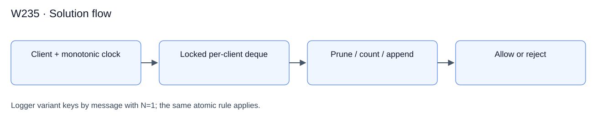

# W235. Design and Implement a Rate Limiter

**Priority group:** Third 100 — broader practice

**Category:** API limits, quotas and overload

**Study position:** 235 of 547

[Group list](../THIRD_100.md) · [All categories](../ALL_CATEGORIES.md) · [Chapter guide](../README.md)

<span class="practice-page"></span>

## Question

Design and implement a rate limiter. Base ask: allow(client_id) -&gt; bool that admits up to N requests per T seconds per client. The interviewer drives:

Pure enforcement (5 requests / 10 seconds).
Sliding-window precision — a request from 11s ago must not count.
Burst handling — short spikes within the window admitted up to N.

Follow-ups: scale to 100K QPS; distributed enforcement across untrusted gateway nodes; composing two limits (per-user + global). Variant: a logger shouldPrintMessage(timestamp, message) returning true at most once per message per window.

## Worked solution

### Preserve a recent log rather than fixed buckets

Use the exact sliding-window implementation in [W234](W234.md) and wrap it with an injected monotonic clock. This version serializes clock reading with admission to avoid a later timestamp overtaking an earlier one under threads.

```python
from collections import deque
import threading
import time

class SlidingWindowLimiter:
    """Accepted requests in (timestamp - window, timestamp]; monotonic per key."""
    def __init__(self, limit, window):
        if limit <= 0 or window <= 0:
            raise ValueError('positive limit/window required')
        self.limit, self.window = limit, window
        self.events, self.last = {}, {}
        self.lock = threading.Lock()

    def allow(self, user_id, timestamp):
        with self.lock:
            if timestamp < self.last.get(user_id, -float('inf')):
                raise ValueError('timestamps must not go backward per user')
            self.last[user_id] = timestamp
            q = self.events.setdefault(user_id, deque())
            while q and q[0] <= timestamp - self.window:
                q.popleft()
            if len(q) >= self.limit:
                return False
            q.append(timestamp)
            return True

    def expire_idle(self, now):
        """Call periodically with the same monotonic clock as allow()."""
        with self.lock:
            for key in list(self.last):
                if self.last[key] <= now - self.window:
                    self.last.pop(key)
                    self.events.pop(key, None)
```

```python
class RateLimiter:
    def __init__(self, limit=5, window=10, clock=time.monotonic):
        self.clock = clock
        self.impl = SlidingWindowLimiter(limit, window)

    def allow(self, client_id):
        # Read clock under the same serialization as request ordering.
        with self.impl.lock:
            now = self.clock()
            q = self.impl.events.setdefault(client_id, deque())
            while q and q[0] <= now - self.impl.window:
                q.popleft()
            self.impl.last[client_id] = now
            if len(q) == self.impl.limit:
                return False
            q.append(now)
            return True

class Logger:
    def __init__(self, window=10):
        self.limiter = SlidingWindowLimiter(1, window)

    def shouldPrintMessage(self, timestamp, message):
        return self.limiter.allow(message, timestamp)
```

For five requests per ten seconds, five calls at t=0 pass, the sixth fails, and at t=11 all five old entries are gone. Short spikes are allowed up to five, but no aligned fixed-window boundary admits ten. The log stores only admitted calls, giving amortized O(1) per call and O(N × active clients) memory; periodically sweep idle state using the same clock, or maintain expirations in a timing wheel.

For the logger variant, `Logger` sets N=1 and keys by message; calls at t=1 and t=5 for the same message yield true,false, then t=11 yields true. Messages are independent. Define whether attempted suppressed messages count: this solution counts only printed ones, matching the usual logger contract.

At 100K QPS, benchmark lock contention and shard by client; the global limit remains a shared hot spot. In a distributed deployment, gateways cannot be trusted to declare their own identities or timestamps: an authenticated authority derives the key and atomically updates a shared sliding log. A Redis script needs server time, unique entries for equal timestamps, idle expiry and an outage policy. For per-user plus global rules, co-locate their atomic reservation or use a central quota transaction; debiting user then discovering global denial causes conservative underutilization unless refunded safely. A strict global bottleneck can be replaced with bounded leases only if approximation is accepted. Tests use a fake clock and a concurrent barrier so timing sleeps do not determine correctness.

### Follow the diagram



Read the arrows from left to right: Client + monotonic clock → Locked per-client deque → Prune / count / append → Allow or reject. Logger variant keys by message with N=1; the same atomic rule applies.

### Further study

- [F166: Design a token-bucket rate limiter.](../17_distributed_systems_depth.md#f166)
- [F169: Explain backpressure in a multi-stage data pipeline.](../17_distributed_systems_depth.md#f169)
