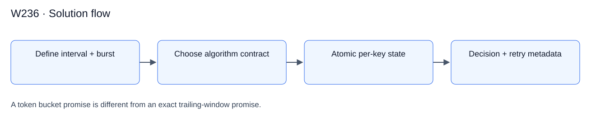

# W236. Rate Limiter Algorithm Design

**Priority group:** Third 100 — broader practice

**Category:** API limits, quotas and overload

**Study position:** 236 of 547

[Group list](../THIRD_100.md) · [All categories](../ALL_CATEGORIES.md) · [Chapter guide](../README.md)

## Question

Rate Limiter Algorithm Design

A system-design round focused less on drawing a distributed architecture and more on rate-limit algorithms: token bucket, leaky bucket, fixed window, sliding window, state storage, and trade-offs.

### Requirements

Design a rate limiter. The interviewer may keep the discussion narrow and focus on algorithms rather than a full distributed-system diagram.

Functional requirements:

Limit requests per user, API key, IP, or tenant.
Return allow / reject decision on every request.
Support configurable limits such as 100 requests / minute.
Expose enough metadata for retry behavior, e.g. remaining quota and retry-after.

Scale / constraints to clarify:

QPS per limiter instance and globally.
Number of tenants / keys.
Required accuracy under concurrency.
Burst tolerance.
Whether fail-open or fail-closed is acceptable.
Notes

Algorithm trade-offs:

Fixed window: simple counter per key and time bucket; cheap but allows boundary bursts.
Sliding window log: exact but stores every timestamp; memory-heavy at high QPS.
Sliding window counter: approximates by blending current and previous buckets; lower memory, small error.
Token bucket: supports bursts up to bucket size while enforcing average refill rate.
Leaky bucket: smooths output at a fixed drain rate; useful when downstream needs steady traffic.

A practical design uses a local in-memory fast path for single-instance limits or a shared store such as Redis for distributed limits. For high scale, shard by key, batch updates where acceptable, and keep configuration in a separate control plane.

Key interviewer traps:

Drawing too much unrelated infrastructure when they want algorithm precision.
Ignoring clock skew and atomicity in distributed counters.
Not explaining burst behavior.
Forgetting that per-key state size dominates memory.

## Worked solution

### State the exact promise before choosing an algorithm

Assume 100 requests/minute per authenticated key, 10,000 checks/s, one million active keys and a required decision `{allowed,remaining,retry_after_ms}`. Ask whether a full 100-request burst is allowed and whether “minute” means a calendar bucket, every trailing 60 seconds, or a long-run average. These are different contracts.

| Algorithm | State / update | Burst and error behavior |
|---|---|---|
| Fixed window | `(bucket_id,count)`; reset on floor(t/W) change | O(1) state, up to 2N near a boundary |
| Sliding log | prune accepted times <= t-W, count, append if below N | exact trailing window; O(N) timestamps/key |
| Sliding counter | current count + previous count × overlap fraction | O(1) state; approximate because actual previous arrival times are lost |
| Token bucket | `tokens=min(C,tokens+r×elapsed)`; spend cost if possible | O(1) state; initial burst C, average refill r, not exact N per trailing W |
| Leaky queue | departures at fixed rate from bounded queue | smooth service, but adds latency and must reject when full |

For a token bucket C=100 and r=100/60 per second, 100 calls at t=0 pass, and one more can pass at t=.6. A strict “at most 100 in every 60 seconds” rule would reject it. This counterexample is more useful than treating all algorithms as interchangeable. For a rejected unit cost with balance b, retry-after is `(1-b)/r`; for sliding logs it is oldest accepted time+W-now. Compute metadata inside the same atomic update so it reflects the decision, though later concurrent requests may change remaining capacity immediately.

Use [W239's runnable token bucket](W239.md) or [W234's exact log](W234.md) depending on that contract. A million keys at an assumed 64 bytes of packed token state need 64 MB before language-object/key/hash overhead; storing 100 64-bit timestamps/key alone needs 800 MB. Expire idle keys only after their state is equivalent to a reset bucket/window. Bound untrusted key cardinality.

Prune/refill/check/debit is one critical section locally or one shared-store script distributed. Use a monotonic local clock or one authoritative server clock, not unsynchronized gateway clocks. Shard by key; a single hot key still serializes. Dynamic configuration is a versioned control-plane concern separate from balances. Specify fail-open, fail-closed or bounded local fallback per endpoint and observe rejection/latency/state memory; do not add unrelated services before explaining these transitions and guarantees.

### Follow the diagram

Read the arrows from left to right: Define interval + burst → Choose algorithm contract → Atomic per-key state → Decision + retry metadata. A token bucket promise is different from an exact trailing-window promise.

### Further study

- [F166: Design a token-bucket rate limiter.](../17_distributed_systems_depth.md#f166)
- [F169: Explain backpressure in a multi-stage data pipeline.](../17_distributed_systems_depth.md#f169)
