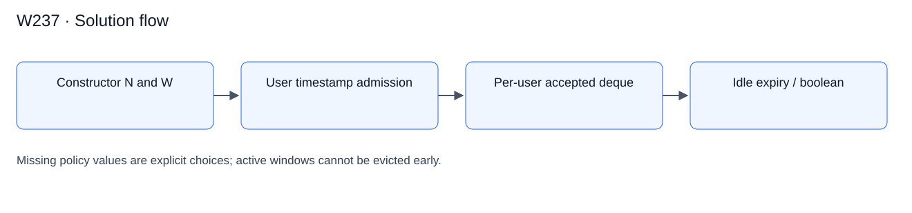

# W237. Rate Limiter Design (OOD)

**Priority group:** Third 100 — broader practice

**Category:** API limits, quotas and overload

**Study position:** 237 of 547

[Group list](../THIRD_100.md) · [All categories](../ALL_CATEGORIES.md) · [Chapter guide](../README.md)

<span class="practice-page"></span>

## Question

Implement a rate limiter for inbound user requests.

API: allow(user_id, timestamp) -&gt; bool decides whether a request is accepted.

The time window and request limit are deliberately unspecified — clarify (sliding vs fixed window, per-second vs per-minute, burst tolerance) as part of the round. Also discuss memory growth, how to expire stale state, and how the design extends to a distributed multi-gateway deployment.

## Worked solution

### Make the unspecified policy a constructor contract

The window and limit are absent, so no single numeric judge result is determined. Choose and state a demonstration policy: exact accepted-request sliding windows `(t-W,t]`, default 100 requests/60 seconds, bursts up to 100, trusted nondecreasing per-user timestamps. Make N and W constructor inputs rather than hard-coded globals.

```python
from collections import deque
import threading
import time


class SlidingWindowLimiter:
    """Accepted requests in (timestamp - window, timestamp]; monotonic per key."""

    def __init__(self, limit, window):
        if limit <= 0 or window <= 0:
            raise ValueError("positive limit/window required")
        self.limit, self.window = limit, window
        self.events, self.last = {}, {}
        self.lock = threading.Lock()

    def allow(self, user_id, timestamp):
        with self.lock:
            if timestamp < self.last.get(user_id, -float("inf")):
                raise ValueError("timestamps must not go backward per user")
            self.last[user_id] = timestamp
            q = self.events.setdefault(user_id, deque())
            while q and q[0] <= timestamp - self.window:
                q.popleft()
            if len(q) >= self.limit:
                return False
            q.append(timestamp)
            return True

    def expire_idle(self, now):
        """Call periodically with the same monotonic clock as allow()."""
        with self.lock:
            for key in list(self.last):
                if self.last[key] <= now - self.window:
                    self.last.pop(key)
                    self.events.pop(key, None)
```

Usage: `limiter=SlidingWindowLimiter(100,60); limiter.allow("u",0)`. For a smaller check, `(2,10)` accepts at 0 and 1, rejects at 9 and accepts at 10. Deques isolate users, while one lock protects the entire prune/check/append operation. A production high-QPS implementation stripes locks by stable key; do not mutate one deque under different locks.

Each user's deque has at most N timestamps, but millions of one-time users can still exhaust memory. `expire_idle(now)` removes users with no accepted request remaining and also drops backward-time tracking. After expiration, the caller must continue using the trusted clock; it is not a supported arbitrary event-time API. A sweep is O(number of users); an expiry heap with generation numbers or timing wheel gives incremental cleanup. Do not LRU-evict an active window without accepting a quota reset.

Policy objects should own `window,limit,version`; identity extraction and endpoint selection belong outside the algorithm. A larger future window cannot be enforced exactly from history already discarded under a shorter policy, so define a migration/cold-start policy. In a multi-gateway deployment, route a user to an authoritative shard or execute one atomic Redis prune/count/append. Sticky routing alone is insufficient when failover resets state. Distributed failure mode and retry metadata are part of the interface; strict costly actions fail closed if the authority is unavailable. Tests cover isolation, exact boundary, concurrency and stale-state cleanup; the missing numeric policy is explicitly a chosen example, not inferred from the title.

### Follow the diagram



Read the arrows from left to right: Constructor N and W → User timestamp admission → Per-user accepted deque → Idle expiry / boolean. Missing policy values are explicit choices; active windows cannot be evicted early.

### Further study

- [F166: Design a token-bucket rate limiter.](../17_distributed_systems_depth.md#f166)
- [F169: Explain backpressure in a multi-stage data pipeline.](../17_distributed_systems_depth.md#f169)
