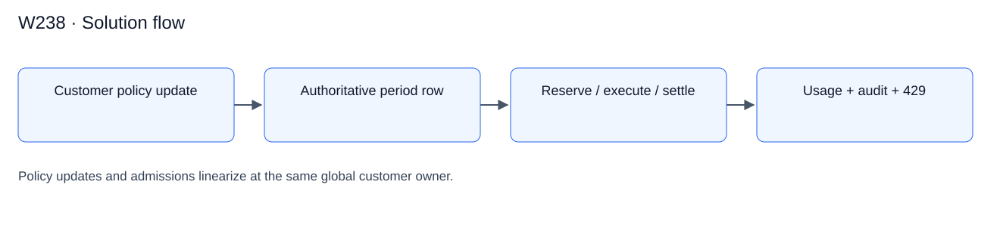

# W238. Rate Limiter for Expensive API with User-Configurable Monthly Quota

**Priority group:** Third 100 — broader practice

**Category:** API limits, quotas and overload

**Study position:** 238 of 547

[Group list](../THIRD_100.md) · [All categories](../ALL_CATEGORIES.md) · [Chapter guide](../README.md)

## Question

Tech-screen system-design round in the Salesforce MTS/SMTS loop. The product has one expensive API; each customer can set their own monthly call limit via dashboard. Design the rate-limiting layer that enforces those quotas, accepts updates to them, and explains overage behaviour.

### Requirements

Single expensive API endpoint (think LLM inference, third-party data pull, etc.).
Each customer configures their own monthly quota (e.g. "500 calls / month") via a self-serve dashboard. Quota changes take effect immediately.
Enforce the quota on every API call:
Reject calls beyond the quota with a clear 429 / quota-exceeded error.
Optionally allow soft-cap warnings ("80% used this month").
Quota window: calendar month (resets at the start of each month in the customer's billing tz) or rolling 30-day — clarify.
Multi-region / multi-instance enforcement: a customer's quota is global, not per-instance.
Reporting: customer can view current usage; admin can audit historical usage.

## Worked solution

### Monthly usage is a durable quota ledger

Choose calendar months in each customer's stored billing timezone. Freeze the timezone for the active billing period; changes apply next period to prevent resetting usage by switching zones. Server-side billing logic maps time to an immutable `period_id` and UTC bounds, handling daylight-saving transitions. A rolling 30-day rule instead needs timestamped usage or time buckets and is not equivalent.

Store `Policy(customer_id,monthly_limit,version,billing_tz)`, `Usage(customer_id,period_id,committed,reserved)`, `Request(customer,period,key,state)` and append-only audit events. `PUT /quota` authenticates the customer/admin, validates a nonnegative integer limit and atomically updates the policy version. `POST /admissions` with an idempotency key transactionally reads the current policy and usage, then reserves one call if `committed+reserved < limit`. Execute the expensive API only with that reservation. An immediate change must be read from the same linearizable authority; a TTL config cache alone violates “immediate.”

Define billing semantics: in this design a call is charged once the provider accepts execution, even if its result later fails. A local validation failure cancels the reservation; ambiguous provider outcomes stay reserved until reconciliation. Commit/cancel are idempotent state transitions. Retrying with the same key returns the same admission/result rather than another charge; a new key is a new call. Lowering quota below already used/reserved calls does not undo accepted work: available becomes zero and future calls reject until a new period or increase. State that behavior in the dashboard.

Example: limit=500, used=499. Two concurrent calls serialize on the customer-period row: one reserves the last slot, one receives 429 `quota_exceeded`, used/reserved and period reset time. Raising to 600 permits the next call immediately after the policy transaction commits. A transaction started before the update may linearize before it; “immediate” needs this precise ordering, not retroactive cancellation.

At an assumed 20K peak QPS, shard by customer and route all regions to that customer's owner with a replicated consensus-backed database. Cross-region RTT may dominate; use regional ownership placement, not independent counters that each grant 500. On loss of quorum, reject new costly calls rather than overspend. Reporting replicas can lag and must show their watermark; admission responses show authoritative usage. Audit policy changes, reservations, charges/refunds and actors; alert at 80% once per customer-period/threshold. Calendar reset creates a new row, avoiding a fleet-wide midnight counter rewrite and retaining history.

### Follow the diagram

Read the arrows from left to right: Customer policy update → Authoritative period row → Reserve / execute / settle → Usage + audit + 429. Policy updates and admissions linearize at the same global customer owner.

### Further study

- [F166: Design a token-bucket rate limiter.](../17_distributed_systems_depth.md#f166)
- [F169: Explain backpressure in a multi-stage data pipeline.](../17_distributed_systems_depth.md#f169)
