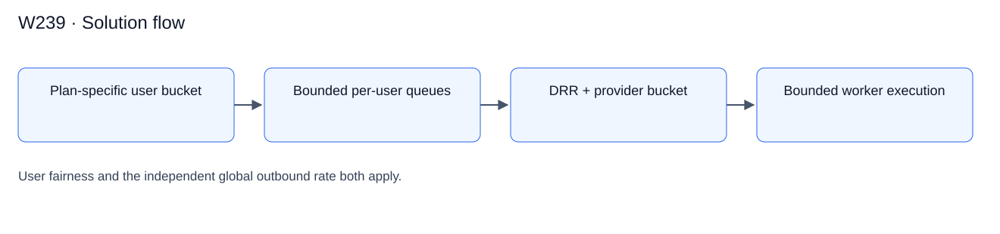

# W239. Rate Limiter — Inbound + Outbound

**Priority group:** Third 100 — broader practice

**Category:** API limits, quotas and overload

**Study position:** 239 of 547

[Group list](../THIRD_100.md) · [All categories](../ALL_CATEGORIES.md) · [Chapter guide](../README.md)

<span class="practice-page"></span>

## Question

Rate Limiter — Inbound + Outbound

Either a standalone SD round or an additional layer baked into the take-home prompt. Design a rate limiter that gates both inbound API requests (e.g. 100 req/s) and outbound calls to a downstream consumer (e.g. 10 req/s), maintains fairness across users, and degrades gracefully when limits are hit.

### Requirements

Functional:

Cap inbound request rate per API endpoint or per user (typical numbers from reports: 100 req/s inbound, 10 req/s outbound to a downstream worker).
Support custom per-user quotas rather than one global limit. A power user / enterprise account may get 10_000 tokens/s, a regular user 100 tokens/s, and a free user 10 tokens/s; the limiter should read (capacity, refill_rate) from user or plan configuration instead of hard-coding one bucket shape.
When an outbound consumer is slower than inbound, buffer requests in a queue with a bounded length; reject or shed when the buffer is full.
Return a sane error to the caller when rate-limited (429 plus retry-after header).
Per-user fairness: one heavy user must not starve others sharing the same outbound budget.

Non-functional:

Single-process correctness first; then discuss horizontal scaling (Redis token bucket, sticky sharding by user ID, etc.).
Concurrency-safe: multiple worker threads must not double-spend a token.
Notes
Token bucket is the expected baseline algorithm; sliding-window log and leaky bucket are valid variants but require an explicit tradeoff explanation.
For the take-home variant, the rate-limiter requirement is sometimes hidden in the spec until you read carefully — candidates have lost the round by missing it. Re-read the prompt twice before coding.
For the SD variant, the interviewer will press on "what happens when the consumer is much slower than producers" — be ready with backpressure (bounded queue + 429), drop policies (head/tail/random), and a metric for monitoring queue depth.
The cross-process / cross-instance case (Redis-backed token bucket with INCR + EXPIRE, or a CRDT) is the standard scaling follow-up.
Per-user fairness is often probed via the "weighted fair queueing" angle — mention DRR (deficit round robin) or per-user token sub-buckets.
A common production split is to run two limiters of different shapes in series: a per-user *request-rate* limiter (token bucket, N req/s) for steady traffic, plus a *concurrent-requests* limiter (semaphore on in-flight count) to protect against expensive long-running calls — both centrally backed by Redis with INCR + EXPIRE so they survive a process restart.
For variable quotas, keep policy data separate from bucket state: a QuotaConfig lookup maps user or plan to refill rate, capacity, burst allowance, and override expiration; the hot token-bucket row stores only current tokens and last-refill timestamp. Cache quota config with a short TTL so account upgrades propagate without rewriting every active bucket.

## Worked solution

### Independent budgets plus bounded fair buffering

Use separate policy/state for inbound user admission and outbound dependency dispatch. A user's inbound bucket reads capacity/refill from versioned plan configuration; a global dependency bucket caps provider calls at 10/s. A paid user with capacity 20,000 and refill 10,000 tokens/s is a different policy from a free user at capacity 20/refill 10. Charge request cost in the unit actually constrained: a 2,000-token generation should not consume the same token budget as a 20-token response if tokens drive provider cost.

```python
import threading
import time


class TokenBucket:
    def __init__(self, capacity, refill_rate, clock=time.monotonic):
        if capacity <= 0 or refill_rate <= 0:
            raise ValueError("positive policy required")
        self.capacity, self.rate, self.clock = capacity, refill_rate, clock
        self.tokens, self.updated = float(capacity), clock()
        self.lock = threading.Lock()

    def allow(self, cost=1):
        if not 0 < cost <= self.capacity:
            raise ValueError("cost must fit bucket")
        with self.lock:
            now = self.clock()
            self.tokens = min(
                self.capacity, self.tokens + max(0, now - self.updated) * self.rate
            )
            self.updated = now
            if self.tokens < cost:
                return False, (cost - self.tokens) / self.rate
            self.tokens -= cost
            return True, 0.0
```

The request path is authenticated request → per-user inbound bucket → bounded per-user queue → deficit-round-robin dispatcher → global outbound bucket → bounded worker pool. The code above supplies the atomic single-process primitive; queues and dispatcher are separate components. Refill/check/debit runs under one lock, so two threads cannot both spend the final token. A full capacity-2/rate-1 bucket admits two immediate calls, rejects the third with retry=1 second, and refills after the fake clock advances. Policy changes must refill under the old policy through their activation time, then clamp to the new capacity; overwriting a rate without a migration overcredits past time.

Keep one queue per active user, a global queue-length/byte cap and per-user caps. DRR rotates users, adding plan-specific deficit and dispatching affordable jobs; a maximum cost and aging policy avoid starvation for large jobs. User sub-buckets alone do not guarantee fairness in a shared FIFO. At 100 requests/s arriving and only 10/s departing, backlog grows by 90/s. A 900-item queue fills in ten seconds from empty, and its tail waits about 90 seconds at saturation. Choose the cap from a latency SLO and reject excess with 429/Retry-After or return 202 plus an authenticated job ID if asynchronous waiting is acceptable. Never buffer without bound.

Retries re-enter outbound admission with jitter/backoff and a retry budget. Use deadlines, a circuit breaker and in-flight concurrency caps because a rate cap alone does not protect against long-running calls. A cancelled queued job releases its reserved budget exactly once. Redis deployment needs an atomic Lua token calculation, not bare INCR+EXPIRE pretending to implement refill. All workers share the global provider key; per-user policies can shard. Cross-key all-or-none admission needs co-location/transactional reservation or a stated conservative loss of utilization. CRDT eventual counters cannot guarantee strict no-double-spend quotas without bounded allocations. Observe queue age/depth, per-user service share, rejection, retries, in-flight count and policy age. Tests validate the primitive's burst/refill and concurrent last-token behavior; distributed/DRR performance still requires deployment load testing.

### Follow the diagram



Read the arrows from left to right: Plan-specific user bucket → Bounded per-user queues → DRR + provider bucket → Bounded worker execution. User fairness and the independent global outbound rate both apply.

### Further study

- [F166: Design a token-bucket rate limiter.](../17_distributed_systems_depth.md#f166)
- [F169: Explain backpressure in a multi-stage data pipeline.](../17_distributed_systems_depth.md#f169)
