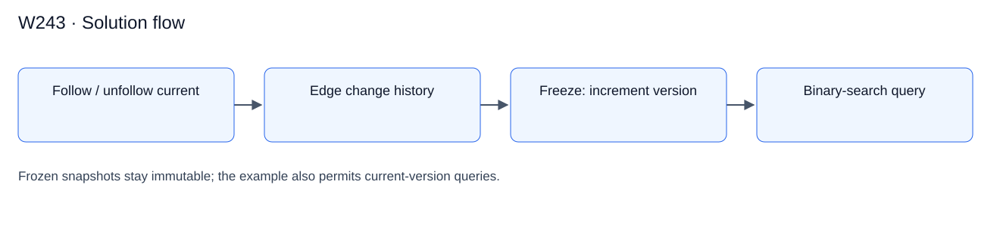

# W243. Versioned Social Network with Snapshots

**Priority group:** Third 100 — broader practice

**Category:** Algorithms, simulations and geometry

**Study position:** 243 of 547

[Group list](../THIRD_100.md) · [All categories](../ALL_CATEGORIES.md) · [Chapter guide](../README.md)

<span class="practice-page"></span>

## Question

Design a social network whose follow graph supports point-in-time snapshots.

follow(followerId, followeeId) — follower follows followee (directed, one-way).
unfollow(followerId, followeeId) — remove a follow edge.
createSnapshot() -&gt; int — freeze the current state of all follow relationships and return a snapshot/version id.
isFollowing(followerId, followeeId, snapId) -&gt; bool — whether the edge existed in the given snapshot.

A new version is created only when createSnapshot() is called. follow/unfollow apply to the current (latest) version. Historical snapshots must stay queryable even after later unfollows.

Example:

sn.follow(1, 2)            # writes to version 0
sn.createSnapshot()        # returns 0; current version becomes 1
sn.unfollow(1, 2)          # writes to version 1
sn.isFollowing(1, 2, 0)    # True
sn.isFollowing(1, 2, 1)    # False

## Worked solution

### Store edge changes, not a copy of the whole graph

The prose calls snapIds frozen, but its example queries version 1 before `createSnapshot()` freezes it. To match the example, this implementation permits querying the **current mutable version** as well as frozen versions; versions greater than current raise ValueError. If only frozen queries are desired, require `snapId < current_version` instead. This is an explicit contract clarification.

Maintain a sorted change history `(version,present)` per directed edge. Writes in the same current version overwrite its last entry, so follow/unfollow/follow before a snapshot records only final presence. `createSnapshot()` returns current version then increments it in O(1). For a query, binary-search the last change whose version is <= snapId; missing history means absent.

```python
from bisect import bisect_right

class VersionedSocialNetwork:
    def __init__(self):
        self.version = 0
        self.history = {}  # edge -> sorted (version, value), coalesced within version

    def _write(self, follower, followee, value):
        h = self.history.setdefault((follower, followee), [])
        if h and h[-1][0] == self.version:
            h[-1] = (self.version, value)
        elif (h[-1][1] if h else False) != value:
            h.append((self.version, value))

    def follow(self, followerId, followeeId):
        self._write(followerId, followeeId, True)

    def unfollow(self, followerId, followeeId):
        self._write(followerId, followeeId, False)

    def createSnapshot(self):
        result = self.version
        self.version += 1
        return result

    def isFollowing(self, followerId, followeeId, snapId):
        # The example queries the mutable current version, so allow it explicitly.
        if not 0 <= snapId <= self.version:
            raise ValueError('unknown version')
        h = self.history.get((followerId, followeeId), [])
        i = bisect_right(h, (snapId, True)) - 1
        return h[i][1] if i >= 0 else False
```

The example yields snapshot 0=True after a later unfollow, and mutable version 1=False. Calling `createSnapshot()` again freezes that false value; later follows do not change it. Writes are amortized O(1); a query is O(log changes_for_edge); storage is O(changed edge/version pairs), independent of unchanged edges across snapshots. A no-op may leave a redundant same-version entry, but correctness is unchanged. Tests cover repeated toggles, missing edges, directionality and querying older versions before an edge was first created. This is an in-memory, single-threaded object; concurrent writers would need one lock around both version assignment and mutation/snapshot, and durable snapshots need a transactional log or persistent store.

### Follow the diagram



Read the arrows from left to right: Follow / unfollow current → Edge change history → Freeze: increment version → Binary-search query. Frozen snapshots stay immutable; the example also permits current-version queries.

### Further study

- [F100: How do you practice an unfamiliar ML coding problem?](../10_debugging_and_interview_reasoning.md#f100)
- [F170: Design a cache without serving incorrect data.](../17_distributed_systems_depth.md#f170)
