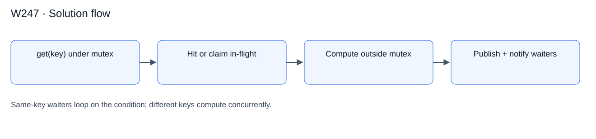

# W247. Thread-Safe Cache with Lock and Condition Variable

**Priority group:** Third 100 — broader practice

**Category:** Coding, concurrency and application structure

**Study position:** 247 of 547

[Group list](../THIRD_100.md) · [All categories](../ALL_CATEGORIES.md) · [Chapter guide](../README.md)

<span class="practice-page"></span>

## Question

You are given an existing cache code skeleton:

The cache stores key -&gt; value.
When get(key) is called:
If key exists in the cache, return the cached value.
If key is not in the cache, call an expensive function compute(key) to produce the value, then store it in the cache and return it.

You must add concurrency control using only:

a lock / mutex
a condition variable (cv)
Concurrency requirements
Multiple threads may call get(key) concurrently.
The cache must be safe under concurrent reads/writes (no data races).
When two threads concurrently request the same missing key, your design must handle it correctly (e.g., prevent write races; whether you allow duplicate computation or make others wait is up to your design, but the behavior must be correct and well-defined).
What to implement / describe
A thread-safe get(key) (and any necessary internal data structures).
Coordination between threads using a lock and a condition variable.
Clearly define what happens when multiple threads miss on the same key at the same time (e.g., single-flight: one computes and others wait; or allow duplicate compute but ensure cache consistency).
Example test scenarios (conceptual)
Single-thread hit: first get(1) triggers compute(1), stores result; second get(1) returns from cache.
Two-thread same-key concurrent miss: threads A and B call get(2) at nearly the same time; key=2 is missing. Keep cache state correct and avoid races/crashes.
Two-thread different-key concurrent miss: A calls get(3), B calls get(4), both miss; computes may run concurrently; cache access remains thread-safe.
Concurrent hit + miss: A calls get(5) (hit), B calls get(6) (miss and compute).
High-concurrency stability: many threads repeatedly call get on a small set of keys; no deadlocks, data races, or returning uninitialized values.

*(Concurrency design question — discussed and reasoned about, not run on the online judge.)*

## Worked solution

### One computation per missing key; other keys proceed

The supplied skeleton is descriptive, so this implementation supplies an explicit constructor `SingleFlightCache(compute)` and `get(key)`. Under one mutex, keep completed values and a set of in-progress keys. A miss claims the key, releases the mutex and computes. Same-key callers wait on a condition in a while loop; different keys can compute concurrently. Publish the value, remove in-progress and notify under the mutex.

```python
import threading


class SingleFlightCache:
    def __init__(self, compute):
        self.compute, self.values, self.inflight = compute, {}, set()
        self.cv = threading.Condition(threading.Lock())

    def get(self, key):
        with self.cv:
            while key in self.inflight:
                self.cv.wait()  # always recheck after spurious wakeups
            if key in self.values:
                return self.values[key]  # None is a valid value
            self.inflight.add(key)
        try:
            value = self.compute(key)  # no global lock during expensive work
        except BaseException:
            with self.cv:
                self.inflight.remove(key)
                self.cv.notify_all()
            raise
        with self.cv:
            self.values[key] = value
            self.inflight.remove(key)
            self.cv.notify_all()
            return value
```

For concurrent get(2), A marks 2 in-flight, B sleeps, A publishes, then B returns the same cached value. A cached None is a hit because membership is tested separately from truthiness. On compute failure, remove in-flight and notify in a finally-equivalent exception path; the computing caller receives the exception, and a waiter may retry. Exceptions are not cached and waiters need not receive the same exception. Define that behavior instead of leaving them stuck forever.

Tests use barriers/events for same-key single-flight, different-key overlap, cached None, failure recovery and high-concurrency stability. Compute is never called while holding the global lock, so a slow miss does not block unrelated hits. Recursive same-key compute would wait on itself and is unsupported; detect ownership or prohibit it explicitly. This cache has no eviction, TTL or cross-process guarantee; adding eviction must not remove in-flight coordination while waiters exist. Every wait rechecks the predicate, covering spurious wakeups and competition after notification.

### Follow the diagram



Read the arrows from left to right: get(key) under mutex → Hit or claim in-flight → Compute outside mutex → Publish + notify waiters. Same-key waiters loop on the condition; different keys compute concurrently.

### Further study

- [F162: Design a durable work queue with retries and leases.](../17_distributed_systems_depth.md#f162)
- [F169: Explain backpressure in a multi-stage data pipeline.](../17_distributed_systems_depth.md#f169)
