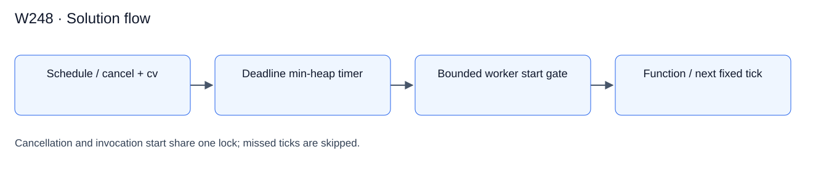

# W248. Thread-Safe Job Scheduler with Cancellation

**Priority group:** Third 100 — broader practice

**Category:** Coding, concurrency and application structure

**Study position:** 248 of 547

[Group list](../THIRD_100.md) · [All categories](../ALL_CATEGORIES.md) · [Chapter guide](../README.md)

<span class="practice-page"></span>

## Question

Implement a JobScheduler that periodically executes user-provided functions. The scheduler must support concurrent calls and safe task cancellation.

Implement the following interface:

```text
class JobScheduler:
def schedule(self, fn, frequency_seconds) -> int:
```

"""Register fn to run once every frequency_seconds seconds.
Return a unique job_id."""

```python
def deschedule(self, job_id) -> bool:
    ...
```

"""Cancel the task identified by job_id.
Return True if an existing task was cancelled, otherwise False."""

### Requirements

frequency_seconds is positive.
A task first runs one full interval after schedule is called.
Subsequent runs should be scheduled at a fixed frequency as closely as possible. A long-running task must not block scheduling of other tasks.
schedule(), deschedule(), and the scheduler's background thread may run concurrently.
After deschedule() returns, a future invocation that has not started must not run.
Explain how locks, condition variables/events, and task queues are used to avoid races and busy waiting.
An exception raised by one job must not terminate the scheduler or prevent other jobs from running.
Example
schedule(print_A, 2) -&gt; 1
schedule(print_B, 1) -&gt; 2

At about 1 second: print_B runs.
At about 2 seconds: print_A and print_B run.

deschedule(2) -&gt; True
print_B never runs again; print_A continues every 2 seconds.
Scale
Support up to approximately 10^5 registered jobs.
Focus on thread safety, cancellation semantics, resource management, and scheduling efficiency.

*(Concurrency/timing design question — discussed and whiteboarded, not run on the online judge.)*

## Worked solution

### Heap deadlines, bounded dispatch and explicit cancellation ordering

Use a monotonic clock and a min-heap of `(next_deadline,job_id)`; a single timer thread sleeps on a condition until the earliest deadline or a schedule/cancel wakeup. A bounded-size worker pool executes functions outside the scheduler lock, so a slow function does not block the timer or every other job. There are O(jobs) heap/state entries, O(log jobs) scheduling/tick operations and a bounded worker queue, suitable for approximately 100,000 mostly sleeping jobs. The required execution load still must fit the workers; no finite pool can promise exact frequency under arbitrary overload.

The implementation uses **fixed-rate, nonoverlapping, skip-missed-ticks** semantics. The first deadline is one full interval later; subsequent deadlines stay anchored to that schedule. If a job is queued/running or the bounded dispatch budget is full, coalesce the tick rather than create an unbounded backlog. A later deadline is always strictly in the future. Long jobs consume one worker; enough simultaneous blocking jobs can still saturate the pool, so set quotas and use separate pools/processes where isolation is necessary.

```python
import math
import threading
import time
import heapq
import logging
from concurrent.futures import ThreadPoolExecutor

class JobScheduler:
    """Fixed-rate, skip missed ticks, no overlap per job; bounded dispatch queue."""
    def __init__(self, workers=8):
        self.cv = threading.Condition()
        self.jobs, self.heap, self.next_id = {}, [], 1
        self.closed = False
        self.pending, self.max_pending = 0, workers * 2
        self.pool = ThreadPoolExecutor(max_workers=workers)
        self.thread = threading.Thread(target=self._loop, daemon=True)
        self.thread.start()

    def schedule(self, fn, frequency_seconds):
        if not callable(fn) or not math.isfinite(frequency_seconds) or frequency_seconds <= 0:
            raise ValueError('callable and finite positive interval required')
        with self.cv:
            if self.closed:
                raise RuntimeError('scheduler closed')
            job_id = self.next_id; self.next_id += 1
            self.jobs[job_id] = {'fn': fn, 'period': frequency_seconds, 'busy': False}
            heapq.heappush(self.heap, (time.monotonic() + frequency_seconds, job_id))
            self.cv.notify_all()
            return job_id

    def deschedule(self, job_id):
        with self.cv:
            found = self.jobs.pop(job_id, None) is not None
            self.cv.notify_all()
            return found

    def _loop(self):
        with self.cv:
            while not self.closed:
                # Lazy deletion is bounded by compaction below.
                while self.heap and self.heap[0][1] not in self.jobs:
                    heapq.heappop(self.heap)
                if len(self.heap) > 2 * len(self.jobs) + 100:
                    self.heap = [(t, j) for t, j in self.heap if j in self.jobs]
                    heapq.heapify(self.heap)
                if not self.heap:
                    self.cv.wait(); continue
                due, job_id = self.heap[0]
                delay = due - time.monotonic()
                if delay > 0:
                    self.cv.wait(delay); continue
                heapq.heappop(self.heap)
                job = self.jobs[job_id]
                now = time.monotonic()
                ticks = max(1, math.floor((now - due) / job['period']) + 1)
                heapq.heappush(self.heap, (due + ticks * job['period'], job_id))
                if not job['busy'] and self.pending < self.max_pending:
                    job['busy'] = True
                    self.pending += 1
                    self.pool.submit(self._execute, job_id)

    def _execute(self, job_id):
        with self.cv:
            job = self.jobs.get(job_id)
            if job is None or self.closed:
                self.pending -= 1
                return
            fn = job['fn']  # invocation starts/linearizes under this same lock
        try:
            fn()
        except BaseException:
            logging.exception('Scheduled job failed: %s', job_id)
        finally:
            with self.cv:
                job['busy'] = False
                self.pending -= 1
                self.cv.notify_all()

    def close(self):
        with self.cv:
            self.closed = True
            self.jobs.clear()
            self.cv.notify_all()
        self.thread.join()
        self.pool.shutdown(wait=True)
```

Cancellation removes the job under the same condition lock used by the worker's start gate. A queued worker rechecks existence before claiming invocation. Define invocation start as that protected claim: if cancellation wins, it never invokes; if start wins, that invocation is already running and may finish after deschedule returns. This linearization boundary matters even if the OS pauses the worker between the claim and the first user-function instruction. Cancellation does not interrupt Python code already started. If the requirement instead demands waiting for every already-started call to finish, add a running counter/condition wait, account for potentially blocking cancellation, and avoid self-cancellation deadlock.

`deschedule` returns True only for an existing registration, not for already cancelled/unknown IDs. Exceptions are logged and contained. Lazy cancelled heap entries are periodically compacted. `close()` stops admission/timing and joins workers; call it from an owning thread, not from a job executing in the same pool. Tests cover first-interval delay, queued cancellation, same-job nonoverlap, concurrent schedule/cancel, unrelated fast jobs during a slow job, exception isolation and clean shutdown. Timing checks use events and broad deadlines; they establish behavior, not a real-time guarantee or a 100K-job throughput benchmark.

### Follow the diagram



Read the arrows from left to right: Schedule / cancel + cv → Deadline min-heap timer → Bounded worker start gate → Function / next fixed tick. Cancellation and invocation start share one lock; missed ticks are skipped.

### Further study

- [F162: Design a durable work queue with retries and leases.](../17_distributed_systems_depth.md#f162)
- [F169: Explain backpressure in a multi-stage data pipeline.](../17_distributed_systems_depth.md#f169)
