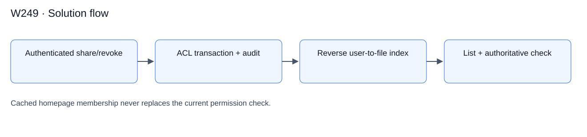

# W249. Design a File-Sharing Permission Control System

**Priority group:** Third 100 — broader practice

**Category:** Configuration, identity and authorization

**Study position:** 249 of 547

[Group list](../THIRD_100.md) · [All categories](../ALL_CATEGORIES.md) · [Chapter guide](../README.md)

## Question

Design a file-sharing permission control system.

Functional requirements:

Share a file with another user (grant access).
On a user's homepage, list every file they have access to.
For any (user, file) pair, return whether the user has access.

Non-functional / discussion points:

Read-heavy workload — homepage reads dominate.
Consistency model on share/revoke, and an audit trail.
Open with clarifying questions on ACL granularity (user vs group), permission hierarchy (read/write/owner), and inheritance (folder → file).

## Worked solution

### A user-to-files index and an authoritative ACL

Clarify user versus group grants, read/write/owner implications and folder inheritance. For a first version, assume direct user grants, `owner > write > read`, no implicit folder inheritance, and no explicit deny. Ownership is required to grant/revoke. Groups/inheritance add graph expansion and revocation complexity and should be explicit extensions.

Store `File(id,owner_id,name,state,acl_version)` and `Grant(file_id,user_id,permission,created_by,created_at)` with primary key `(file_id,user_id)` and reverse index `(user_id,file_id)` including permission. Treat the owner as an implicit grant so they appear on the homepage. `POST /files/{id}/shares` upserts a grant, `DELETE /files/{id}/shares/{user}` revokes, `GET /me/files?cursor=...` lists accessible files, and `POST /authorization/check` accepts user, file, action. Derive user identity from the authenticated session, not an arbitrary homepage query parameter.

The flow is client → auth → file/ACL service → relational transaction; homepage reads use the user-to-file index and join file metadata. Authorization reads use `(file,user)` and the action hierarchy. Use a stable `(updated_at,file_id)` cursor or a snapshot when strict pagination is needed. For an assumed 100 million grant edges at 64 logical bytes/edge, raw grants are about 6.4 GB before reverse indexes/replicas; 10 million users × five homepage opens/day gives about 580 average reads/s, with a 10× peak near 5,800. These assumptions determine whether one database, read replicas or sharding is necessary.

Choose strong read-after-write/revoke at the ACL authority. Grant/revoke updates the grant, increments `acl_version` and appends audit/outbox events in one transaction. Homepage caches are derived and may lag for, say, a second; they may show a revoked filename, so either promise a bounded list delay or use authoritative filtering when even metadata disclosure is unacceptable. Opening/downloading always rechecks current authorization, not cached list membership. Revoking database access does not invalidate an already downloaded copy; short-lived signed URLs limit but do not eliminate post-revoke use unless the media path checks every request.

Concurrent grants/revokes serialize on the file/version, with optimistic `If-Match` for management UI changes. A retry uses an idempotency key and records one audit action; audit contains actor, subject, file, old/new permission and request ID. Fail closed on authority outage, permit cached metadata only under the declared privacy policy, and reconcile the reverse index if asynchronously materialized. Group/folder support would store membership/inheritance edges, detect cycles, define deny precedence and ensure revocation invalidates effective-access caches by dependency/version. Do not solve efficient listing by serving a stale permission cache as final authorization.

### Follow the diagram

Read the arrows from left to right: Authenticated share/revoke → ACL transaction + audit → Reverse user-to-file index → List + authoritative check. Cached homepage membership never replaces the current permission check.

### Further study

- [F170: Design a cache without serving incorrect data.](../17_distributed_systems_depth.md#f170)
- [F079: Defend an LLM application against prompt injection.](../08_rag_and_agents.md#f079)
