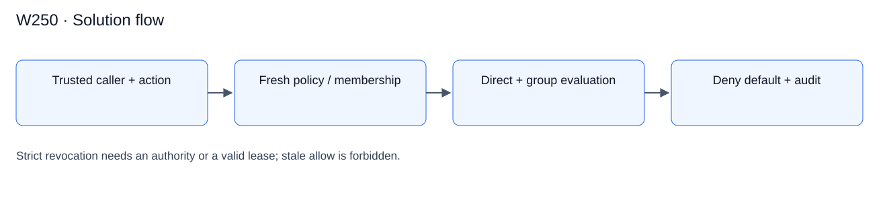

# W250. Design an ACL Authorization Service

**Priority group:** Third 100 — broader practice

**Category:** Configuration, identity and authorization

**Study position:** 250 of 547

[Group list](../THIRD_100.md) · [All categories](../ALL_CATEGORIES.md) · [Chapter guide](../README.md)

## Question

Design a service that performs ACL-style authorization checks on behalf of another service. Given (subject_id, resource_id, action), decide allow / deny plus an optional reason for the audit log.

### Requirements

Invoked synchronously by the caller before every privileged action.
Rules support direct grants (subject → resource → action) and group / role indirection (subject ∈ group → resource → action).
Latency budget: low single-digit milliseconds at p99, because every privileged call in the caller's request path waits on this check.
Throughput scales with the caller's QPS.

## Worked solution

### Make the consistency/latency contract explicit

`Check(subject_id,resource_id,action,context) -> {allow,reason_code,policy_version,decision_id}` is invoked by an authenticated trusted service before every privileged action. Default deny and deny on evaluation/transport failure for privileged writes. The caller binds the checked resource/action to the operation; it must not check one ID then mutate another. Return stable reason codes for audit rather than leaking sensitive group membership to end users.

Store `Grant(resource,principal_type,principal_id,action,version)`, `Membership(subject,group,version)`, role-to-action mappings, resource tenant and a versioned policy root. Index direct grants by `(resource,subject,action)` and group grants by `(resource,group,action)`. Scope every ID to its tenant. Define union-of-allows semantics for this version; explicit denies or role hierarchies require a stated precedence/cycle rule. An allowed write can imply read only if that hierarchy is part of policy, not an accidental string comparison.

Assume 200K peak checks/s and low single-digit p99 within one region. Put an evaluator near callers with in-memory immutable policy/membership snapshots and pooled RPC connections. Compile a subject's group set and resource grant postings; direct lookup is O(1), while group intersection cost depends on the smaller set/bitmap. A cross-region database round trip per check cannot meet that latency. Size, for example, 10 million grants at 64 bytes = 640 MB raw plus membership, indexes and replicas; partition by tenant/resource, replicate frequently checked policy to regional evaluators and benchmark actual p99 under hot tenants and snapshot changes.

### Revocation is the hard part

Choose either a bounded-staleness authorization contract or a strict revocation protocol; do not claim asynchronous invalidation gives immediate revocation. For strict checks, an authoritative shard linearizes policy/membership changes and checks, or evaluators hold short policy leases that the writer must revoke/await before acknowledging a change. During loss of freshness/lease, evaluators fail closed. This can reduce availability or exceed the latency budget across regions; region ownership and locally replicated consensus are explicit deployment assumptions. For a resource operation that must remain authorized through commit, use an authorization version/fence checked in the resource transaction, or combine policy and operation ownership. A check followed by a delayed write otherwise has a time-of-check/time-of-use gap.

Example: Alice belongs to analysts, analysts has read on report R, so read allows but write denies. Removing Alice from analysts changes membership version; a cache keyed only by `(Alice,R,read)` must be invalidated or fenced. Cache decisions by all relevant versions and bounded TTL, not indefinitely. Group nesting, if added, needs closure/cycle control and transitive invalidation.

Audit each decision with caller, subject/resource/action, result/reason, policy/membership versions, trace ID and latency in an append-only restricted stream. Bound asynchronous audit buffering; for actions requiring durable audit before execution, synchronously persist an audit receipt and include its latency in the budget. Canary policy changes in shadow mode, compare old/new decisions, monitor deny spikes, stale evaluators and p99, and retain rollback versions. A fast “allow” from an unknown/stale policy is a correctness failure, not a successful low-latency check.

### Follow the diagram

Read the arrows from left to right: Trusted caller + action → Fresh policy / membership → Direct + group evaluation → Deny default + audit. Strict revocation needs an authority or a valid lease; stale allow is forbidden.

### Further study

- [F170: Design a cache without serving incorrect data.](../17_distributed_systems_depth.md#f170)
- [F079: Defend an LLM application against prompt injection.](../08_rag_and_agents.md#f079)
