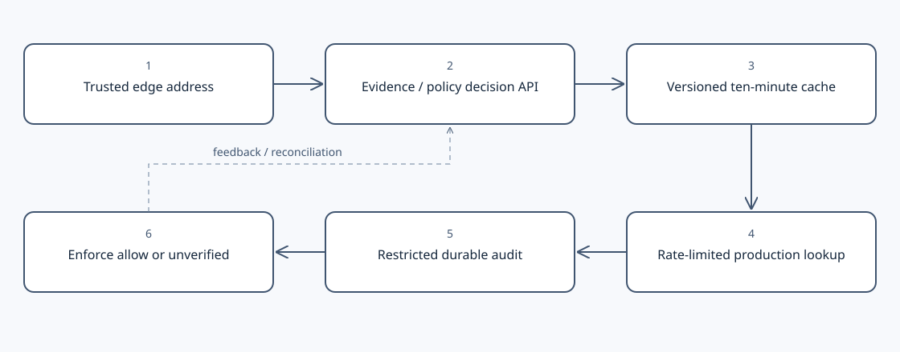

# W251. Design an IP Blocking Policy Decision Service

**Priority group:** Third 100 — broader practice

**Category:** Configuration, identity and authorization

**Study position:** 251 of 547

[Group list](../THIRD_100.md) · [All categories](../ALL_CATEGORIES.md) · [Chapter guide](../README.md)

## Question

Design an IP access-decision service that checks an external government authority before a protected company service handles a request. The company may serve the request only when the decision service has affirmative evidence that the address is not blocked. The design must also adopt changes to the authority's policy within a seven-day grace period.

What to design

Present the architecture and operational plan for a service with this internal API:

POST /v1/access-decisions

ip_address: an IPv4 or IPv6 address supplied by a trusted edge proxy.
service_id: the protected service requesting a decision.
request_id: an idempotency and audit identifier.

Every response contains allowed (boolean), reason (NOT_BLOCKED, BLOCKED, or UNVERIFIED), authority_policy_version (string or null), evaluated_at (timestamp or null), valid_until (timestamp or null), and retryable (boolean). For NOT_BLOCKED and BLOCKED, the version and both timestamps describe the successful authority evaluation and retryable is false. For UNVERIFIED, those three evidence fields are null: there is no current authority result supporting the decision. retryable is true only when another attempt could obtain evidence without changing the request, such as after a timeout, quota rejection, or temporary dependency failure; it is false for invalid or untrusted input and an incompatible policy version. A protected service proceeds only when allowed is true.

The external authority offers a lookup API for one normalized IP address and a policy-version endpoint. The production lookup accepts an explicit policy version after the authority releases that version for production, then returns NOT_BLOCKED or BLOCKED together with the version used. For each announced version, the authority also exposes a version-pinned validation endpoint before activation. It accepts one normalized address and an explicit policy version, applies that version's real matching semantics, and returns the same decision schema as production. Its separate non-production quota is 50 lookups per second, and its responses are validation evidence only: they must never authorize a protected request.

### Rules

1. Normalize and validate both IPv4 and IPv6 addresses. Reject an address that did not come through the trusted edge path.
2. A cached authority result may be used for at most 10 minutes. Do not extend its validity merely because the authority is unavailable.
3. On a cache miss that cannot be filled, timeout, malformed authority response, or expired result that cannot be refreshed, return allowed: false with reason UNVERIFIED. Set retryable to true for a timeout, quota rejection, or temporary authority, cache, or audit failure. Set it to false for malformed input, an untrusted edge context, a malformed authority response, or an incompatible or overdue policy; an expired result inherits the classification of the failed refresh. The protected service must not fail open.
4. Poll the authority's policy-version endpoint every 5 minutes. A newly observed version must be evaluated, rolled out, and made active within 7 calendar days. Record the observation time and activation time for audit.
5. Preserve the last known-good policy during a faulty rollout, but once its grace deadline expires, do not claim that an address is verified under the new policy until the new version can be evaluated correctly.
6. Do not place raw IP addresses in ordinary application logs. Retain a restricted audit record containing the request id, service id, decision, policy version, timestamps, and an access-controlled representation of the address.

### Examples

Example 1: authority confirms access

Request:

JSON
{"ip_address":"203.0.113.8","service_id":"training-api","request_id":"req-1001"}

Authority result: NOT_BLOCKED, policy version 2026-10-20.3.

Response:

JSON
{"allowed":true,"reason":"NOT_BLOCKED","authority_policy_version":"2026-10-20.3","evaluated_at":"2026-10-26T16:00:00Z","valid_until":"2026-10-26T16:10:00Z","retryable":false}

Explanation: the authority explicitly reports that the normalized address is not blocked, so the company may serve the request until the short-lived result expires.

Example 2: authority blocks access

Request:

JSON
{"ip_address":"2001:db8::25","service_id":"model-api","request_id":"req-1002"}

Authority result: BLOCKED, policy version 2026-10-20.3.

Response:

JSON
{"allowed":false,"reason":"BLOCKED","authority_policy_version":"2026-10-20.3","evaluated_at":"2026-10-26T16:01:00Z","valid_until":"2026-10-26T16:11:00Z","retryable":false}

Explanation: a blocked result prevents the protected service from serving the request, regardless of its own capacity or health.

Example 3: no current evidence

The cached result expired and the authority lookup times out. Return the complete response:

JSON
{"allowed":false,"reason":"UNVERIFIED","authority_policy_version":null,"evaluated_at":null,"valid_until":null,"retryable":true}

Explanation: an unavailable dependency is different from a confirmed block, but neither state is affirmative evidence that service is permitted. The null evidence fields make clear that the expired result is not being reused, while retryable: true tells the caller that the same request may succeed after the dependency recovers.

### Constraints

20,000 average and 100,000 peak access decisions per second across three regions.
Up to 10,000,000 distinct IP addresses per day, with uneven regional traffic.
The authority permits 500 lookups per second, has 300 ms p95 latency, and provides 99.5% monthly availability.
The internal decision API targets 20 ms p99 latency for cached decisions and 99.99% monthly availability.
Audit decisions are retained for 90 days. Raw or reversibly protected address data is restricted to authorized compliance operators.
A policy version may introduce new response fields or matching semantics, so rollout must support validation and rollback.
Follow-up 1: capacity and cache behavior

Estimate request volume, cache size, authority-call pressure, and behavior for hot addresses. Explain cache keys, TTLs, coalescing, quotas, and protection against cache stampedes.

Follow-up 2: policy rollout within the grace period

Design the version-discovery, validation, canary, activation, rollback, deadline alerting, and audit workflow. Explain what happens when a new policy is incompatible or the authority is unavailable near the deadline.

Follow-up 3: failures and regional operation

Cover authority latency and outages, stale or contradictory results, cache and database failures, region loss, malformed inputs, abuse, and recovery without allowing prohibited traffic.

## Worked solution

### Evidence, capacity and the API contract

Only a successful **production** authority result may authorize access. Normalize with an IPv4/IPv6 parser, canonicalize IPv6 spellings, and explicitly decide whether IPv4-mapped IPv6 maps to IPv4; use the authority's declared normalization semantics. Trust only authenticated edge context, never an arbitrary forwarded header. Authenticate service_id and bind request_id to the normalized address/body hash so a reused key with a different address fails. Use a keyed HMAC for ordinary internal cache keys and restricted encrypted address data for authority calls/audit; raw addresses never enter ordinary logs.

20,000 average decisions/s is 1.728 billion/day, or 155.52 billion over 90 days. At an assumed compact 150-byte audit record that is 23.328 TB before indexes, replicas and restricted address representation. Peak is 100,000/s; three regions must be sized for uneven traffic and failover, not 33,333 each by assumption. Ten million distinct addresses/day imply at least 115.7 first lookups/s on average if each is seen once. The authority's 500/s limit permits 43.2 million lookups/day, but continuous demand from all ten million addresses every ten minutes would require about 16,667/s. Thus the specified traffic does **not** guarantee enough quota: the design must reject unverified misses under high churn/working-set refresh, negotiate quota or reduce demand. Never extend TTL to hide this mismatch.

Cache key includes normalized address, active authority version and any authority-relevant service scope. Store decision, exact returned version, successful evaluation time and valid_until≤evaluated_at+10 minutes, additionally capped at the old policy's grace deadline when a newer policy is pending. Protected callers never reuse an allow after valid_until; policy-deadline checks also override an earlier cached response on a fresh evaluation. Use short local L1 plus shared regional cache with identical absolute expiry; copying between tiers never resets age. Ten million assumed 200-byte entries would be 2 GB logical before cache overhead/replication, though active ten-minute cardinality depends on traffic. Coalesce hot-address misses, bound waiters and use a global 500/s token budget distributed by regional leases with conservative failover so regions cannot each spend 500/s. Prefetching consumes the same budget; negative BLOCKED caching also expires in ten minutes.

### Request path, retries and audit

The diagram is trusted edge → decision API → versioned evidence cache → production authority on miss → durable audit → enforcement. A valid NOT_BLOCKED result returns allowed=true; valid BLOCKED returns false; both return actual version/evaluated_at/valid_until and retryable=false. Verify authority schema, address binding and requested production version. An old or contradictory concurrent result cannot overwrite newer evidence; conservatively invalidate contradictions and investigate rather than pick a convenient allow. Cache hits target 20 ms p99; misses inherit 300 ms authority p95 and cannot share that latency target.

On absent/expired evidence return the full UNVERIFIED object with allowed=false and all three evidence fields null. retryable=true for timeout, quota or temporary authority/cache/audit failure; false for malformed/untrusted input, malformed authority response and incompatible/overdue policy. An expired entry inherits the failed-refresh classification. Treat inability to durably audit as inability to authorize, using a regional replicated append log plus outbox rather than synchronous warehouse writes. A request retry may obtain fresh evidence after a temporary failure, so do not permanently memoize UNVERIFIED by request_id. Cache successful idempotent responses only while their evidence and policy remain valid; never replay an expired allow merely because the request ID matches.

### Version rollout and the seven-day deadline

Poll the version endpoint every five minutes from redundant pollers. Record Version(version,first_observed_at,deadline=observed+7 calendar days,state,activation_at,compatibility,validation_manifest) durably; preserve the earliest observation across regions. Pin both production requests and cache keys to the currently active version. For a new version, test parsing and **real matching semantics** using the provided version-pinned validation endpoint. Its 50/s separate quota is 4.32 million validations/day. Build a stratified boundary corpus covering IPv4/IPv6, prefix boundaries, changed-rule addresses and production traffic samples; validation results are stored separately with a validation-only marker and never copied into the authorization cache.

Canary the new adapter/parser in non-authorizing comparison, inspect expected/observed differences and errors, then after production release canary actual version-pinned production lookups. Atomically activate a manifest carrying version and adapter compatibility across regions; decisions include their actual version. Roll back to last known-good during a faulty rollout only while it remains inside the grace policy. Alert well before deadline and page on validation incompatibility, missing release, quota starvation or regional version lag. At the deadline, if the new version cannot be evaluated correctly, the old result must no longer authorize: return UNVERIFIED retryable=false for overdue/incompatible policy even if an old cache entry has TTL left. A temporary production timeout under an otherwise active compatible new version is retryable=true. Availability cannot override this rule.

### Regional failures and validation

The 99.99% internal availability target can mean returning a valid deny/UNVERIFIED response, not 99.99% affirmative authorization: the external authority is only 99.5% available. During its outage, still-valid production evidence may be used until its original expiry and policy deadline; misses deny. A lost cache can be bypassed only through rate-limited fresh production evidence plus durable audit; otherwise UNVERIFIED retryable=true. Replicate policy manifests and restricted audits across zones/regions with explicit RPO, fence policy activation leadership and preserve deadline enforcement during regional failover. Rate-limit untrusted/high-cardinality abuse before consuming authority quota.

Test canonical equivalent addresses, forged edges, hot-key coalescing, global quota under region loss, TTL expiry while authority is down, malformed/mismatched responses, audit failure, delayed older policy manifests, validation-only evidence leakage and the exact deadline boundary. Monitor cache-hit ratio and age, authority/validation budget, UNVERIFIED by cause, deadline/activation lag, audit completeness and regional p99. This explicitly chooses denied service over unsupported authorization when capacity or dependencies cannot supply affirmative evidence.

<!-- architecture:W251:start -->

Read the numbered flow as Trusted edge address → Evidence / policy decision API → Versioned ten-minute cache → Rate-limited production lookup → Restricted durable audit → Enforce allow or unverified. The dashed return represents the feedback/reconciliation described above; it does not replace the stated durability, authority or failure contract.
<!-- architecture:W251:end -->

[Batch behavior checks](../test_review_251_300.py). Capacity/SLO estimates are design calculations, not measured production results.

### Further study

- [F170: Design a cache without serving incorrect data.](../17_distributed_systems_depth.md#f170)
- [F079: Defend an LLM application against prompt injection.](../08_rag_and_agents.md#f079)
