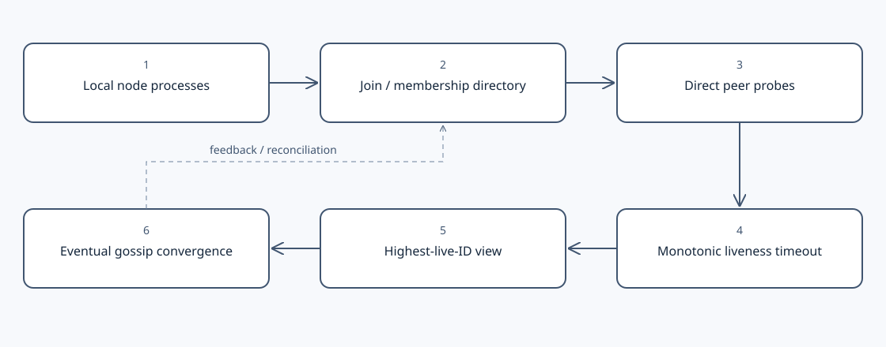

# W254. Implement a Leader-Follower Distributed System with Membership, Failover Detection, and Leader Election (Practical pair-programming)

**Priority group:** Third 100 — broader practice

**Category:** Distributed consistency and recovery

**Study position:** 254 of 547

[Group list](../THIRD_100.md) · [All categories](../ALL_CATEGORIES.md) · [Chapter guide](../README.md)

<span class="practice-page"></span>

## Question

Implement a simplified leader-follower distributed system that runs locally as several processes, where every node can tell which node is the current leader.

### Requirements

1. Leader visibility: any node can answer who the current leader is (for example its id or address).
2. Membership / join: a new node can start, join a running cluster through a seed node, and become known to the other nodes.
3. Failure detection: when the leader crashes or becomes unreachable, the cluster detects it automatically using heartbeats, leases, or timeouts.
4. Leader election: after the leader fails, the surviving nodes elect a new leader and all of them eventually agree on the same one.
5. Robustness: handle (or at least explain your handling of) network jitter, concurrent joins, and duplicate or stale messages.

Write runnable code, not only a design. You may use an external store such as Redis for shared state; if you do, integrate it and still implement the core logic yourself.

### Input

You define how nodes are launched and what they expose. For example:

Start a node: node --id &lt;id&gt; --port &lt;port&gt; [--seed &lt;host:port&gt;]
Query the leader: HTTP GET /leader
Join the cluster: HTTP POST /join
Output / deliverable
A program that can run 3–7 node processes locally.
A demonstration that (a) a node that joins identifies the leader, (b) killing the leader triggers a new election, and (c) every surviving node eventually reports the new leader.
A short explanation of the join flow, how leader identity is stored and propagated, the failure-detection timeout, and the election policy (by node id, timestamp, or priority) and how conflicts are resolved.

### Constraints

3–7 node processes on one machine.
Failure is simulated by killing the leader process or making it unreachable.
Failure must be detected and a new leader elected within a configurable timeout (for example 1–5 seconds).
Example

With the policy "the leader is the live node with the highest id":

USD  node --id 1 --port 8001
USD  node --id 2 --port 8002 --seed 127.0.0.1:8001
USD  node --id 3 --port 8003 --seed 127.0.0.1:8001
GET 127.0.0.1:8002/leader   -&gt;  {"leader": 3}
(kill node 3, then wait longer than the failure timeout)
GET 127.0.0.1:8001/leader   -&gt;  {"leader": 2}
GET 127.0.0.1:8002/leader   -&gt;  {"leader": 2}

## Worked solution

### Explicitly simplified election contract

Use the live node with the highest ID, as the example permits. Nodes discover addresses through `/join`, gossip a grow-only membership directory, directly probe peers and return their currently perceived leader through `/leader`. A peer is live only if it responded directly within the configured timeout; gossip about a peer must not keep a dead node alive. Membership identity is a unique ID/address for the lifetime of this local demonstration. Conflicting address reuse is rejected; production restarts need incarnation IDs and authenticated membership.

The complete runnable standard-library program is below and in the linked implementation. It binds to localhost and runs 3–7 independent processes; it does not rely on Redis or a hidden shared state service.

```python
"""Runnable highest-live-ID membership demo; eventual agreement, not consensus."""
import argparse
from concurrent.futures import ThreadPoolExecutor
import json
import threading
import time
from http.server import BaseHTTPRequestHandler, ThreadingHTTPServer
from urllib.request import Request, urlopen

class Cluster:
    def __init__(self, node_id, address, timeout=2.0):
        self.id, self.address, self.timeout = node_id, address, timeout
        self.members = {node_id: address}
        self.seen = {node_id: time.monotonic()}
        self.lock = threading.Lock()

    def state(self):
        with self.lock:
            now = time.monotonic()
            live = [self.id] + [i for i,t in self.seen.items() if now-t < self.timeout]
            return {'id': self.id, 'leader': max(live),
                    'members': {str(i): a for i,a in self.members.items()}}

    def merge(self, data):
        with self.lock:
            for ident,address in data['members'].items():
                ident=int(ident)
                if ident in self.members and self.members[ident] != address:
                    raise ValueError('duplicate node ID has another address')
                self.members[ident]=address

    def contact(self, address):
        req=Request(f'http://{address}/join', data=json.dumps(self.state()).encode(),
                    headers={'Content-Type':'application/json'},method='POST')
        with urlopen(req,timeout=min(.3,self.timeout/3)) as response:
            data=json.load(response)
        self.merge(data)
        # Only a direct response refreshes this peer's health, not gossip.
        with self.lock: self.seen[int(data['id'])]=time.monotonic()

    def loop(self, stop):
        with ThreadPoolExecutor(max_workers=7) as pool:
            while not stop.is_set():
                with self.lock: peers=[a for i,a in self.members.items() if i!=self.id]
                def ping(address):
                    try: self.contact(address)
                    except Exception: pass  # timeout is suspicion; try next tick
                list(pool.map(ping,peers))
                stop.wait(.15)

def main():
    parser=argparse.ArgumentParser()
    parser.add_argument('--id',type=int,required=True)
    parser.add_argument('--port',type=int,required=True)
    parser.add_argument('--seed')
    parser.add_argument('--timeout',type=float,default=2.)
    args=parser.parse_args()
    if args.timeout<=0: parser.error('timeout must be positive')
    cluster=Cluster(args.id,f'127.0.0.1:{args.port}',args.timeout)
    class Handler(BaseHTTPRequestHandler):
        def log_message(self,*args): pass
        def reply(self,status,payload):
            body=json.dumps(payload).encode(); self.send_response(status)
            self.send_header('Content-Type','application/json');self.send_header('Content-Length',str(len(body)))
            self.end_headers();self.wfile.write(body)
        def do_GET(self):
            self.reply(200,cluster.state()) if self.path=='/leader' else self.reply(404,{})
        def do_POST(self):
            if self.path!='/join': self.reply(404,{});return
            try:
                size=int(self.headers.get('Content-Length','0'))
                if not 0<size<=65536: raise ValueError('bad request size')
                cluster.merge(json.loads(self.rfile.read(size)))
                self.reply(200,cluster.state())
            except (ValueError,KeyError,TypeError) as exc: self.reply(400,{'error':str(exc)})
    server=ThreadingHTTPServer(('127.0.0.1',args.port),Handler)
    stop=threading.Event()
    thread=threading.Thread(target=cluster.loop,args=(stop,),daemon=True)
    # Start the HTTP server before the background join retries.
    def seed_join():
        while not stop.is_set():
            try: cluster.contact(args.seed);return
            except Exception: stop.wait(.2)
    thread.start()
    if args.seed: threading.Thread(target=seed_join,daemon=True).start()
    try: server.serve_forever(poll_interval=.1)
    finally: stop.set();server.server_close();thread.join(timeout=1)

if __name__=='__main__': main()
```

### Launch, failure and convergence

Run the file three times with `--id 1 --port 8001`, `--id 2 --port 8002 --seed 127.0.0.1:8001`, and `--id 3 --port 8003 --seed 127.0.0.1:8001`. Add `--timeout 2` to configure suspicion. Query `http://127.0.0.1:8002/leader`: after joining/probing converges its leader is 3. Kill process 3; after its last direct response is older than two seconds and probes complete, nodes 1 and 2 report 2. The automated test launches actual processes on free local ports, checks all report 3, kills 3, then checks survivors report 2 with a bounded wait.

Concurrent joins merge the same ID→address directory idempotently under a mutex, and callbacks/network calls run outside it. Duplicate membership messages do not create duplicate peers; direct response deadlines limit the freshness effect of delayed replies. Jitter may briefly produce different live sets; repeated direct probes eventually converge once communication/timing stabilizes. A seed can fail after the node learns peers, and initial seed contact retries until available. Keep the timeout comfortably above normal probe latency; a fixed timeout cannot guarantee failure detection within five seconds under unbounded asynchronous delay.

This is **eventual leader visibility**, not a consensus or exclusive-write service. Network partitions can elect a highest ID on each side. It therefore must not commit money/authoritative replicated writes on the strength of this election alone. Adding durable terms, quorum voting, joint membership changes and downstream fencing would be a different, stronger protocol. The original generic replicated-log diagram was misleading for this implementation; the revised drawing shows membership and direct probes, not an invented consensus log. Tests demonstrate crash failover under localhost timing, not partition-safe leadership.

<!-- architecture:W254:start -->


Read the numbered flow as Local node processes → Join / membership directory → Direct peer probes → Monotonic liveness timeout → Highest-live-ID view → Eventual gossip convergence. The dashed return represents the feedback/reconciliation described above; it does not replace the stated durability, authority or failure contract.
<!-- architecture:W254:end -->

[Runnable W254 implementation](../review_w254_implementation.py).

[Batch behavior checks](../test_review_251_300.py). Capacity/SLO estimates are design calculations, not measured production results.

### Further study

- [F161: Explain CAP during a real network partition.](../17_distributed_systems_depth.md#f161)
- [F162: Design a durable work queue with retries and leases.](../17_distributed_systems_depth.md#f162)
