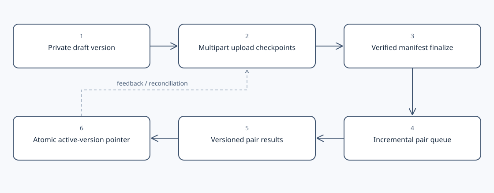

# W257. Video-Keyword Association Review System

**Priority group:** Third 100 — broader practice

**Category:** Evaluation, calibration and data quality

**Study position:** 257 of 547

[Group list](../THIRD_100.md) · [All categories](../ALL_CATEGORIES.md) · [Chapter guide](../README.md)

<span class="practice-page"></span>

## Question

Design a backend service where a user submits a batch of videos and keywords, and the system evaluates how strongly each video is associated with the keywords. Users can later update a submission, and uploads can be interrupted and resumed.

### Requirements

1. A user can submit a batch of at least 50 videos and at least 1000 keywords.
2. The system evaluates the association (relevance) between each video and the keyword set and stores a result per video and keyword.
3. A user can update a prior submission. Updates create a new version; earlier versions are not overwritten.
4. Uploads may be interrupted and must be resumable without re-sending completed data.
5. An incomplete batch must never be visible to readers or to evaluation.
Questions to answer
1. Data model. Define the entities and their relationships for submissions, versions, video assets, keyword sets, evaluation jobs and per-version results. Show tables and keys in plain text.
2. Scoring strategy. Compare scoring every video-keyword pair with using an index or embedding retrieval to reduce candidate pairs before scoring. State the cost of each for 50 videos x 1000 keywords per submission and repeated updates.
3. Resumable upload. How is upload progress stored, and how are incomplete batches isolated from active versions?
4. Incremental recomputation. How are results recomputed when only some videos or keywords change?

### Constraints

Treat the 50 x 1000 cross product, multiplied by repeated updates, as the main cost pressure.
A naive full recompute may be acceptable at small traffic, but give an incremental path for production scale.

## Worked solution

### Immutable versions and complete-publication boundary

Use the following logical tables:

```text
Submission(id PK, owner, active_version_id nullable)
Version(id PK, submission_id FK, parent_version_id, state, created_at, manifest_hash)
Asset(id PK, content_hash UNIQUE, object_ref, byte_count, verified)
VersionVideo(version_id FK, video_id, asset_id FK, PRIMARY KEY(version_id,video_id))
KeywordSet(id PK, normalized_content_hash UNIQUE)
Keyword(set_id FK, keyword_id, normalized_text, PRIMARY KEY(set_id,keyword_id))
VersionKeywords(version_id PK/FK, keyword_set_id FK)
Upload(id PK, version_id, asset_id, object_upload_id, expected_size, checksum, state)
UploadPart(upload_id, part_number, etag, checksum, PRIMARY KEY(upload_id,part_number))
Evaluation(id PK, version_id, scorer_version, state, lease_token)
Result(version_id,video_id,keyword_id,scorer_version,score,status,
       PRIMARY KEY(version_id,video_id,keyword_id,scorer_version))
```

`POST /submissions` and `POST /submissions/{id}/versions` create DRAFT versions with idempotency keys. Signed multipart upload APIs return upload ID and known completed parts; the client sends only missing parts after reconnection. Persist checksums/ETags and verify completed object size/hash. A finalize transaction validates every video and keyword manifest, then changes DRAFT→READY and emits an outbox event. Readers/evaluators see only READY/EVALUATING/COMPLETE versions under explicit APIs; never infer completeness from an object existing. Update active_version_id atomically only when the selected publication/evaluation contract is complete. Interrupted drafts remain private and are eventually garbage-collected.

### Pair cost and incremental scoring

Fifty videos×1,000 keywords is 50,000 results per version. Full scoring is reasonable at low traffic; at an assumed 2 ms expensive pair evaluation it is 100 serial seconds, excluding video decoding. Precompute video/text embeddings once per content hash and score the 50×1,000 matrix cheaply; an expensive cross-model can rerank ambiguous pairs. Retrieval of top-k keywords/video reduces expensive pairs to 50k (e.g. k=20 gives 1,000), but it does **not** satisfy “a stored result per pair” by silently dropping the other 49,000. Persist an inexpensive embedding score for all pairs, or explicit NOT_DEEPLY_SCORED status/score semantics approved by the product; assess retrieval recall on a full-scored holdout.

With Δv changed videos and Δk changed keywords and unchanged scorer, recompute Δv·K+(V-Δv)·Δk pairs, reusing all unchanged content-hash/scorer results. For two changed videos and ten changed keywords, 2×1,000+48×10=2,480 pairs, versus 50,000. Removed entities simply leave the new version manifest; earlier results remain immutable. New scorer/normalization versions invalidate affected reusable scores. Keyword IDs alone cannot establish equivalence if text changed.

The diagram's upload/version gate precedes evaluation queues; workers lease partitioned video/keyword blocks, retry idempotently and write results under the version/scorer key. Store large media in object storage and metadata/results in SQL or a partitioned analytical result store. A failed evaluator never advances the active pointer; reconciliation verifies expected pair count/checksums before COMPLETE. Assuming 10,000 submissions/day, full versions produce 500 million pair rows/day before updates, so retain/share content-addressed scores and partition by submission/version. Enforce tenant access, upload limits and result paging. Test interrupted uploads, duplicate parts, wrong hashes, finalize races, two simultaneous new versions and stale completion after a new active version. Metrics include draft age, pair reuse, pending pairs, scorer latency and publication correctness.

<!-- architecture:W257:start -->


Read the numbered flow as Private draft version → Multipart upload checkpoints → Verified manifest finalize → Incremental pair queue → Versioned pair results → Atomic active-version pointer. The dashed return represents the feedback/reconciliation described above; it does not replace the stated durability, authority or failure contract.
<!-- architecture:W257:end -->

[Batch behavior checks](../test_review_251_300.py). Capacity/SLO estimates are design calculations, not measured production results.

### Further study

- [F069: Audit human-labeled training data before scaling it.](../07_evaluation_and_data.md#f069)
- [F088: Design an LLM evaluation and annotation platform.](../09_ml_system_design.md#f088)
