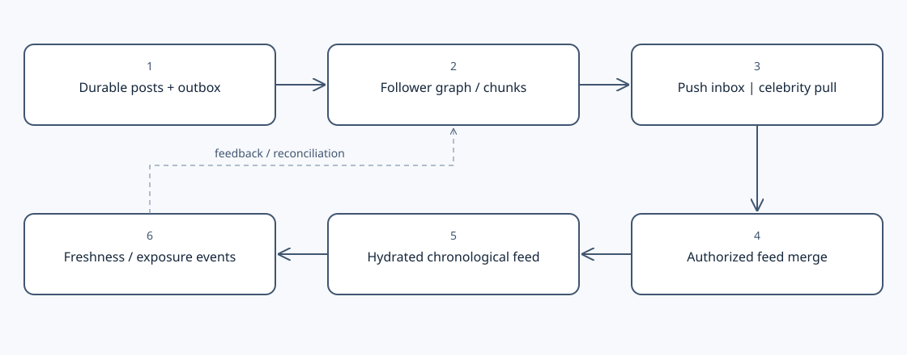

# W258. Design a Large-Scale News Feed

**Priority group:** Third 100 — broader practice

**Category:** Feeds, notifications and social graphs

**Study position:** 258 of 547

[Group list](../THIRD_100.md) · [All categories](../ALL_CATEGORIES.md) · [Chapter guide](../README.md)

## Question

Design a news feed system: users follow other users and see a reverse-chronological (or ranked) feed of posts from the people they follow, with support for posting, likes, and near-real-time delivery at very large scale.

## Worked solution

### Authoritative content and derived feeds

Assume follows, text/media posts, likes and a home feed; chronological order is the baseline, with personalized ranking optional. `POST /posts` uses a client idempotency key and returns only after post metadata plus an outbox event commit durably. `GET /posts/{id}`, `GET /feed?cursor=`, and idempotent `PUT/DELETE /posts/{id}/likes/me` expose reads/reactions. Store Post(id,author,time,visibility,media_refs,version), Follow(follower,followee), Like(user,post,state,version) and FeedEntry(user,post,source,time). Media lives in object storage/CDN; feed entries contain IDs rather than repeated media.

The diagram is post storage/outbox → fanout workers → per-user feed index, with a separate high-follower read-merge path. Push ordinary publishers' IDs to active followers; pull celebrity posts at read time to avoid millions of writes per post. Partition graph adjacency lists by follower/followee as needed and feed storage by user. Fanout chunks have idempotent (post,recipient) keys and checkpoints, so worker retry cannot duplicate timeline entries. Like counts are asynchronously derived from unique current reaction state, not blindly incremented on every retry.

### Read correctness and scale

Read the precomputed recent feed, merge followed high-fanout publisher streams, deduplicate, apply current privacy/block/takedown checks and hydrate posts in batch. Chronological cursors use an initial high-watermark and (created_at,id) ordering, avoiding offset shifts when new posts arrive. Ranked feeds instead pin a short-lived candidate/order snapshot with model version; mutable score cursors alone can skip/repeat posts. New posts trigger a small freshness notification over a reconnectable channel; the durable feed remains authoritative after disconnect.

Scale is unspecified. Assume ten million posts/day, 200 ordinary followers each: two billion fanout entries/day, about 23,148/s average. At assumed 24 bytes/entry that is 48 GB logical/day before indexes/replicas. If feed opens total 100 million/day, average is 1,157/s, with peak and celebrity skew much higher. Use bounded hot caches, active-user fanout, read-time merging and workload-specific sharding rather than sizing from user count alone.

A queue outage delays feeds but does not lose acknowledged posts; outbox replay restores them. Cache failure falls back to feed/post stores with admission limits. Author deletion/visibility changes emit tombstones and purge events, and serving checks prevent stale feed copies bypassing permissions. Monitor post-to-feed lag, fanout backlog, duplication/missing entries, hot-key load and p99. Test worker death halfway through fanout, duplicate likes, follow/privacy changes and pagination during new posts. If ranking is added, train on point-in-time exposure logs and A/B-test satisfaction/retention separately from transport freshness.

<!-- architecture:W258:start -->

Read the numbered flow as Durable posts + outbox → Follower graph / chunks → Push inbox | celebrity pull → Authorized feed merge → Hydrated chronological feed → Freshness / exposure events. The dashed return represents the feedback/reconciliation described above; it does not replace the stated durability, authority or failure contract.
<!-- architecture:W258:end -->

[Batch behavior checks](../test_review_251_300.py). Capacity/SLO estimates are design calculations, not measured production results.

### Further study

- [F082: Design a recommendation system from candidate generation to ranking.](../09_ml_system_design.md#f082)
- [F170: Design a cache without serving incorrect data.](../17_distributed_systems_depth.md#f170)
