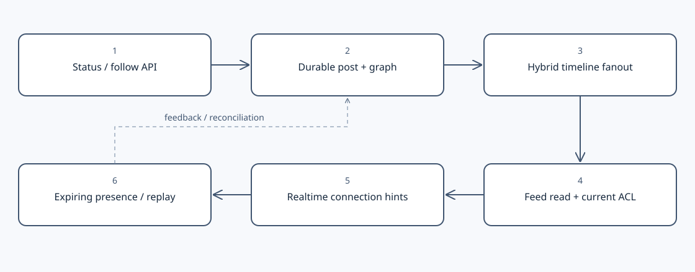

# W259. Design a Status/Feed App

**Priority group:** Third 100 — broader practice

**Category:** Feeds, notifications and social graphs

**Study position:** 259 of 547

[Group list](../THIRD_100.md) · [All categories](../ALL_CATEGORIES.md) · [Chapter guide](../README.md)

## Question

Design a status/feed application. Users post updates, and the system serves each user a timeline of updates from the people they follow. Handle real-time or near-real-time freshness.

Discuss how updates are stored, how timelines are generated and served, and how you handle the social-graph fan-out and presence.

## Worked solution

### Data and timeline generation

Treat a status as a durable post with author, text/media reference, timestamp, visibility, version and optional expiry. Store User, Follow(follower,followee), Status and TimelineEntry(viewer,status,time); index author/time for pull and viewer/time for pushed feeds. `POST /statuses` takes an idempotency key, commits the status/outbox and returns its ID; `GET /timeline?cursor=` returns a bounded newest-first page; `PUT/DELETE /follows/{id}` changes the graph transactionally. Presence is a separate expiring observation, not a durable follow or a permission.

Push IDs for ordinary authors into active followers' timelines, while high-follower authors are merged on read. The diagram's social graph determines fanout targets, its timeline cache accelerates reads, and its presence/realtime gateway only tells connected clients that newer content may be available. A WebSocket disconnect does not lose the underlying timeline. Workers process fanout chunks idempotently by (status,viewer), checkpoint progress and retry after failure.

### Presence, freshness and permissions

Presence gateways heartbeat active sessions with TTL, aggregate multiple devices and broadcast only to authorized followers/friends with bounded subscriptions. On disconnect the status expires rather than requiring a perfectly delivered offline event. Stale presence is acceptable; stale access is not. Feed reads and media URLs recheck current visibility/blocks, and deletes/expiry use tombstones plus cache invalidation. A client receives monotonically increasing change cursors and fetches missed updates after reconnect; do not use a presence stream as the only content source.

Use a fixed feed high-watermark and (time,id) cursor for chronological pages, keeping new inserts above the current paging session; refresh starts a newer stream. Hydrate posts in a batch and suppress duplicates from push/pull overlap. If personalized order is added, snapshot the order for stable pagination. No exact latency/traffic is supplied: assume 2,000 timeline reads/s, 100 status writes/s and 100 ordinary followers; fanout is 10,000 entry writes/s before celebrities. If each presence heartbeat is every 30 seconds for one million online devices, expect about 33,333 heartbeats/s, which can dominate status writes.

Use regional presence/cache shards and durable replicated post/graph stores. Queue outages delay freshness; replay recovers it. A failed presence service shows unknown rather than declaring everyone offline as durable fact. Rate-limit spam, bound feed retention/hot caches and measure write-to-visible lag, presence staleness, reconnect gaps and per-user read p99. Validate duplicate publishes, expired statuses in cached feeds, a block while connected and a celebrity burst. The trade-off is cheap read latency versus push amplification; presence cost is independently controlled by heartbeat interval and subscription scope.

<!-- architecture:W259:start -->

Read the numbered flow as Status / follow API → Durable post + graph → Hybrid timeline fanout → Feed read + current ACL → Realtime connection hints → Expiring presence / replay. The dashed return represents the feedback/reconciliation described above; it does not replace the stated durability, authority or failure contract.
<!-- architecture:W259:end -->

[Batch behavior checks](../test_review_251_300.py). Capacity/SLO estimates are design calculations, not measured production results.

### Further study

- [F082: Design a recommendation system from candidate generation to ranking.](../09_ml_system_design.md#f082)
- [F170: Design a cache without serving incorrect data.](../17_distributed_systems_depth.md#f170)
