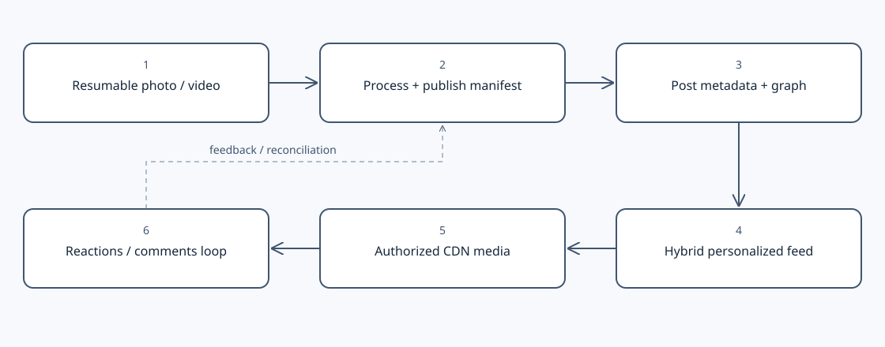

# W260. Design Instagram

**Priority group:** Third 100 — broader practice

**Category:** Feeds, notifications and social graphs

**Study position:** 260 of 547

[Group list](../THIRD_100.md) · [All categories](../ALL_CATEGORIES.md) · [Chapter guide](../README.md)

## Question

Design an Instagram-style application. Support media (photo/video) posting, feed generation, follows, likes, and comments, and serve media at large scale.

Cover media upload and storage, feed ranking/generation, the social graph, and how you serve media efficiently to a global audience.

## Worked solution

### Media and metadata use different paths

Assume photo/video posting, follows, home feed, likes/comments and private accounts; exclude live/ads. `POST /uploads` returns a resumable signed object upload; `POST /posts` finalizes verified assets plus caption/visibility under an idempotency key. Upload states INITIATED→UPLOADED→PROCESSING→READY or FAILED prevent incomplete/corrupt media from entering feeds. Images get sized variants, videos get transcoded renditions/thumbnails and safety checks. Immutable object keys and CDN delivery keep large media out of application/database servers.

SQL or a sharded durable metadata store holds Post, MediaAsset, Follow, Like(user,post), Comment(post,parent,time) and outbox records. Author/time and post/id keys support profile/detail reads; graph adjacency supports followers/followees. Ownership/privacy changes need authoritative conditional updates; derived view/like counters can lag. A repeated like sets the same state, not a second increment. Comments have paged parent/time indexes and separate moderation state.

### Feed generation and global serving

The diagram's post event feeds idempotent fanout workers. Push ordinary creators into active user inboxes and pull celebrity/high-follower content on read. Retrieve a bounded candidate set from follows and optionally discovery, filter access/safety, rank by predicted satisfying engagement and freshness, then diversify. `GET /feed?cursor=` returns post IDs, ranked snapshot cursor and exposure IDs; snapshot ordering prevents duplicates/skips as new likes change scores. On reconnect the app fetches fresh pages; realtime hints only signal change.

Serve media through regional CDNs with origin shields and multiple bitrate renditions; authorize private media with short-lived scoped URLs and revocation-aware TTLs. Viral content benefits from request coalescing/prewarming. A cache hit must not bypass blocks or deletion; tombstones/permission checks apply to cached feed entries and media access.

### Capacity and failure example

Scale is not numerically specified. Assume 100 million photos/day at 1 MB average original: 100 TB/day before variants/replicas, about 1.16 GB/s mean upload. Ten million one-minute videos at 5 Mbit/s add 375 TB/day originals. These chosen assumptions show why storage/egress/transcode dominate; actual sizes change the plan. Feed metadata at an assumed 32 bytes×one billion deliveries/day is only 32 GB/day before overhead.

A failed transcode retries by asset hash/rendition version, publishing a complete manifest only once. A crash after post commit but before fanout is recovered from the outbox. Region loss routes reads to replicas/CDN and fences write ownership before promotion; acknowledged media durability requires replicated object storage and metadata. If ranking fails, serve the last authorized chronological feed; if processing is delayed, show the author's pending state without exposing an incomplete post. Monitor upload completion, transcode lag, video-start/rebuffer, feed p99, privacy propagation and duplicate reactions. Test interrupted upload, replayed finalize, duplicate fanout, private-to-public-to-private updates and hot viral posts.

<!-- architecture:W260:start -->

Read the numbered flow as Resumable photo / video → Process + publish manifest → Post metadata + graph → Hybrid personalized feed → Authorized CDN media → Reactions / comments loop. The dashed return represents the feedback/reconciliation described above; it does not replace the stated durability, authority or failure contract.
<!-- architecture:W260:end -->

[Batch behavior checks](../test_review_251_300.py). Capacity/SLO estimates are design calculations, not measured production results.

### Further study

- [F082: Design a recommendation system from candidate generation to ranking.](../09_ml_system_design.md#f082)
- [F170: Design a cache without serving incorrect data.](../17_distributed_systems_depth.md#f170)
