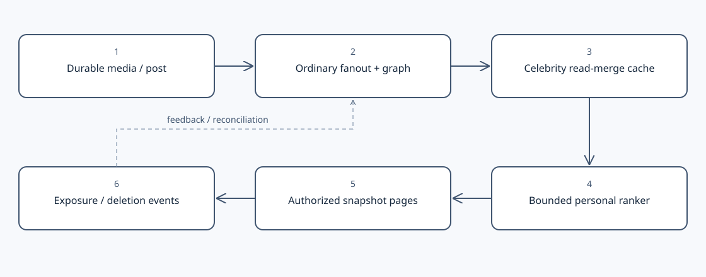

# W261. Design Instagram / Facebook News Feed

**Priority group:** Third 100 — broader practice

**Category:** Feeds, notifications and social graphs

**Study position:** 261 of 547

[Group list](../THIRD_100.md) · [All categories](../ALL_CATEGORIES.md) · [Chapter guide](../README.md)

## Question

Design the Instagram / Facebook News Feed with personalized ranking.

Functional: post photo/video, follow users, view a personalized home feed, like/comment.

Scale: ~2B users, ~1B DAU, hundreds of millions of posts/day, fan-out to followers including celebrity accounts with millions of followers.

Canonical decision points: push vs pull fan-out, hot-key handling, and the ranking layer. Read-path p95 latency budget ~200 ms.

## Worked solution

### Size the supplied social workload

There are about two billion users and one billion daily active users. Use an explicitly assumed 300 million posts/day to instantiate “hundreds of millions”: about 3,472 writes/s average. If each active user opens the feed ten times/day, an assumed ten billion reads/day is about 115,741/s average. At a chosen fivefold peak, roughly 579,000 feed reads/s require regional/sharded serving. An ordinary-author average of 200 followers would imply 60 billion feed-entry writes/day if every post were pushed, about 694,444/s, before indexes/replicas. These assumptions motivate a hybrid and active-user targeting; they are not extra facts about the prompt.

### Architecture and ranked read path

Store Post(author,time,id,media_refs,visibility,version), Follow adjacency lists, unique Like(user,post), Comment(post,parent,id) and durable outbox events. Photos/videos upload resumably to object storage, process asynchronously, and publish only verified READY assets. CDN variants/renditions handle media traffic. `POST /posts` returns after metadata/outbox durability; `GET /feed` returns a versioned snapshot cursor and exposure IDs; follow/like writes are idempotent state transitions.

The diagram separates push fanout for ordinary creators and pull streams for celebrity accounts with millions of followers. Push recent post IDs to active-user inboxes in idempotent chunks; cache/replicate celebrity streams and merge them at read time. Choose the push/pull threshold from measured posting frequency×followers×reader activity, not a universal follower number. Hot celebrity keys are replicated/read-cached; partition fanout tasks and likes aggregation so one viral post cannot pin a single worker/shard.

For p95≈200 ms, a proposed budget is 20 ms auth/user features, 40 ms inbox/celebrity retrieval, 30 ms batched eligibility/item features, 65 ms ranking and 45 ms hydration/network headroom. Rank hundreds using recent user interests, social relationship, content embeddings, recency and quality; re-rank for diversity/safety. Keep a frozen order/candidate snapshot per paging session to prevent mutable scores moving items between pages. Current block/privacy/takedown checks remain authoritative even for old snapshots and signed media URLs.

### Durable fanout, model quality and degradation

Outbox replay survives fanout queue loss; unique (post,recipient) prevents duplication. Feed staleness is acceptable within a declared freshness SLO, but successful post acknowledgment requires replicated durable storage. Like counts can converge asynchronously from unique reaction state. Model/index versions deploy together through warm canaries and compatible rollback. On ranker failure return a safe chronological authorized candidate set; on regional loss use failover capacity and fence writes before promoting replicas.

Train from actual exposures with point-in-time features and mature labels. Measure retrieval recall, ranking quality and calibration; user/cluster experiments measure satisfied engagement/retention with safety and creator-concentration guardrails. Do not claim CTR alone establishes feed quality. Monitor feed p95/p99, fanout age, cache/feature freshness, hot-shard saturation, media-start latency and privacy propagation. Validate celebrity bursts, partial fanout retry, deletion during pagination and a stale model/index pair under the assumed peak load before asserting the latency budget is met.

<!-- architecture:W261:start -->

Read the numbered flow as Durable media / post → Ordinary fanout + graph → Celebrity read-merge cache → Bounded personal ranker → Authorized snapshot pages → Exposure / deletion events. The dashed return represents the feedback/reconciliation described above; it does not replace the stated durability, authority or failure contract.
<!-- architecture:W261:end -->

[Batch behavior checks](../test_review_251_300.py). Capacity/SLO estimates are design calculations, not measured production results.

### Further study

- [F082: Design a recommendation system from candidate generation to ranking.](../09_ml_system_design.md#f082)
- [F170: Design a cache without serving incorrect data.](../17_distributed_systems_depth.md#f170)
