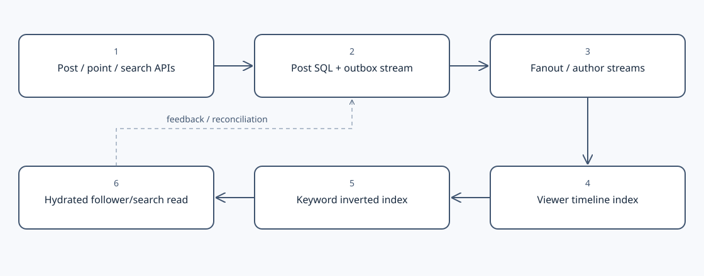

# W262. Design Twitter: Posting, Retrieval and Search

**Priority group:** Third 100 — broader practice

**Category:** Feeds, notifications and social graphs

**Study position:** 262 of 547

[Group list](../THIRD_100.md) · [All categories](../ALL_CATEGORIES.md) · [Chapter guide](../README.md)

<span class="practice-page"></span>

## Question

Design a microblogging service in the style of Twitter, where people publish short posts, open a post by its link, read the posts of the accounts they follow, and search posts by words.

### Requirements

1. Add a post: a signed-in user publishes a short text post (up to 280 characters, optionally with a media attachment). The post becomes visible to others quickly and must never be lost once the user is told it was saved.
2. Retrieve a post: anyone can fetch a single post by its id, and a user can view a timeline: the recent posts of the accounts they follow, newest first, with paging.
3. Search posts: a user searches by keywords and gets matching posts, most relevant or most recent first. A new post should become searchable within seconds.
Scale assumptions

Treat these as given assumptions, not facts about any real product.

```text
1. 100,000,000 daily active users.
2. 20% of them post, about 2 posts each per day.
```

3. Each user opens their timeline about 10 times per day.
4. A user follows 200 accounts on average; a small number of accounts have more than 1,000,000 followers.
5. A post with its metadata is about 300 bytes of text data.
Non-functional requirements
1. Reading must be fast (a timeline in well under half a second) and far more frequent than writing.
2. High availability; slightly stale timelines are acceptable, losing a post is not.
3. The design must scale horizontally as users and posts grow.
Deliverables
1. A high-level architecture with the main services and the path of each operation.
2. The API for the three operations.
3. How posts move through the system (data streaming) to storage, timelines and the search index.
4. The choice of databases, with the data model and partitioning key.
5. Back-of-envelope sizing from the assumptions above.
6. How each service scales, and a walkthrough of one feature end to end, from a user pressing "post" to a follower reading it and a stranger finding it by search.
Scope

Cover the three operations above. Following and unfollowing, direct messages, ads and trending topics are out of scope, and you should say which simplifying assumptions you make about them.

## Worked solution

### Sizing and scope

Given 100 million DAU, 20% posting twice/day produces **40 million posts/day**, about **463/s** average. Ten timeline opens/user/day gives **one billion reads/day**, about **11,574/s**. At 300 bytes of text metadata/post, primary text is **12 GB/day**, about **4.38 TB/year** before indexes/replicas/media. Assume fivefold peak: 2,315 post writes/s and 57,870 timeline reads/s. Following mutations, DMs, ads and trends are excluded; assume an existing read-only follow graph with 200 followees/user and current visibility rules.

### APIs, records and stream

`POST /posts` accepts text≤280 characters, optional verified media_ref and client idempotency key; returns post_id after a replicated durable commit. Bind the key to body hash. `GET /posts/{id}` hydrates one post subject to visibility/deletion. `GET /timeline?cursor=&limit=` returns newest-first followed posts; `GET /search?q=&sort=recent|relevance&cursor=` searches keywords with fresh authorization. Unicode “characters” needs an agreed counting rule; use code points as an explicit simplifying assumption.

Post(id,author_id,created_at,text,media_ref,visibility,version) is partitioned by ID for point reads, with AuthorPosts(author,time,id) for ordered streams. TimelineEntry(user,time,post) is partitioned by viewer. The follow store has follower/followee adjacency indexes; SearchDocument(post,terms,author,time,visibility,version) lives in a sharded inverted index. Object storage/CDN handles optional media. Commit Post and Outbox atomically; a durable stream fans out to timeline workers and search indexers independently. Consumers use event_id/post version, idempotent upserts and tombstones. Search lag of seconds is measured, not hidden as post loss.

### Hybrid fanout and read behavior

The diagram's write path fans ordinary posts to followers' hot timelines; celebrities are merged from cached author streams on read. At an assumed 200 ordinary followers, all-push would yield eight billion timeline-entry writes/day, about 92,593/s mean, even before celebrities. Inactive users can build recent timelines on demand. Parallel merge a bounded recent candidate set, deduplicate push/pull overlap, sort by (time,id), batch hydrate and check permissions. Cursor includes an initial high-watermark and last (time,id), so newly inserted posts do not shift pages. Keyword search combines lexical relevance/recency with explicit filters; a new index version cannot resurrect a deleted post.

### End-to-end and failures

A user presses post: the API validates, durably commits one post/outbox and acknowledges. Workers process the event; a follower's feed entry appears, and a stranger's keyword query finds the indexed text seconds later. If a worker crashes between these effects, outbox/stream replay finishes the missing derivative without creating another post. A client timeout after commit retries the same key and receives the same ID. Search/index outages delay searchability while single-post reads remain available; accepted content survives because the index is not its only copy.

Keep multi-zone replicas, backups, sharded caches and per-tenant rate limits. Target well-under-500-ms reads using, for example, 50 ms retrieval/merge, 50 ms batch hydrate/filter and 100 ms network/headroom, validated at peak. Expose stale/retry behavior on store loss rather than fabricate results. Monitor post durability errors, write-to-feed/search lag, fanout backlog, celebrity hot keys and read p99. Test duplicate submit, partial fanout, delayed index tombstone and paging while new posts arrive. Acknowledgment after only a transient queue enqueue would violate the no-loss requirement.

<!-- architecture:W262:start -->


Read the numbered flow as Post / point / search APIs → Post SQL + outbox stream → Fanout / author streams → Viewer timeline index → Keyword inverted index → Hydrated follower/search read. The dashed return represents the feedback/reconciliation described above; it does not replace the stated durability, authority or failure contract.
<!-- architecture:W262:end -->

[Batch behavior checks](../test_review_251_300.py). Capacity/SLO estimates are design calculations, not measured production results.

### Further study

- [F082: Design a recommendation system from candidate generation to ranking.](../09_ml_system_design.md#f082)
- [F170: Design a cache without serving incorrect data.](../17_distributed_systems_depth.md#f170)
