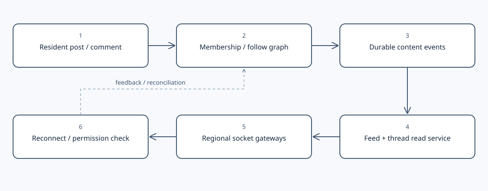

# W263. Designing Nextdoor Newsfeed User Interaction and Real-Time Feed System

**Priority group:** Third 100 — broader practice

**Category:** Feeds, notifications and social graphs

**Study position:** 263 of 547

[Group list](../THIRD_100.md) · [All categories](../ALL_CATEGORIES.md) · [Chapter guide](../README.md)

## Question

Design a system called 'Nextdoor Newsfeed'. Consider the following functionalities and details:

Users can post and comment on other users' posts.
Users can follow other users and see their posts in the newsfeed.
Include user use cases, data storage requirements, architecture diagram, or system components.

Please exclude implementation details and focus on high-level design elements like how the system handles real-time feeds, manages user connections, and threading.

## Worked solution

### User journeys and records

A resident publishes a post, follows another resident, reads authorized followed posts and opens a threaded discussion. Authors can edit/delete; readers comment/reply and block/report. Assume neighborhood membership also constrains visibility, as appropriate to the product; clarify public versus neighborhood-only posts before implementation. Keep User/Membership, Follow, Post(author,neighborhood,visibility,time,version), Comment(post,parent,time,author,version) and moderation records in durable stores. Media, if allowed, uses object storage with authorized delivery.

The high-level diagram is client → post/follow services → durable content/graph → event fanout → feed cache/read service → client, with a separate comments/thread service. Content writes and events commit together. Ordinary authors' IDs fan out to active followers; high-follower accounts can be merged on read. The feed service hydrates a bounded set and applies current neighborhood, follow/block and removal checks. A cached timeline does not establish permission to see a private neighborhood post.

### Threading and realtime connections

Threading means parent-child discussion relationships, not a requirement to build one server thread per user. Store parent_id and post_id on each comment, page top-level comments and fetch child pages on expansion. Keep deleted-parent placeholders where needed to preserve the reply context, while redacting removed content. Paged thread reads avoid loading a huge discussion all at once. If ranked comments are used, pin an ordering snapshot per paging session; chronological threads use stable time/ID cursors.

Regional WebSocket/push gateways manage user connections and tell clients a feed/thread changed. Presence heartbeats expire independently of durable membership. A reconnect uses a last-seen event cursor to fetch missed updates; realtime delivery is a hint plus replay, not the only content copy. Slow clients get bounded buffers and a resync marker instead of unlimited queued messages. Permission changes revoke subscriptions and are checked again when fetching content.

### Scale, recovery and validation

No workload is supplied. Assume one million daily users, ten feed reads each and 100,000 posts/day: about 116 read/s and 1.16 post/s average, with an assumed tenfold peak. One post to 500 followers can still cause 500 feed updates, so size burst/fanout separately. Partition feeds by viewer, content by post/author and graph adjacency by user; cache only hot recent IDs. Freshness of a few seconds is an explicit proposed target, not a supplied guarantee.

An event backlog delays new-feed visibility, but replay restores it through idempotent fanout. The client sees pending/retry for a failed post save and never a false saved acknowledgment. Region loss uses durable replicas and capacity headroom; a failed gateway reconnects clients without recreating posts/comments. Monitor post-to-feed lag, thread page latency, duplicate events, connection lag and privacy violations. Validate a large thread, self/duplicate follow, author deletion, blocked users on an open socket and reconnect after missed updates. This stays at the requested component/data/interaction level rather than prescribing implementation internals.

<!-- architecture:W263:start -->

Read the numbered flow as Resident post / comment → Membership / follow graph → Durable content events → Feed + thread read service → Regional socket gateways → Reconnect / permission check. The dashed return represents the feedback/reconciliation described above; it does not replace the stated durability, authority or failure contract.
<!-- architecture:W263:end -->

[Batch behavior checks](../test_review_251_300.py). Capacity/SLO estimates are design calculations, not measured production results.

### Further study

- [F082: Design a recommendation system from candidate generation to ranking.](../09_ml_system_design.md#f082)
- [F170: Design a cache without serving incorrect data.](../17_distributed_systems_depth.md#f170)
