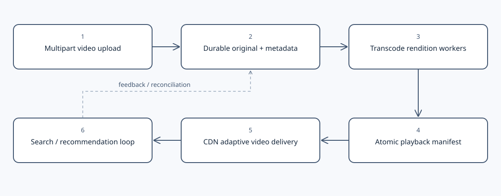

# W264. Designing YouTube

**Priority group:** Third 100 — broader practice

**Category:** Feeds, notifications and social graphs

**Study position:** 264 of 547

[Group list](../THIRD_100.md) · [All categories](../ALL_CATEGORIES.md) · [Chapter guide](../README.md)

## Question

System Design Interview Question: Design YouTube
Problem Statement

Design a video-sharing platform like YouTube.

Users should be able to upload videos, watch videos, search videos, subscribe to creators, like/comment on videos, and receive personalized recommendations.

The system should support massive global scale, high availability, low-latency video playback, durable video storage, asynchronous video processing, and efficient content delivery.

Clarifying Questions
1. Are we designing the full YouTube system or focusing on video upload and playback?
2. Do we need to support live streaming?
3. Do we need recommendations, search, comments, subscriptions, and ads?
4. What video formats and qualities should be supported?
5. Are videos public only, or do we need private/unlisted videos?
6. Do we need creator analytics?
7. Do we need copyright detection and moderation?
Functional Requirements
Core Requirements
1. Users can upload videos.
2. Users can watch videos.
3. Users can search for videos.
4. Users can like, comment, and subscribe.
5. Users can see video metadata: title, description, duration, thumbnail, views, likes, upload time.
6. System generates multiple video qualities, such as 144p, 360p, 720p, 1080p, and 4K.
7. System supports adaptive bitrate streaming.
8. System recommends videos to users.
Non-Core Requirements
1. Live streaming.
2. Ads insertion.
3. Creator monetization.
4. Copyright detection.
5. Abuse detection and content moderation.
6. Real-time chat.
7. Creator studio analytics.
Non-Functional Requirements
1. High availability for video playback.
2. Low latency video start time.
3. Durable storage for uploaded videos.
4. High write throughput for uploads.
5. Very high read throughput for video playback.
6. Eventually consistent counters are acceptable for views and likes.
7. Strong consistency is preferred for ownership, permissions, and upload state.
8. System should support global users.
9. System should tolerate spikes caused by viral videos.

## Worked solution

### Scope and upload/playback architecture

Clarify live streaming, ads, privacy, target qualities, analytics and moderation. For the core design include upload, VOD playback, search, subscriptions, likes/comments and recommendations; treat live/ads/monetization/realtime chat/advanced copyright/creator analytics as extensions. Basic safety/access control still gate publication. Support public, unlisted and private metadata, with permission semantics explicit.

`POST /uploads` creates a resumable upload and signed multipart URLs; `/uploads/{id}:complete` verifies size/hash and commits metadata/outbox. Store Video(id,owner,title,description,visibility,state,source_ref,version), Rendition(video,codec,resolution,manifest), Subscription, unique Reaction(user,video), Comment and ProcessingAttempt. States UPLOADING→PROCESSING→READY/FAILED prevent incomplete media playback. Originals and segments live in replicated object storage, never in the metadata database. Processing workers transcode a rendition ladder (144p through 4K where source permits), generate thumbnails/captions, validate output and atomically publish a complete HLS/DASH manifest.

The diagram's playback path is metadata/authorization → manifest → CDN segments, separate from asynchronous upload/transcode/search events. Adaptive bitrate clients select renditions based on bandwidth/buffer and switch at aligned segment boundaries. Origin shields, regional caches, request coalescing and hot-object prewarming protect against viral-video stampedes; immutable segment keys cache efficiently. Private manifests/media use scoped short-lived authorization; unlisted means link-discoverable, not necessarily private.

### Discovery and consistency

`GET /videos/{id}` returns current metadata; search indexes title/description/transcript with seconds-of-lag and versioned tombstones; subscriptions supply creator candidates. Personalized recommendations use retrieval pools/content/co-watch embeddings, bounded ranking and safety/diversity rules trained on actual impressions, watch duration and satisfaction. Likes/views may converge eventually, but ownership, permissions and upload state use strong conditional updates. Views require a defined playback/dedup rule; raw HTTP segment hits are not view counts. Comments page by video/parent/time and enforce moderation/access.

### Capacity and failures

No numeric scale is given. Assume one million uploads/day averaging 100 MB: 100 TB/day originals, about 1.16 GB/s mean ingest. Assume ten million concurrent viewers at 3 Mbit/s: **30 Tbit/s** delivery, explaining CDN necessity. A twofold rendition-storage multiplier is an assumption, not universal; codecs/content determine it. Transcoding capacity depends on duration×codec/resolution speed and needs independent estimates.

Retry processing by (video,source_version,rendition,encoder_version), write attempt-scoped segments and publish once. A worker death cannot expose a half-written manifest; outbox replay completes missed search/recommendation updates. Client finalize retry returns the same video; upload orphan cleanup respects active leases and retention. On recommendation outage use subscriptions/trending; on regional metadata loss fail over with fenced writes, while cached public playback can continue if its access policy allows. Monitor upload errors, transcode queue age, durability, time-to-first-frame, rebuffer, CDN hit ratio and authorization/takedown propagation. Test interrupted upload, corrupt rendition, duplicate like, viral origin load and permission revocation during cached playback. A low average playback latency does not prove global startup/rebuffer SLOs without network/device load tests.

<!-- architecture:W264:start -->

Read the numbered flow as Multipart video upload → Durable original + metadata → Transcode rendition workers → Atomic playback manifest → CDN adaptive video delivery → Search / recommendation loop. The dashed return represents the feedback/reconciliation described above; it does not replace the stated durability, authority or failure contract.
<!-- architecture:W264:end -->

[Batch behavior checks](../test_review_251_300.py). Capacity/SLO estimates are design calculations, not measured production results.

### Further study

- [F082: Design a recommendation system from candidate generation to ranking.](../09_ml_system_design.md#f082)
- [F170: Design a cache without serving incorrect data.](../17_distributed_systems_depth.md#f170)
