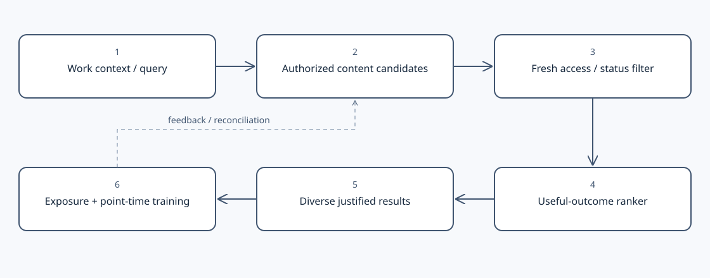

# W265. Product Feed and Shopping Recommendation System

**Priority group:** Third 100 — broader practice

**Category:** Feeds, notifications and social graphs

**Study position:** 265 of 547

[Group list](../THIRD_100.md) · [All categories](../ALL_CATEGORIES.md) · [Chapter guide](../README.md)

## Question

Design a recommendation system for a product feed, Jira-style recommendations, or an Amazon-style shopping surface. Variants distinguish landing-page recommendations from search-engine recommendations and expect discussion of ranking, retrieval, feedback, and latency.

### Requirements

Generate recommendations for a product feed, cross-product Jira/Confluence surface, or shopping experience.
Separate candidate generation from ranking.
Consider landing-page recommendations and search-result recommendations separately when the prompt asks for both.
Incorporate user signals, item/content metadata, and recent interactions.
Discuss latency constraints for online ranking and batch/offline pipelines for model training or feature generation.
Define metrics for relevance, engagement, freshness, and business quality.
Notes
MLE candidates may get this as a fairly standard ML system-design prompt, but interviewers can still go deep on product-specific retrieval and ranking choices.
Clarify whether recommendations must be explainable, permission-aware, or scoped to a specific Atlassian product.

## Worked solution

### Choose a permission-aware work-product surface

Assume the Atlassian variant: recommend Jira issues and Confluence documents that help a user complete current work. Optimize useful opens followed by task progress/reference reuse, with dismissals, access violations, duplicate content and latency guardrails. If choosing shopping instead, change labels to qualified purchase/retained value and add stock/shipping constraints; do not blend those targets with workplace clicks. Clarify explainability and tenant/product scope; this design returns supported reasons and enforces access.

Landing-page recommendations have no explicit query, so retrieve from the user's projects, recent issues/docs, followed collaborators, content embeddings and authorized team activity. Search-result recommendations are conditioned on the query and must preserve lexical/exact-ticket matching as well as semantic retrieval; user interests cannot override an explicit issue key. The diagram's candidate union differs by entry surface, while authorization and ranking packages are shared.

### Features, models and online path

Use user role/team/project membership, recent searches/issues, item text/title/labels/owner/status/freshness and user-item collaboration/content affinity. Private document embeddings and graph features are tenant-scoped. Begin with content/project-recency rules, then train a two-tower retriever and GBDT/multi-task ranker on actual exposure, useful-open, save/reference and completion signals. Completion labels require care: the recommended item may correlate with progress without causing it. Unshown items are unlabeled, and delayed outcomes need mature windows/selection-bias analysis. Cold users use current project/onboarding context; cold items use metadata/content.

`GET /recommendations?surface=&project=` retrieves hundreds, checks current access/status, scores a bounded set and re-ranks for project/type diversity. Reasons are structured, e.g. “linked to issue you follow,” with authorized evidence IDs; don't fabricate a causal explanation. Assume p99<200 ms: 30 ms retrieval, 40 ms batched access/features, 60 ms rank and 70 ms network/headroom. At assumed 10,000 requests/s and 200 candidates, plan two million pair scores/s plus permission lookup load. Cache by tenant/user/access-version and short TTL; final checks prevent stale access grants.

### Learning, updates and evidence

Content/permission changes commit to durable metadata/outbox, then update versioned indexes idempotently. Tombstones remove deleted/restricted items and old events cannot resurrect them. Online streams refresh recent interaction features; batch jobs train from point-in-time snapshots and deploy compatible model/index manifests via canaries. Feature-store failure uses content/project rules; permission-service failure omits unverifiable items instead of leaking them.

Evaluate retrieval recall, NDCG, freshness and useful-outcome calibration with forward-time and project/item-family holdouts. At launch without interactions, human task-relevance checks are possible but personalized uplift is not. A/B-test by workspace/team when shared work creates interference, measuring task usefulness/retention plus dismissal and trust guardrails. Monitor index/feature age, permission denials, model drift, exposure completeness and p99. Test cross-tenant retrieval, revoked document access, stale issue status and a new product with no history.

<!-- architecture:W265:start -->

Read the numbered flow as Work context / query → Authorized content candidates → Fresh access / status filter → Useful-outcome ranker → Diverse justified results → Exposure + point-time training. The dashed return represents the feedback/reconciliation described above; it does not replace the stated durability, authority or failure contract.
<!-- architecture:W265:end -->

[Batch behavior checks](../test_review_251_300.py). Capacity/SLO estimates are design calculations, not measured production results.

### Further study

- [F082: Design a recommendation system from candidate generation to ranking.](../09_ml_system_design.md#f082)
- [F170: Design a cache without serving incorrect data.](../17_distributed_systems_depth.md#f170)
