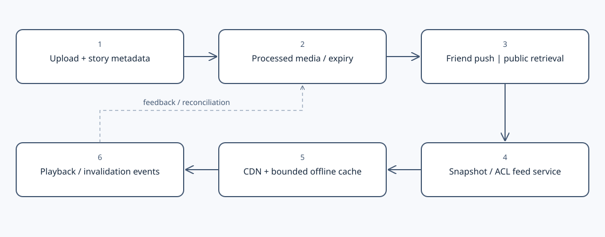

# W266. Snap Story or Spotlight Feed Backend

**Priority group:** Third 100 — broader practice

**Category:** Feeds, notifications and social graphs

**Study position:** 266 of 547

[Group list](../THIRD_100.md) · [All categories](../ALL_CATEGORIES.md) · [Chapter guide](../README.md)

## Question

Design the backend for Snapchat Stories or Spotlight video feed vending, including upload, privacy, offline support, feed pagination, freshness, storage, and serving trade-offs.

Functional requirements
1. Users upload stories or short videos with metadata, media, author, visibility, and expiration policy.
2. Viewers fetch a feed, page up/down, and resume from a cursor.
3. Stories support saving, favorites, and offline behavior where applicable.
4. Visibility rules must respect friends, public content, blocks, age/region limits, and content safety.
5. The system logs views, skips, hides, favorites, and completion events.
Scale / constraints
Media files are large; metadata and feed records are small but very hot.
Feed serving needs low latency and high availability.
A fully recomputed feed per request may be too expensive.
Design decisions
Push vs pull fanout for friend stories; hybrid for high-fanout creators.
Object storage plus CDN for media; separate metadata store for story records.
Cursor semantics for pagination; precomputed feed cache vs on-request generation; offline cache invalidation and expiration.

## Worked solution

### Story state and media publication

Assume friends' expiring Stories plus a public Spotlight discovery feed, with separate eligibility/ranking policies. `POST /uploads` supports resumable media transfer; `POST /stories` finalizes a verified asset and metadata under an idempotency key. Store Story(id,author,media_ref,created_at,expires_at,visibility,version,safety_state), friendship/block records, Favorite(user,story) and FeedSnapshot(user,id,ordered_ids,created_at,expiry,model_version). Media uses object storage/CDN with processed thumbnails/bitrates; metadata and feed IDs are small durable/hot records. Publish only READY media.

The diagram's friend feed pushes ordinary story IDs to active friends, pulling high-fanout creators on read; Spotlight retrieves public eligible candidates and ranks by recent interest, multimodal content and quality. Shared storage does not imply shared permissions: friends-only stories never become public discovery candidates. Recheck friends/blocks, age/region, expiry and takedown at serve/playback time. Current ACL checks or short scoped media tokens bound stale CDN access.

### Bidirectional paging and offline semantics

`GET /feed?cursor=&direction=up|down` returns an ordered snapshot/window, anchors and seen IDs; cursors bind user, feed type, snapshot, position and TTL, and are authenticated against tampering. Freeze order for a paging session and fetch missing bodies in batch; refreshing creates a new snapshot with a high-watermark so items do not jump unpredictably. If a snapshot expires, explicitly resync rather than promise perfect continuation. A realtime hint says new content is available; the client chooses when to refresh.

Offline caches store an expiry and permission/token lifetime. The client must hide expired stories using a trusted server-time offset, and reconnection processes deletion/block invalidations before presenting fresh cached content. A disconnected device cannot learn immediate revocation: state that limit, use bounded offline validity, and disable offline private caching when strict immediate revocation is required. “Favorite” may mean a bookmark that stops working after expiry, or an authorized durable save; choose and expose the contract rather than secretly preserve ephemeral media. Assume bookmarks do not extend the author's expiry.

### Recovery and estimate

Log view/skip/hide/favorite/completion with event_id, playback session, story version and event time; deduplicate retries and define actual visible playback separately from prefetch. Offline events can arrive late without restoring expired content. Fanout/outbox updates are idempotent, and tombstones prevent stale completion from resurrecting a story. If ranking fails, use recent safe authorized items; if metadata/permission checks fail, omit uncertain private content. Expiration cleanup reclaims storage after the retention/legal window, independently of feed hiding.

Assume ten million stories/day at 5 MB each: 50 TB/day media before variants/replicas. An assumed 100 million feed pages/day is 1,157/s average; viral media egress can dominate. Precompute short candidate windows, use regional caches and benchmark a proposed 150 ms feed p99 with bounded candidates. Monitor upload/processing lag, feed duplicates/gaps, expiry violations, view-event lag and CDN hit ratio. Test offline expiry, block while cached, cursor up/down overlap, deleted favorites and reconnect with replayed completion events.

<!-- architecture:W266:start -->

Read the numbered flow as Upload + story metadata → Processed media / expiry → Friend push | public retrieval → Snapshot / ACL feed service → CDN + bounded offline cache → Playback / invalidation events. The dashed return represents the feedback/reconciliation described above; it does not replace the stated durability, authority or failure contract.
<!-- architecture:W266:end -->

[Batch behavior checks](../test_review_251_300.py). Capacity/SLO estimates are design calculations, not measured production results.

### Further study

- [F082: Design a recommendation system from candidate generation to ranking.](../09_ml_system_design.md#f082)
- [F170: Design a cache without serving incorrect data.](../17_distributed_systems_depth.md#f170)
