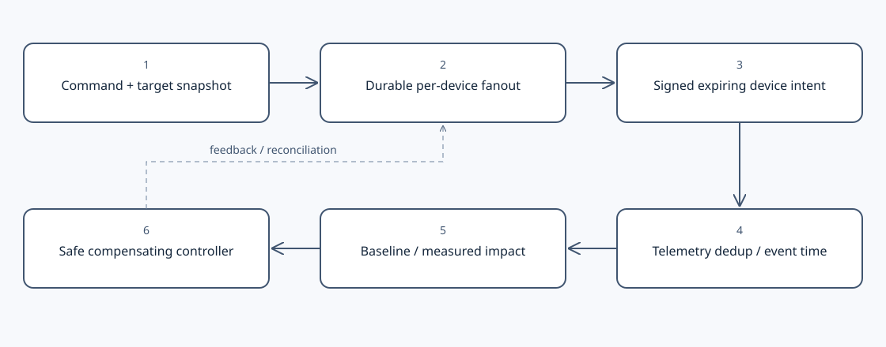

# W267. Distributed Device Control

**Priority group:** Third 100 — broader practice

**Category:** Geospatial, dispatch and tracking systems

**Study position:** 267 of 547

[Group list](../THIRD_100.md) · [All categories](../ALL_CATEGORIES.md) · [Chapter guide](../README.md)

## Question

Distributed Device Control

Design a distributed control system for a power-grid operator that manages tens of millions of internet-connected devices such as HVAC systems, EV chargers, and batteries.

The operator can issue commands such as:

“Reduce power consumption of eligible HVAC devices in the Northeast by 20% for the next 30 minutes.”

Devices have unreliable connectivity. A device may not receive the command, may reject it, may accept but fail to execute it, or may execute successfully but report telemetry late. Telemetry may also be duplicated, missing, or arrive out of order.

The system should support:

Targeting millions of devices by attributes such as region and device type
Reliable command distribution
Tracking delivery, acceptance, execution, and actual physical impact
High-volume telemetry ingestion and aggregation
Late/out-of-order telemetry and historical reconciliation
Determining whether the requested aggregate reduction has been achieved
Issuing additional commands when the system is under-delivering
Scalability, fault tolerance, and auditability

Assume:

~50M registered devices
Up to ~5M devices targeted by one command
Millions of telemetry events per second

Design the system end to end. Discuss APIs/data models, targeting, fan-out, delivery semantics, telemetry processing, reconciliation, closed-loop control, failure handling, and consistency trade-offs.

## Worked solution

### Model intent separately from physical effect

`POST /commands` accepts an idempotency key, selector, requested aggregate reduction, start/end, safety constraints and control policy version; `GET /commands/{id}` returns delivery, acceptance, execution and measured-impact summaries separately. Store Device(id,region,type,capabilities,opt_in,connectivity,version), Command(id,target_snapshot,action,valid_from,expires_at,generation,state), DeviceCommand(command,device,state,ack_times,reason), and Telemetry(device,boot_id,seq,event_time,ingest_time,power,quality). Snapshot up to five million eligible device IDs/versions for audit; recheck safety/opt-out at actual dispatch/execution.

“Reduce consumption by 20%” needs a denominator and actuator semantics. Assume a 20% reduction from an estimated eligible-fleet baseline power for 30 minutes, translated into safe device-specific setpoints/duty schedules. Device capability, comfort, minimum charge and local override constrain allocation. A signed command includes command_id/generation, expiry and a bounded desired state, not “subtract another 20%” on every retry.

### Distribution and telemetry pipeline

The diagram is targeting registry → durable partitioned fanout → regional device gateways → signed device commands, with telemetry returning through a durable stream to state/impact aggregators and a closed-loop controller. Persistent outbound device connections tolerate NAT/offline behavior; per-device mailbox/desired-state state persists while disconnected. Device ACK means received, acceptance means locally feasible, execution reports actuator state, and telemetry measures watts. Retry unacknowledged valid commands with backoff; expired commands are never freshly executed. Device deduplication persists recent command IDs/generations across reconnect/reboot, and higher generations supersede old control intent.

Partition telemetry by device, deduplicate (device,boot_id,seq), retain event/ingest times and reject older state from replacing a newer live reading. Event-time windows with watermarks produce provisional aggregates; late data corrects historical windows through idempotent retractions/upserts. Keep raw immutable telemetry for reconciliation. Missing/stale devices are UNKNOWN, not zero consumption or confirmed success.

### Closed-loop control and scale

Estimate reduction as counterfactual baseline minus observed consumption, with baseline uncertainty and coverage reported. A pre-event matched weather/time model or randomized holdout can estimate baseline; naive pre/post comparison confounds weather and natural load. The controller compares confidence-bounded achieved kW to the target, accounts for command/telemetry delays and issues **new** bounded compensating command generations to spare eligible devices. Use hysteresis, rate limits, cooldowns and saturation/anti-windup; repeatedly commanding based on delayed telemetry can overcorrect. Local safety controllers always override remote optimization. At expiry restore safe prior/default policy with a watchdog even if the cloud is unreachable.

Five million targets at assumed 200 bytes/dispatch mean 1 GB logical fanout; over one minute that is about 83,333 commands/s. At an illustrative two million telemetry events/s×100 bytes, ingress is 200 MB/s or 17.28 TB/day before replication/indexes. Shard gateways/queues/aggregators by region/device and merge sums/counts hierarchically; hot regional summaries must not serialize each raw event. Long-term retention uses rollups with documented late corrections.

A gateway/region outage leaves device-local expiry/safety active; durable desired state replays after reconnect only if still valid. Controller leadership uses epochs and transactional generation changes; duplicate dispatch never implies another physical reduction. Restrict operator roles, sign commands, rotate device keys and audit selection, overrides and impact revisions. Test five-million fanout, disconnected targets, duplicate/out-of-order telemetry, accept-but-fail, late execution reports and underdelivery with delayed feedback. Monitor separate stage rates, measurement coverage/age, achieved kW uncertainty, command backlog and safety overrides rather than one “success” percentage.

<!-- architecture:W267:start -->

Read the numbered flow as Command + target snapshot → Durable per-device fanout → Signed expiring device intent → Telemetry dedup / event time → Baseline / measured impact → Safe compensating controller. The dashed return represents the feedback/reconciliation described above; it does not replace the stated durability, authority or failure contract.
<!-- architecture:W267:end -->

[Batch behavior checks](../test_review_251_300.py). Capacity/SLO estimates are design calculations, not measured production results.

### Further study

- [F168: Design a state-wide temperature ingestion and query system.](../17_distributed_systems_depth.md#f168)
- [F169: Explain backpressure in a multi-stage data pipeline.](../17_distributed_systems_depth.md#f169)
