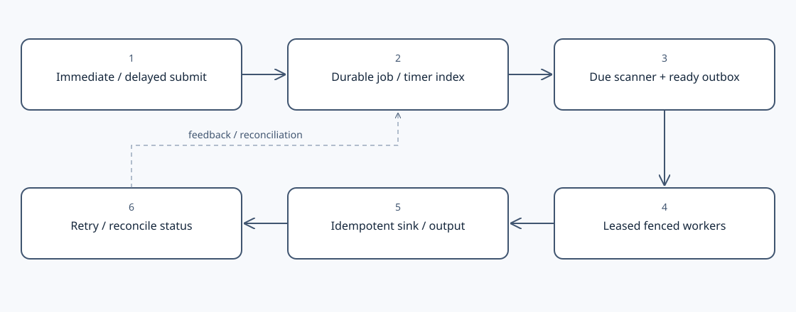

# W268. Async Job Scheduler

**Priority group:** Third 100 — broader practice

**Category:** Jobs, concurrency and durable workflows

**Study position:** 268 of 547

[Group list](../THIRD_100.md) · [All categories](../ALL_CATEGORIES.md) · [Chapter guide](../README.md)

## Question

Async Job Scheduler

Design an asynchronous job scheduler supporting two job types: run-immediately jobs and delayed jobs that fire after a timer (e.g. one hour). The focus is fault tolerance — exactly-once execution and recovery when a worker dies mid-job.

### Requirements

Design an async job scheduler:

Two job types: (1) jobs that should run as soon as possible, and (2) jobs submitted with a delay/timer (e.g. one hour) that should run as soon as possible after the timer elapses.
Primary emphasis is failure handling: how to achieve exactly-once execution and what happens when a worker crashes mid-execution.
Notes
The interviewer drives hard on correctness under failure: exactly-once semantics (visibility timeouts / leases + idempotency keys so a re-delivered job is not double-run), and worker-death recovery (lease expiry re-queues the job for another worker).
The delayed-job path is the design wrinkle: a durable timer/delay queue (or a time-bucketed store polled as timers come due) feeding the same ready queue as immediate jobs.
Difficulty is moderate; this maps closely to a standard job-scheduler design (queue + workers + durable store + retries), so a well-rehearsed template plus crisp exactly-once reasoning is enough.

## Worked solution

### Durable timers feed one execution path

`POST /jobs` accepts payload_ref, idempotency_key, run_at (now for immediate work), timeout and retry policy; `GET /jobs/{id}` returns state/attempts/result and cancel disables future starts. Store Job(id,tenant,key,request_hash,run_at,state,attempt_count,result_ref), Attempt(job,n,worker,token,lease_expiry,state) and Outbox. Unique (tenant,key) returns one logical job; binding the request hash rejects accidental key reuse.

Immediate jobs enter READY. Delayed jobs stay WAITING in an index on (state,run_at,id). Partitioned timer scanners use database time and lock/claim due batches, atomically change WAITING→READY and insert outbox events. Queue publication is retried after scanner crash, never the only timer record. Short-term timing wheels can accelerate due checks, but must rebuild from durable schedules after restart. At-least-once queue messages contain job_id/version, not authoritative ownership.

### Exactly-once effect versus execution

The diagram's workers atomically claim READY→RUNNING with a fencing token and renewable lease. They read payload, heartbeat, publish a complete output and conditionally commit SUCCEEDED for the current token; retryable failure/lease expiry creates another attempt with bounded backoff. Permanent failures enter FAILED/dead-letter state. Worker crash recovery can run the same code again. A lease does **not** guarantee exactly-once execution: the old worker may still run after a network partition, or may have performed an effect before its acknowledgment vanished.

Achieve one committed business effect by using job_id as a sink idempotency key, a transaction covering state+effect in one database, or an external system that durably deduplicates. An output object can be written per attempt then one manifest conditionally committed. If an external effect provides no idempotency/transaction/reconciliation, exactly-once effect is not generally achievable. Choosing strict at-most-once attempt launch instead means some crashed/uncertain jobs never retry; state the lost-work trade-off.

Example: a one-hour delayed invoice job becomes due once, worker A charges then dies before success. B's retry sends the same payment idempotency key and records the existing charge; charging with a new key would duplicate money movement. A late success from A cannot replace B's token. Cancellation fences queued work and requests running interruption, but cannot undo an already committed external charge.

Scale is unspecified. Assume one million live timers at 200 bytes each: 200 MB raw metadata plus indexes/replicas; if 100,000 expire at once, drain time depends on dispatch/worker capacity, not timer precision. Partition ready queues by job type/tenant, impose admission limits and monitor due-to-start delay, oldest timer, expired leases, retries and outbox lag. Test scanner failure after commit, lost queue ACK, duplicate timer delivery, worker crash around the effect and clock boundaries. The design promises durable scheduling and deduplicated effects under stated sink contracts, not physically once-only CPU execution.

<!-- architecture:W268:start -->

Read the numbered flow as Immediate / delayed submit → Durable job / timer index → Due scanner + ready outbox → Leased fenced workers → Idempotent sink / output → Retry / reconcile status. The dashed return represents the feedback/reconciliation described above; it does not replace the stated durability, authority or failure contract.
<!-- architecture:W268:end -->

[Batch behavior checks](../test_review_251_300.py). Capacity/SLO estimates are design calculations, not measured production results.

### Further study

- [F162: Design a durable work queue with retries and leases.](../17_distributed_systems_depth.md#f162)
- [F163: Handle dependency-aware job scheduling.](../17_distributed_systems_depth.md#f163)
