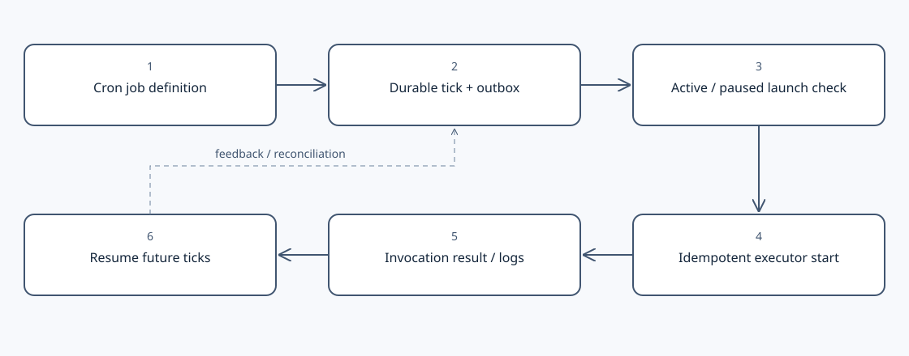

# W269. Design a Distributed Job Scheduler with Cron, Pause, Resume

**Priority group:** Third 100 — broader practice

**Category:** Jobs, concurrency and durable workflows

**Study position:** 269 of 547

[Group list](../THIRD_100.md) · [All categories](../ALL_CATEGORIES.md) · [Chapter guide](../README.md)

## Question

Design a distributed job scheduler that supports cron-style recurring jobs, pause (allow in-flight jobs to complete, launch no new invocations), and resume. Workers are assumed effectively unlimited.

API surface:

submit(job, cron_expression)
pause(job_id) — already-running invocations finish; no new invocations launch.
resume(job_id) — re-enable future scheduled launches.
cancel(job_id)

Requirements: job definitions, schedules, and state must survive a scheduler restart (persistence); a launch must not be duplicated under failover (idempotency); observability of per-job last-run, next-run, status.

## Worked solution

### Pause is checked at launch, not just timer creation

Persist JobDefinition(id,payload_ref,cron,timezone,state,version,next_fire_at,last_run_id) and Invocation(job,scheduled_time,definition_version,state,token,result), unique by (job,scheduled_time). Assume UTC cron, no catch-up for occurrences while paused, and already-running work allowed to finish. State these choices because timezone/DST, overlap and missed schedules are otherwise ambiguous. Cancel is terminal: prevent new invocations and request cancellation of running ones; if a different cancellation contract is desired, define it separately from pause.

`submit(job,cron)` validates the expression and idempotency key, then stores ACTIVE and next_fire_at. `pause` changes ACTIVE→PAUSED and increments version in one transaction; `resume` changes to ACTIVE and computes the next future tick from database time. `GET /jobs/{id}` exposes state, last scheduled/start/end/result and next fire. A dashboard read may lag, but launch decisions use authoritative state.

### Failover-safe launches

The diagram's schedule scanner queries indexed due definitions and materializes logical invocation rows with an outbox. Dispatch locks the job definition and invocation, rechecks ACTIVE and the generation, and records one launch authorization before contacting the executor. Pause uses the same job lock. Thus a launch authorized before pause's linearization point is in flight and may finish; a later one is rejected, even if an old queue message exists. A queue merely waking workers cannot bypass that check. While paused, pending unlaunched ticks are marked skipped/suppressed according to the stated no-catch-up rule.

A failover scanner's duplicate insert hits the unique tick key, returning the original invocation. The executor needs a durable idempotent `start(invocation_id,payload)` API: a response timeout is reconciled by that ID rather than creating another launch. Without such an executor contract, conditional scheduler state alone cannot resolve a crash between sending the start and observing its result. Execution effects still require idempotency if worker retry is allowed. Unlimited workers remove a capacity bottleneck, not this ambiguity.

### Worked race and recovery

A minute job has tick 12:01 queued. Pause commits at 12:00:59; dispatch at 12:01 reads PAUSED and starts nothing. If dispatch authorization committed at 12:00:58 for already-due work, pause allows that invocation to finish. Resume at 12:05:20 schedules 12:06, not five unintended catch-up runs. Persisted timestamps let a restarted scheduler reconstruct this behavior.

Traffic is unspecified: assume one million minute schedules, about 16,667 invocations/s on average, with worse aligned bursts. Shard timers by job/time bucket, use bounded outbox batches and jitter only where the schedule contract permits. Multi-zone database replicas and leased scanner shards avoid a single scheduler failure point. Monitor schedule-to-start delay, paused-job launch violations, duplicate authorization, unresolved starts and last/next-run correctness. Test pause-versus-dispatch, resume retry, cancel-versus-success, scanner death and executor timeout. Recurrence must continue after one failed run; a failure does not silently disable the definition.

<!-- architecture:W269:start -->

Read the numbered flow as Cron job definition → Durable tick + outbox → Active / paused launch check → Idempotent executor start → Invocation result / logs → Resume future ticks. The dashed return represents the feedback/reconciliation described above; it does not replace the stated durability, authority or failure contract.
<!-- architecture:W269:end -->

[Batch behavior checks](../test_review_251_300.py). Capacity/SLO estimates are design calculations, not measured production results.

### Further study

- [F162: Design a durable work queue with retries and leases.](../17_distributed_systems_depth.md#f162)
- [F163: Handle dependency-aware job scheduling.](../17_distributed_systems_depth.md#f163)
