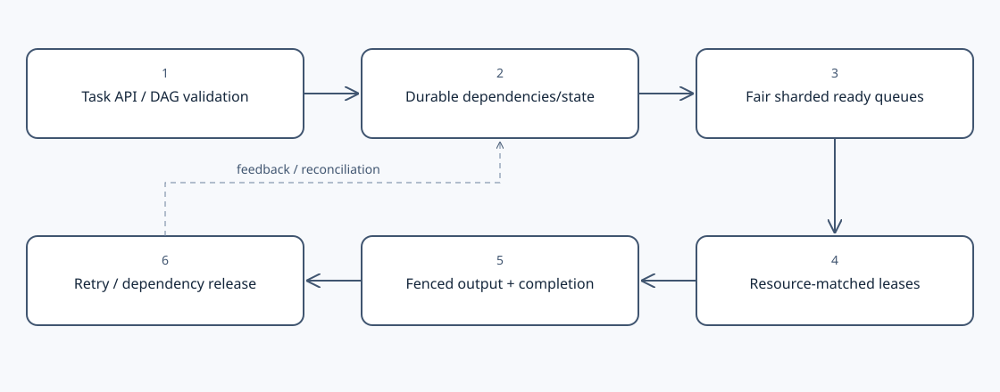

# W270. Design a Distributed Task Scheduler

**Priority group:** Third 100 — broader practice

**Category:** Jobs, concurrency and durable workflows

**Study position:** 270 of 547

[Group list](../THIRD_100.md) · [All categories](../ALL_CATEGORIES.md) · [Chapter guide](../README.md)

## Question

Design a distributed task scheduler.

Functional requirements:
1. Submit tasks with metadata, priority, dependencies, and execution constraints.
2. Store runnable and pending tasks durably.
3. Assign work to workers while avoiding duplicate execution.
4. Retry failed tasks with backoff and expose status.
5. Scale the task queue and workers independently.

Scale / constraints:

Handle many tasks and workers without one queue becoming a bottleneck.
A task may fail, time out, or be picked by a worker that then dies.

Discuss: central vs sharded queues; lease/heartbeat semantics; priority and fairness; dependency resolution and idempotent retries.

## Worked solution

### Explicit scheduling objects

`POST /tasks` accepts tenant idempotency key, payload_ref, priority, dependencies, resource/capability constraints and retry limit; status/cancel/log APIs expose attempts and blocked reasons. Store Task(id,tenant,state,priority,ready_at,spec,attempt_count), Edge(parent,child), Attempt(task,n,token,worker,lease_expiry,result) and Outbox. Validate dependencies and reject cycles at admission. Persist pending and runnable tasks in SQL or a transactional key-value store; a queue message is not the only copy.

### Sharded ready queues and dependency release

The diagram's dispatcher routes READY tasks to resource-class/tenant shards; CPU-only work cannot block behind unavailable GPU work. Within a shard use weighted fair shares plus priority/aging, and backfill feasible small tasks while reserving progress for large jobs. Central queues are simpler for modest volume but can become hot locks; sharding improves throughput at the cost of approximate global priority and cross-shard balance. Work stealing moves eligible ownership through conditional state, not by duplicating claims.

A worker atomically changes READY→RUNNING, receives a generation token and heartbeat lease, and enforces resource/runtime limits. Completion requires current token, unexpired lease and active task/job state, and publishes a durable result manifest. In one transaction or through a deduplicated completion ledger, release a child only when all distinct predecessors succeeded. A duplicate parent completion cannot decrement remaining-dependency count twice. After retries exhaust, mark dependent tasks SKIPPED/FAILED_DEPENDENCY according to a declared fail-fast policy, while independent branches may continue if allowed.

### Failures and correctness example

On timeout or worker loss, fence the attempt, release confirmed resources and retry with capped exponential backoff/jitter. The lost worker can still run, so sinks need token fencing/idempotency by logical task ID; a lease only prevents two **valid owners**, not two physical processes. Deterministic invalid payloads fail fast rather than burn the retry fleet. Cancellation is an authoritative versioned transition and prevents late success from releasing dependents.

Example: C depends on A and B. Two success messages for A count once; C remains blocked until B commits. If B's first worker returns after attempt 2 started, its old token is rejected. API/scheduler crash after database commit but before queue send is recovered by the outbox; a periodic reconciler finds ready tasks missing dispatch, expired leases and orphan workers.

Scale is unspecified. Assume 100,000 tasks/s peak and 20 queue shards: 5,000 messages/s/shard before retries, subject to measured broker/DB capacity. One million active workers heartbeating every 30 seconds add 33,333 lease updates/s, needing sharded state or batched lease renewal. Autoscale workers from resource-feasible backlog/queue age, independently from queue partitions and API instances. Monitor tenant wait percentiles, fairness/starvation, dispatch lag, lease conflicts, retry causes and result completeness. Test duplicate delivery, partitioned worker, hot tenant and cross-shard dependency completion rather than treating queue acknowledgment as application success.

<!-- architecture:W270:start -->

Read the numbered flow as Task API / DAG validation → Durable dependencies/state → Fair sharded ready queues → Resource-matched leases → Fenced output + completion → Retry / dependency release. The dashed return represents the feedback/reconciliation described above; it does not replace the stated durability, authority or failure contract.
<!-- architecture:W270:end -->

[Batch behavior checks](../test_review_251_300.py). Capacity/SLO estimates are design calculations, not measured production results.

### Further study

- [F162: Design a durable work queue with retries and leases.](../17_distributed_systems_depth.md#f162)
- [F163: Handle dependency-aware job scheduling.](../17_distributed_systems_depth.md#f163)
