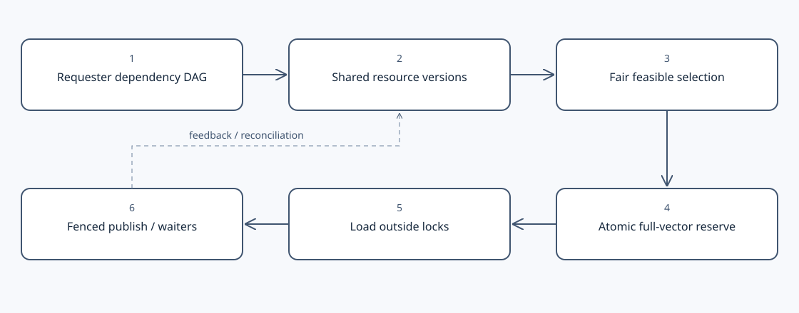

# W271. Design a Multi-Resource Loader/Scheduler

**Priority group:** Third 100 — broader practice

**Category:** Jobs, concurrency and durable workflows

**Study position:** 271 of 547

[Group list](../THIRD_100.md) · [All categories](../ALL_CATEGORIES.md) · [Chapter guide](../README.md)

## Question

Design a loader that schedules work across multiple constrained resources while respecting task dependencies, fairness across requesters, and failure handling.

Tasks may depend on other tasks. Resources have limited capacity. Discuss how you order and dispatch work, how you enforce fairness, and how you recover from failures.

## Worked solution

### Resource vectors and shared loads

Represent Task(id,requester,dependencies,required_resource_vector,state,attempt,token) and ResourcePool(id,total,reserved,health). The resource vector may include CPU, GPU, memory and I/O slots. A task is eligible only after all dependencies succeed; do not reserve its resources while it waits for a prerequisite that needs the same pool. Detect dependency cycles at submission and reject impossible resource requests. If this is a model/data loader, use ResourceVersion(id,version,state,waiters,refcount) and coalesce concurrent compatible load requests.

The diagram's dependency gate produces ready work; fair selection chooses a requester; an atomic reservation allocates the entire vector; a worker performs slow loading/execution outside central locks. Use weighted dominant-resource fairness or weighted deficit scheduling with per-requester concurrency limits and aging. A simple strict priority queue can starve small requesters; resource-aware backfill needs a reservation/aging policy so large tasks also progress. For one placement, reserve all required resources together transactionally or in a fixed global order with rollback to avoid partial-allocation deadlocks.

### State and API

`submit(spec,key)` returns a stable task ID; `status`, `cancel` and `acquire/release resource version` expose state. Store Task/Dependency/Attempt/Reservation and an outbox durably when restart recovery is required. States BLOCKED→READY→LOADING/RUNNING→READY_RESOURCE/SUCCEEDED, with RETRY_WAIT/FAILED/CANCELED alternatives. A generation token prevents a stale load of model v1 replacing current v2. Record one terminal notification per waiter and result; canceling one waiter does not cancel a shared load still needed by others. Evict only unreferenced resources, with memory pressure and reload cost considered.

### Failure example and sizing

Suppose pool capacity is four CPU slots and 8 GB memory. Task A needs (2,6), B (2,4). They cannot run together even though CPUs fit; reserve the full vector and run one, then release its memory before admitting the other. Ten callers requesting the same 6 GB model version share one load and ten waiters, rather than allocate 60 GB. A changed version or incompatible environment is a different key.

Workers heartbeat reservations/leases; failure fences the old attempt, retries transient I/O with bounded backoff and releases resources after reconciliation. Partial downloads write temporary objects and publish only after checksum validation. Persistent allocation records and observed process/memory state must be reconciled after restart; blindly resetting counters can overcommit live resources. On shutdown, stop admission, drain/cancel tasks and resolve waiters explicitly.

No arrival/resource distribution is given. Assume 100 new loads/s averaging 0.5 seconds and 200 MB transient memory: Little's law gives 50 in flight and about 10 GB transient memory before cache/headroom. Coalescing and retention change this substantially. Monitor queue age by requester, allocation fragmentation, resource leaks, cache hit/load reuse, stale completions and fairness. Test dependent-resource deadlock, one canceled waiter, simultaneous version requests, partial failure and eviction while referenced. This separates task ordering, resource feasibility and fairness instead of assuming one queue order solves all three.

<!-- architecture:W271:start -->

Read the numbered flow as Requester dependency DAG → Shared resource versions → Fair feasible selection → Atomic full-vector reserve → Load outside locks → Fenced publish / waiters. The dashed return represents the feedback/reconciliation described above; it does not replace the stated durability, authority or failure contract.
<!-- architecture:W271:end -->

[Batch behavior checks](../test_review_251_300.py). Capacity/SLO estimates are design calculations, not measured production results.

### Further study

- [F039: Design a fair GPU job scheduler.](../04_serving_and_training_systems.md#f039)
- [F169: Explain backpressure in a multi-stage data pipeline.](../17_distributed_systems_depth.md#f169)
