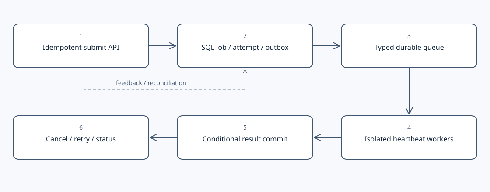

# W272. Design an Async Job / Task System

**Priority group:** Third 100 — broader practice

**Category:** Jobs, concurrency and durable workflows

**Study position:** 272 of 547

[Group list](../THIRD_100.md) · [All categories](../ALL_CATEGORIES.md) · [Chapter guide](../README.md)

## Question

First system-design round in the Salesforce LMTS onsite. Design a generic async job execution service — API surface, state machine, retry, idempotency, storage choice. Not asking for novel architecture, but for the candidate to explain a complete service cleanly end-to-end.

### Requirements

Public API: submit(job_definition) -&gt; job_id, status(job_id) -&gt; state, cancel(job_id), optionally result(job_id) -&gt; output.
Job lifecycle: submitted -&gt; queued -&gt; running -&gt; (succeeded | failed | cancelled). Failed jobs may auto-retry per policy.
Worker pool consumes from the queue; jobs may take seconds to hours.
Retry semantics: exponential backoff with jitter; max attempt cap.
Idempotency: a duplicate submit (same client-side idempotency key) must not create a second job.
Persistence: jobs and their state survive worker / scheduler restarts.
Storage choice (RDBMS vs NoSQL) is an explicit discussion point.

## Worked solution

### One logical job, several possible attempts

Expose `submit(job_definition,idempotency_key)→job_id`, `status(job_id)`, `cancel(job_id)` and `result(job_id)`. Bind a tenant-scoped unique key to a request hash; duplicate identical submits return the same job, while a different body under that key is a conflict. Define payload/image/resource/time limits and keep large payloads/results in object storage. A success response to submit follows durable metadata/outbox commit.

Choose an RDBMS initially because uniqueness, state/lease transactions, attempts and user queries are central. Job(id,tenant,key,hash,state,spec_ref,created_at,next_attempt_at,result_ref) and Attempt(job,n,worker,token,lease_expiry,error) use indexes on state/ready time and lease expiry. A queue wakes workers, and an outbox closes the database-to-broker atomicity gap. A partitioned conditional-write NoSQL store may fit much higher volume but requires deliberately implementing the same multi-record/index consistency; naming it does not remove those invariants.

### End-to-end state machine

SUBMITTED/QUEUED→RUNNING→SUCCEEDED or FAILED/CANCELED. Retryable attempt failure returns the logical job to QUEUED after RETRY_WAIT; preserve attempts rather than overwriting failure history. A worker claims queued state with a unique renewable lease/token, starts isolated work and heartbeats throughout seconds-to-hours execution. It uploads an output/checksum manifest before conditionally committing success. Retry transient infrastructure failures with exponential backoff and jitter up to a configured total-attempt cap; invalid definitions fail permanently. A reconciler expires stale leases and republishes ready outbox work after crashes.

Cancel atomically records cancellation intent, fences new claims and active completion, and asks the worker to stop cooperatively/forcefully after grace. Return CANCELING until durable finalization; don't claim an external side effect was undone. A late success from an old token cannot overwrite CANCELED. Repeated cancel is idempotent and a terminal success is not rewritten by a later request.

### Failure trace and estimate

The diagram's API/state/queue/worker/result path is a durable workflow, not an exactly-once CPU guarantee. If A performs an effect then dies before acknowledgment, B may retry. Use the same job/effect idempotency key at the sink, a shared transaction or a fenced conditional output commit; otherwise duplicate external effects remain possible. On a queue outage accepted jobs stay in SQL/outbox. On DB outage do not hand out unrecorded leases. On object-store failure leave output uncommitted and retry safely.

Traffic is unspecified. Assume 100 jobs/s with five-minute mean runtime: about 30,000 simultaneous running jobs; 30-second heartbeat gives 1,000 updates/s before retries. Partition ready queues by type/tenant and add quotas/dead-letter inspection/log cursors. Job logs are append-only offset streams, not a large SQL field. Monitor time-to-start, attempts, lease loss, cancellation delay, outbox backlog and cost. Test duplicate submission, failed queue publish, worker crash after output, cancellation/commit races and result-read authorization. This delivers a complete service while keeping the storage and effect guarantees explicit.

<!-- architecture:W272:start -->

Read the numbered flow as Idempotent submit API → SQL job / attempt / outbox → Typed durable queue → Isolated heartbeat workers → Conditional result commit → Cancel / retry / status. The dashed return represents the feedback/reconciliation described above; it does not replace the stated durability, authority or failure contract.
<!-- architecture:W272:end -->

[Batch behavior checks](../test_review_251_300.py). Capacity/SLO estimates are design calculations, not measured production results.

### Further study

- [F162: Design a durable work queue with retries and leases.](../17_distributed_systems_depth.md#f162)
- [F163: Handle dependency-aware job scheduling.](../17_distributed_systems_depth.md#f163)
