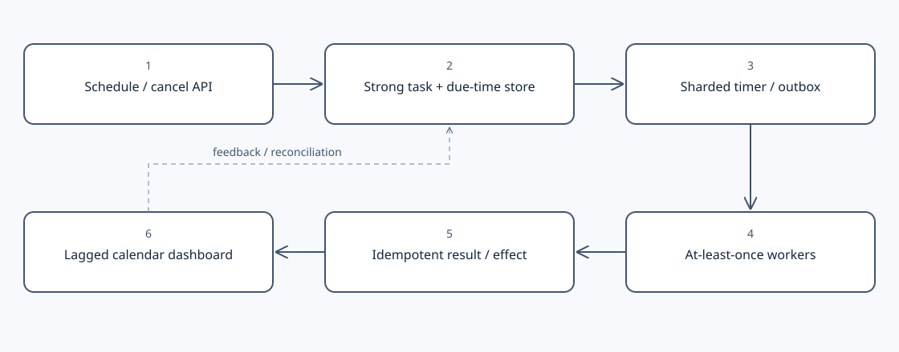

# W273. Distributed Job Scheduler / Calendar Service

**Priority group:** Third 100 — broader practice

**Category:** Jobs, concurrency and durable workflows

**Study position:** 273 of 547

[Group list](../THIRD_100.md) · [All categories](../ALL_CATEGORIES.md) · [Chapter guide](../README.md)

## Question

Design a distributed job scheduler / calendar service supporting millions of live scheduled tasks.

Functional: schedule(task_id, run_at_ts, payload), cancel(task_id), query(window_start, window_end) (powers a real-time dashboard). A worker pool executes tasks at their scheduled time with at-least-once semantics and idempotency hooks.

Variant: calendar service with timezones, recurrence rules (RRULE), and conflict detection.

Non-functional: millions of tasks live at once; sub-second worker pickup of due tasks; dashboard tolerates &lt; 5s staleness, the schedule path tolerates none.

## Worked solution

### Durable schedule path and due-time indexing

`schedule(task_id,run_at_ts,payload)` creates a caller-identified task with version and payload_ref; duplicate identical requests return the current record and differing reuse requires an explicit reschedule/version check. `cancel(task_id,expected_version)` conditionally marks CANCELED; `query(start,end,cursor)` returns scheduled records from a dashboard projection with data_as_of. Schedule/cancel acknowledgment follows a strongly consistent durable write, whereas the dashboard may lag under five seconds.

Store Task(id,tenant,run_at,state,version,payload_ref), Attempt(task,n,token,lease_expiry), Outbox and a due index partitioned by time bucket plus hash shard. Millions of live future tasks remain in durable indexed storage; only a near-future horizon enters an in-memory timing wheel. On restart rebuild that wheel from SQL/conditional-write state. Shard leases distribute time buckets and fencing epochs prevent old scanners claiming after takeover. Poll near-due buckets at, for example, 100 ms, then atomically claim due tasks and enqueue dispatch through an outbox. Sub-second pickup also needs broker/worker capacity and clock synchronization; it is not achieved by polling alone.

### Cancellation, execution and dashboard

The diagram separates authoritative scheduling from due dispatch, workers and an asynchronous query/read model. Workers validate current task state/version and attempt lease, run idempotently, heartbeat and conditionally commit the output. At-least-once delivery plus sink idempotency means duplicate dispatch cannot repeat a committed effect. Expired leases retry after fencing; timeout does not prove old work stopped. Cancellation wins against claims through a shared conditional transaction; after execution effects commit, cancellation cannot magically erase them. Log which race won.

Change events update a time-indexed dashboard projection idempotently using task version; cancel/reschedule removes the previous indexed time before adding the new one. An old delayed event cannot resurrect canceled entries. Expensive full-window scans need pagination and quotas. During projection outage schedule writes continue and the dashboard reports stale data; during schedule-store outage reject new acknowledged schedules rather than buffer them only in memory.

### Capacity and calendar variant

Assume ten million live tasks at 300 bytes: 3 GB raw metadata before indexes/replication. If one million are due at noon, a 10,000/s dispatch fleet takes at least 100 seconds; smooth admitted schedules, reserve capacity or report infeasible sub-second pickup instead of claiming unlimited timing precision. Monitor due lag, clock offset, hot buckets, expired leases and projection age; test reschedule/cancel against a due tick and region failover.

For calendars, retain timezone ID and RRULE/local start separately from UTC materialized occurrences. Define DST gaps/folds and bounded expansion horizon; edits have recurrence versions and occurrence exceptions. Conflict detection is an authoritative per-calendar/resource interval transaction with exclusion/no-overlap checks, not the stale dashboard. Adjacent half-open intervals [start,end) do not conflict. A recurrence update fences old generated occurrences, and cancellations preserve history. Calendar semantics add write coordination; they do not change at-least-once worker effect handling.

<!-- architecture:W273:start -->

Read the numbered flow as Schedule / cancel API → Strong task + due-time store → Sharded timer / outbox → At-least-once workers → Idempotent result / effect → Lagged calendar dashboard. The dashed return represents the feedback/reconciliation described above; it does not replace the stated durability, authority or failure contract.
<!-- architecture:W273:end -->

[Batch behavior checks](../test_review_251_300.py). Capacity/SLO estimates are design calculations, not measured production results.

### Further study

- [F162: Design a durable work queue with retries and leases.](../17_distributed_systems_depth.md#f162)
- [F163: Handle dependency-aware job scheduling.](../17_distributed_systems_depth.md#f163)
