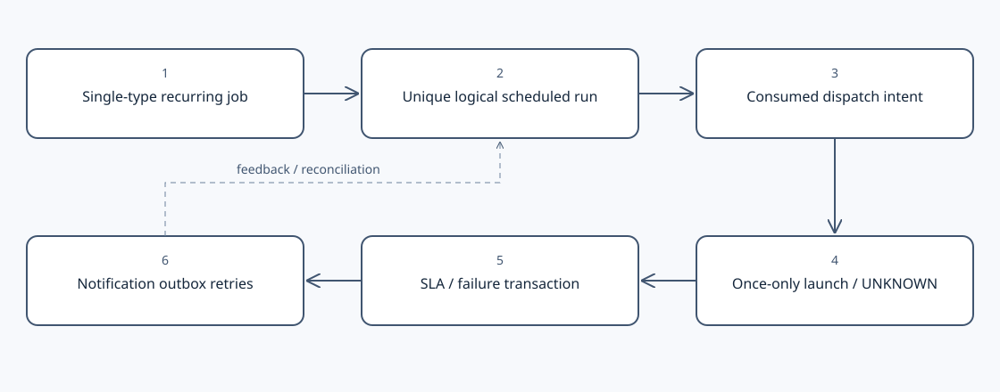

# W274. Job Scheduler System Design

**Priority group:** Third 100 — broader practice

**Category:** Jobs, concurrency and durable workflows

**Study position:** 274 of 547

[Group list](../THIRD_100.md) · [All categories](../ALL_CATEGORIES.md) · [Chapter guide](../README.md)

## Question

Job Scheduler System Design

Robinhood · System Design · 60 min · Free preview

Design a distributed job scheduler that runs typed jobs under an SLA, surfaces failures and logs, and guarantees each job runs at most once. The anchor Robinhood system-design prompt, especially for Senior+; often delivered nearly word-for-word and open-book.

### Requirements

Schedule and run jobs of a given type. Each job has an SLA; if it exceeds the deadline, raise/record an error and let the user inspect logs.
Support recurring jobs (e.g. a job that runs every minute).
Guarantee at-most-once execution per scheduled run.
Handle a broad range of failure cases gracefully — this is where most of the follow-up time goes.

Deep-dive directions interviewers push on:

What happens when a worker or a component in the pipeline dies mid-execution? How do you still honor at-most-once and continue retrying?
A recurring job that fails must still send a notification — design how the failure path reliably triggers the notification even when parts of the system are down.
Retry strategy and backoff; how retries interact with the at-most-once guarantee.
Notes
The round is open-book and the prompt is stable, so the front half carries little differentiation. Proactively and thoroughly cover reliability and fault tolerance early; candidates who leave it thin get walked into follow-up traps and run out of time.
A common at-most-once implementation is conditional writes (compare-and-set on a claim/lease record) so two workers can't both execute the same run.
A frequently added constraint is that the scheduler only handles a single job *type* — don't over-generalize the model.

## Worked solution

### Resolve the at-most-once versus retry contradiction

Strict “each scheduled run executes at most once” and automatic re-execution after an uncertain mid-run worker failure cannot both be guaranteed. A compare-and-set prevents two current claimants, but an expired lease does not stop the old worker, and a crash after an effect but before completion leaves an unknown outcome. State this before choosing the contract. For this answer preserve strict at-most-once **launch**: once dispatch intent is durably consumed, never automatically launch that run again. A failed/uncertain run can be inspected, and a user-requested rerun is a new run ID. If the interviewer instead wants retries, explicitly switch to at-least-once attempts with exactly-once committed effects using sink idempotency/fencing.

### Durable schedule and failure path

For the single-job-type variant store Definition(id,cron,timezone,enabled,SLA,payload_ref), Run(id,definition,scheduled_tick,state,dispatch_consumed,start,deadline,result_ref), LogRef and NotificationOutbox. Unique (definition,scheduled_tick) deduplicates recurring ticks under scanner failover. APIs create/update definitions, inspect runs/logs, cancel and explicitly rerun. Assume UTC/no overlapping same-definition runs unless specified. A recurring definition continues scheduling future ticks even if one invocation fails.

The diagram's scanner commits a logical tick and dispatch record. An idempotent executor start keyed by run_id is ideal; without it, mark consumed before sending. Crash before send can lose that execution, which is the honest cost of strict at-most-once. RPC timeout becomes UNKNOWN and is reconciled/queryable, not silently retried. Heartbeats are progress observations; expiration marks LOST/UNKNOWN and may request termination but never grants permission to relaunch the same strict run. Deadline violation records SLA_EXCEEDED and a failure notification even when the process keeps running; revoke/fence output authority and stop work where possible.

### Reliable notifications and the retry alternative

Record failure/SLA transition plus notification outbox in one transaction. A separate dispatcher retries the notification with exponential backoff and a stable event key, tracks provider acceptance and dead-letters persistent failure for operator attention. The worker itself is not responsible for being alive to send its own death notification. If the database is temporarily down, monitoring retains/reconciles observations and later records the durable failure; do not claim notification at the deadline under total control-plane outage. Deduplication makes one logical alert, while external message delivery can still be duplicate/uncertain without provider support.

Under the alternative retry contract, lease/fence attempt IDs, cap attempts, checkpoint and use (run_id,effect_id) deduplication at sinks. A database transaction or idempotent payment endpoint can give one committed effect even with repeated code execution; arbitrary scripts cannot. Capacity is unspecified: with 100,000 minute definitions, average 1,667 runs/s and aligned-tick bursts need batch/scanner sharding, though worker availability still limits SLA. Monitor due/start delay, UNKNOWN runs, SLA misses, notification age and termination lag. Test every crash boundary around consume/send/ACK/effect/completion and demonstrate the corresponding availability-versus-once trade-off; do not claim a lease alone solves it.

<!-- architecture:W274:start -->

Read the numbered flow as Single-type recurring job → Unique logical scheduled run → Consumed dispatch intent → Once-only launch / UNKNOWN → SLA / failure transaction → Notification outbox retries. The dashed return represents the feedback/reconciliation described above; it does not replace the stated durability, authority or failure contract.
<!-- architecture:W274:end -->

[Batch behavior checks](../test_review_251_300.py). Capacity/SLO estimates are design calculations, not measured production results.

### Further study

- [F162: Design a durable work queue with retries and leases.](../17_distributed_systems_depth.md#f162)
- [F163: Handle dependency-aware job scheduling.](../17_distributed_systems_depth.md#f163)
