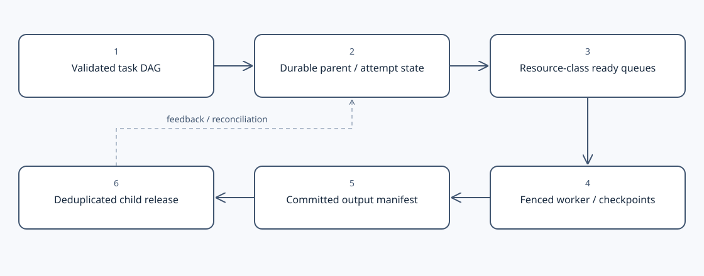

# W275. Job Scheduler with Task Dependencies (DAG Executor)

**Priority group:** Third 100 — broader practice

**Category:** Jobs, concurrency and durable workflows

**Study position:** 275 of 547

[Group list](../THIRD_100.md) · [All categories](../ALL_CATEGORIES.md) · [Chapter guide](../README.md)

## Question

Design a low-level scheduler where each job is a set of tasks with dependency relationships (a DAG). The scheduler must run a task only after all its prerequisites complete.

### Requirements

Model the task graph and execution order (topological scheduling).
Track task states: pending, runnable, running, succeeded, failed, retrying.
Assign tasks to workers; define a retry policy, failure propagation (does a failed task cancel the whole job or allow downstream skip/retry?), and cycle detection.
Keep it concrete: tables, queues, worker lease/heartbeat, state transitions.

A common variant swaps the dependency DAG for a priority-based GPU scheduler: users submit high/low-priority ML training jobs onto a shared GPU pool — priority queue for selection, preemption (checkpoint first), aging to avoid starvation, checkpoint/resume for multi-day jobs, and GPU-crash/OOM/stuck-job recovery. Discuss the design.

## Worked solution

### Graph and ready-state invariants

Store Job(id,tenant,state), Task(job,id,state,payload_ref,resource_spec,attempt_count,result_ref), Edge(job,parent,child), Attempt(task,n,token,worker,lease_expiry) and Outbox. `POST /jobs` validates unique IDs, existing dependencies and acyclicity with Kahn's algorithm/DFS in O(V+E). Roots enter RUNNABLE; others PENDING. `GET /jobs/{id}` exposes each task's state/attempt/error/output, and cancel records authoritative job intent.

The diagram's dependency gate feeds resource-class ready queues, then leased workers and conditional completion. On claim, transactionally check RUNNABLE and active job, set RUNNING and grant a unique token. Worker heartbeat renews only before lease expiry; late/stale completion is rejected. Successful completion first commits output, then one state transition releases children whose **all** distinct parents are SUCCEEDED. Use an edge-completion uniqueness key or an all-parent query; a repeated parent message must not decrement twice. Independent runnable tasks execute concurrently.

### Retry and failure policy

Transient failures move RUNNING→RETRYING with bounded exponential backoff, then RUNNABLE for a new attempt. Preserve the attempt/error history. Assume fail-fast jobs: exhausted retry marks the job FAILING, fences other attempts and marks blocked/runnable tasks canceled/skipped before publishing FAILED. An alternate continue-independent-branches policy must explicitly mark descendants SKIPPED and compute the final job result after those branches finish. Never leave a child waiting forever for an impossible parent. Cancel prevents new work and rejects late completion that would reopen dependencies.

Example: decode→{augment,train}→evaluate. After decode commits, augment and train run concurrently; evaluate waits for both. A duplicate augment completion cannot release evaluate early. Worker loss retries train with a new token; its old worker cannot publish after successor ownership. Side-effecting task payloads need logical-task idempotency even if the queue/lease protocol is correct.

### GPU variant and scale

For high/low-priority training, replace the DAG-ready selection policy with tenant-weighted GPU queues, aging and topology-aware gang reservations. Resource feasibility includes GPU model/count/memory and interconnect, not just priority. Preempt only allowed jobs: request checkpoint with model/optimizer/RNG/sampler state, validate durable manifest, revoke token and reclaim confirmed capacity. Non-checkpointable tasks lose work and need an explicit disruption policy. GPU crash may retry elsewhere; deterministic OOM calls for smaller batch/resource correction rather than infinite identical retries; stuck jobs need progress/watchdog thresholds separate from heartbeat liveness.

Scale is unspecified. Assume 100,000 jobs/day×10 tasks=one million task executions/day, about 11.6/s average; 20,000 live attempts heartbeating every 30 seconds add 667 updates/s. Separate CPU/GPU queues, batch outbox publication and partition task history while keeping each job's dependency transaction coherent. Reconciliation scans expired leases, unsent ready events and nonterminal job finalizers. Observe feasible queue delay, starvation, retry causes, checkpoint age, lost GPU-hours and output completeness. Test cycles, shared descendants, duplicate completion, failure during finalization and preemption/checkpoint races; queue delivery count is not a task success count.

<!-- architecture:W275:start -->

Read the numbered flow as Validated task DAG → Durable parent / attempt state → Resource-class ready queues → Fenced worker / checkpoints → Committed output manifest → Deduplicated child release. The dashed return represents the feedback/reconciliation described above; it does not replace the stated durability, authority or failure contract.
<!-- architecture:W275:end -->

[Batch behavior checks](../test_review_251_300.py). Capacity/SLO estimates are design calculations, not measured production results.

### Further study

- [F162: Design a durable work queue with retries and leases.](../17_distributed_systems_depth.md#f162)
- [F163: Handle dependency-aware job scheduling.](../17_distributed_systems_depth.md#f163)
