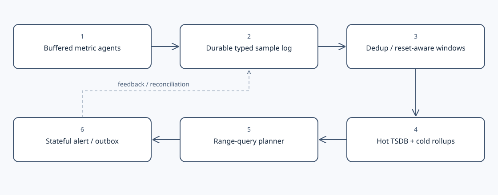

# W276. Design a Distributed Metrics System

**Priority group:** Third 100 — broader practice

**Category:** Logs, metrics and observability

**Study position:** 276 of 547

[Group list](../THIRD_100.md) · [All categories](../ALL_CATEGORIES.md) · [Chapter guide](../README.md)

## Question

Design a distributed metrics / monitoring system. It must ingest high-volume metric data points (counters, gauges, timers) emitted by many services, store them efficiently as time series, and serve aggregation queries (dashboards, alerts) over time windows.

## Worked solution

### Metric semantics and ingestion

Define samples as {tenant,metric_name,type,tags,event_time,ingest_time,value,source_id,sequence}. Counters are cumulative values or increments with an explicit mode/reset identity, gauges are point values, and timers are distributions represented by count/sum/compatible histogram buckets. Never average p99 values from separate hosts. Metric/tag cardinality is bounded by tenant budgets; request IDs belong in logs/traces, not metric labels.

The diagram's buffered agents batch over authenticated push endpoints or answer scrapes, ingestion validates type/schema/quota, a replicated partition log absorbs bursts and stream processors build time-series chunks/rollups. Partition by hash(tenant,series_id) with time chunking; series identity canonicalizes sorted tags and metric type. Deduplicate retried delta batches by source boot_id/sequence. Cumulative counters need monotonic/reset-aware rate computation instead of summing every observed reading. Client memory/disk buffers are bounded and expose drop/backpressure behavior; observing a service must not exhaust it.

### Storage, queries and alerts

Use a time-series engine for recent compressed append-oriented chunks and tag-to-series indexes, with object storage for older downsampled chunks. Store per-window sum/count/min/max and mergeable histogram state; gauges require declared last/average/min/max semantics. A query API accepts metric, authorized tag predicate, time range, step and aggregation. A planner prunes tenant/time/series shards, chooses a resolution no coarser than promised, merges states and returns data timestamps/completeness. Arbitrary historical resolution cannot reconstruct detail already downsampled away.

AlertRule(id,tenant,query,threshold,for_duration,evaluation_interval) drives sharded evaluators over recent aggregates. Persist pending/firing/resolved states, deduplicate incident keys and route notifications through an outbox with retries/suppression. An empty or stale series is UNKNOWN/no-data according to the rule, not automatically zero/healthy.

### Estimate and failure validation

Scale is unspecified. Assume one million samples/s×32 compressed-encoding bytes: 32 MB/s and 2.7648 TB/day before replication/indexes. Seven days raw is 19.35 TB logical, and three replicas about 58.1 TB excluding overhead. Actual compression/cardinality changes this; benchmark series churn. A fifteen-second batch plus fifteen-second rule interval and processing/headroom can target under one-minute alerts; a full one-minute batch cannot.

Replicated logs/checkpoints replay after worker failure; atomic offset+aggregate commit or idempotent batch keys prevent duplicate counts. Late samples update event-time windows within a defined lateness horizon, with corrections retained for longer delays. On overload enforce per-tenant quotas and report dropped/rejected samples; query concurrency/cost budgets protect ingestion and other tenants. Use multi-zone replicas, backups and downsampling manifests. Test counter restart, duplicate batches, late samples, disappearing series, incompatible histogram buckets and high-cardinality abuse. Monitor ingest lag, dropped samples, active series/churn, query p99, alert freshness and rollup correctness.

<!-- architecture:W276:start -->

Read the numbered flow as Buffered metric agents → Durable typed sample log → Dedup / reset-aware windows → Hot TSDB + cold rollups → Range-query planner → Stateful alert / outbox. The dashed return represents the feedback/reconciliation described above; it does not replace the stated durability, authority or failure contract.
<!-- architecture:W276:end -->

[Batch behavior checks](../test_review_251_300.py). Capacity/SLO estimates are design calculations, not measured production results.

### Further study

- [F094: How do you debug a production latency regression?](../10_debugging_and_interview_reasoning.md#f094)
- [F169: Explain backpressure in a multi-stage data pipeline.](../17_distributed_systems_depth.md#f169)
- [F170: Design a cache without serving incorrect data.](../17_distributed_systems_depth.md#f170)
