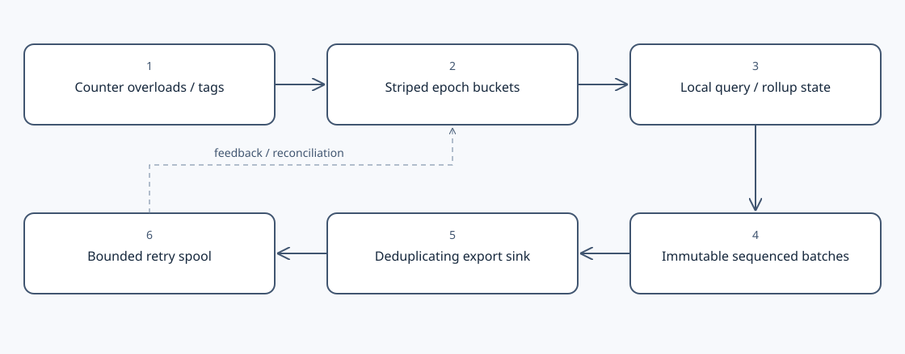

# W277. Design a Metric Counter Library

**Priority group:** Third 100 — broader practice

**Category:** Logs, metrics and observability

**Study position:** 277 of 547

[Group list](../THIRD_100.md) · [All categories](../ALL_CATEGORIES.md) · [Chapter guide](../README.md)

## Question

Design a library that lets services collect and aggregate metrics. It must support counting events, querying counts over time windows (last minute / hour / day), and labeling data with tags such as region or status code.

API surface:

JAVA
// increment a counter
void increment(String metricName);
void increment(String metricName, Map&lt;String,String&gt; tags);
void increment(String metricName, Map&lt;String,String&gt; tags, long value);

// query a total over a time window
long getCount(String metricName, TimeWindow window);
long getCount(String metricName, Map&lt;String,String&gt; tags, TimeWindow window);

// example
counter.increment("api.requests", Map.of("endpoint", "/payments", "status", "200"));
long lastMinute = counter.getCount("api.requests", TimeWindow.LAST_MINUTE);

Design concerns to address:

Performance: record high volume without slowing the host service.
Memory: bound state as time advances; expire old buckets.
Accuracy: when are exact counts required vs. probabilistic estimates?
Delivery: how/when to flush to a central store; handle flush failures.

Deeper questions: sliding vs. tumbling windows, high-cardinality tags, thread safety, batching/retry, clock skew, local pre-aggregation, integration with Prometheus/StatsD.

## Worked solution

### Public semantics before optimization

Keep the requested overloads; canonicalize tags by sorted immutable key/value pairs. Specify that an omitted tag map queries the aggregate of all series for metricName, so the example tagged payment increment contributes to `getCount("api.requests", LAST_MINUTE)`. An exact supplied tag map matches that series; a separate filter API would be needed for partial tags. Define windows as trailing [now-duration,now), using the library's monotonic receipt time locally. Negative increments are rejected for a counter; gauges are a separate metric type.

For bounded approximate time resolution, each series owns a ring of one-second buckets over a day plus sequence/generation metadata. `increment` finds the current slot, atomically resets it when its epoch differs, then adds value; lock reset+increment together or a rollover race loses counts. Query snapshots relevant buckets and sums by timestamp. A one-second bucket cannot answer an exact arbitrary subsecond boundary: either document at-most-one-second boundary approximation or keep timestamped events at much larger memory cost. Coarser minute/hour rollups reduce query work but have the same boundary rule. Probabilistic sketches are appropriate for distinct/count-min-style approximate questions, not silently substituted for required exact event counts.

### Threads, memory and flush

The diagram's hot path is local striped/per-thread counters → sealed immutable flush batches → central aggregate store. Avoid a single global mutex: a concurrent series registry plus per-series/stripe locks handles rotation, while summing/querying snapshots avoids calling network code under those locks. Background flush merges local stripes and exports delta batches with source_instance,boot_id,batch_seq. Retry the same immutable batch until ACK; the central sink deduplicates by that key. Clearing local buckets before durable handoff loses data; adding another cumulative snapshot as a delta double counts. Keep query-retention state separate from pending export state.

Bound series count/tag lengths and allowlist dimensions; on overflow use an explicit overflow series/rejection count rather than allocate one label per request. At an assumed 10,000 series×86,400 one-second 8-byte counts, naive retention alone is 6.912 GB before epochs/locks, so multi-resolution tiers or smaller series budgets matter. Thirty-second retention at full resolution plus minute/day rollups trades boundary precision for memory; advertise actual supported precision.

Flush failures use bounded disk spool, backoff and drop accounting when full. The host call remains nonblocking if that is the chosen contract, so arbitrary outage duration plus finite storage cannot guarantee lossless metrics. Local monotonic time avoids wall-clock jumps; exports include wall timestamps/offset quality for cross-host windows. Prometheus typically scrapes cumulative counters and handles rates/resets; StatsD-style increments are usually best-effort unless reliable transport/ACK/dedup is added. Test concurrent rollover/increment, tag-order equivalence, omitted-tag aggregation, ring expiry, duplicate flush and full spool. Measure hot-call overhead, active series, dropped increments and export lag separately from dashboard query speed.

<!-- architecture:W277:start -->

Read the numbered flow as Counter overloads / tags → Striped epoch buckets → Local query / rollup state → Immutable sequenced batches → Deduplicating export sink → Bounded retry spool. The dashed return represents the feedback/reconciliation described above; it does not replace the stated durability, authority or failure contract.
<!-- architecture:W277:end -->

[Batch behavior checks](../test_review_251_300.py). Capacity/SLO estimates are design calculations, not measured production results.

### Further study

- [F094: How do you debug a production latency regression?](../10_debugging_and_interview_reasoning.md#f094)
- [F169: Explain backpressure in a multi-stage data pipeline.](../17_distributed_systems_depth.md#f169)
- [F170: Design a cache without serving incorrect data.](../17_distributed_systems_depth.md#f170)
