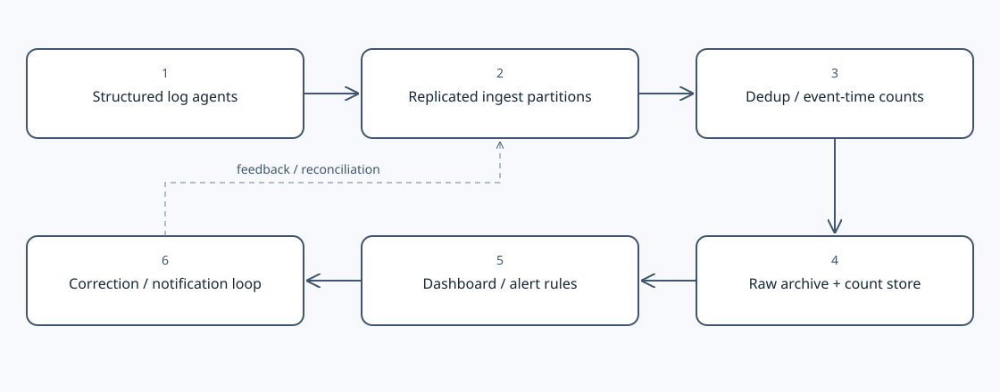

# W278. Design a Real-Time Log Processing System

**Priority group:** Third 100 — broader practice

**Category:** Logs, metrics and observability

**Study position:** 278 of 547

[Group list](../THIRD_100.md) · [All categories](../ALL_CATEGORIES.md) · [Chapter guide](../README.md)

## Question

Design a log processing system that ingests a continuous stream of application logs from a large service fleet and counts errors in real time. A dashboard and alerting layer sits on top, so error counts must be accurate and available with low latency.

Cover: ingest volume / retention / latency SLOs, a capacity calculation, the data model (LogEvent, time-bucketed ErrorCount, AlertRule), store choices with justification, an ingest and query API, the end-to-end pipeline with partitioning and windowing, and scaling trade-offs (latency vs. durability, freshness vs. state size, exactly-once cost). Address the follow-up: how do you reduce end-to-end latency?

## Worked solution

### State an explicit workload and SLO

Assume one million LogEvents/s peak, 200 bytes/event, seven days raw hot retention and 90 days archived; target dashboard counts under one second fresh and p99 query under 500 ms for recent service windows. These are design assumptions because the prompt gives no numbers. Peak ingest is 200 MB/s; if sustained, 17.28 TB/day raw, 120.96 TB for seven days before replicas/index/compression. At assumed 10 MB/s safe ingest per queue partition, use at least 20 at peak and choose 40 for headroom/skew, validated by broker benchmarks.

Schema: LogEvent(event_id,tenant,service,host,boot_id,seq,event_time,ingest_time,level,error_class,message); ErrorCount(tenant,service,error_class,bucket_start,resolution,count,revision); AlertRule(id,query,threshold,for_duration,evaluation_interval,state). `POST /logs:batch` acknowledges the promised durable log boundary, and `GET /error-counts?service=&from=&to=&step=` queries materialized aggregates. Raw message/token search is a separate workload, not a reason to index every free-form label.

### Accurate pipeline and query path

The diagram's agents buffer/batch, ingest validates/authenticates, a replicated log partitions by tenant/service plus hash shard, and stream workers deduplicate event IDs before counting ERROR/FATAL in event-time windows. A service-level hot key uses partial counters by hash shard followed by sums. Commit input offsets, dedup state and aggregate revisions atomically through the stream engine or use idempotent batch contributions; replay after a crash must not add counts again. Late events update windows within a watermark policy and trigger explicit corrections; raw archive supports later reconciliation.

Store recent ErrorCount in a low-latency time-series/OLAP table keyed by tenant/service/time/error_class and raw logs in compressed time-partitioned object/columnar storage. Count queries scan bounded buckets and merge sum/count states. Alerts evaluate recent materialized windows, persist incident state and publish idempotent notification intents through an outbox; deduplicate repeated firings, suppress flapping and represent no-data as unknown.

### Failure and latency trade-offs

Client events need durable local spooling if full accuracy includes host crashes; otherwise document the loss boundary. Network retries preserve batch/event IDs. A lagging partition advances a completeness watermark, so the dashboard can show provisional counts instead of claiming complete zeros. A full backend/queue rejects/backpressures or uses bounded spool with explicit drops; unlimited losslessness and nonblocking finite buffers cannot both hold through an indefinite outage. Separate ingestion and query budgets to contain expensive scans/noisy services.

To reduce end-to-end latency, shorten agent linger and microbatch intervals, use streaming rather than minute polling, increase balanced partitions/consumers, preaggregate hot counters and query cache/materialized windows. Keep durable group commit/replication; lowering fsync durability or skipping dedup changes correctness and must be an explicit trade-off. Smaller batches cost more network/CPU/state operations. Trace emit→agent→broker→processor→store→dashboard stages before optimizing the wrong link. Test duplicate replay, consumer crash at checkpoint, late/error-class corrections, hot-service flood and alert-provider outage; monitor lag/completeness, dedup expiry, p99 and reconciliation differences.

<!-- architecture:W278:start -->

Read the numbered flow as Structured log agents → Replicated ingest partitions → Dedup / event-time counts → Raw archive + count store → Dashboard / alert rules → Correction / notification loop. The dashed return represents the feedback/reconciliation described above; it does not replace the stated durability, authority or failure contract.
<!-- architecture:W278:end -->

[Batch behavior checks](../test_review_251_300.py). Capacity/SLO estimates are design calculations, not measured production results.

### Further study

- [F094: How do you debug a production latency regression?](../10_debugging_and_interview_reasoning.md#f094)
- [F169: Explain backpressure in a multi-stage data pipeline.](../17_distributed_systems_depth.md#f169)
- [F170: Design a cache without serving incorrect data.](../17_distributed_systems_depth.md#f170)
