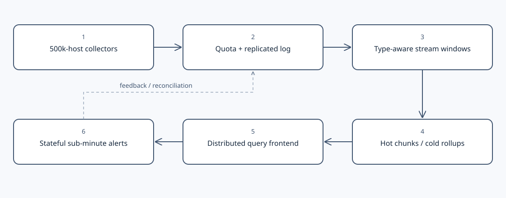

# W279. Design a Real-Time Metrics Monitoring System

**Priority group:** Third 100 — broader practice

**Category:** Logs, metrics and observability

**Study position:** 279 of 547

[Group list](../THIRD_100.md) · [All categories](../ALL_CATEGORIES.md) · [Chapter guide](../README.md)

## Question

Design a real-time monitoring system (Datadog / Prometheus style). Services emit metrics (counters, gauges, histograms, log lines) at high volume; the platform ingests them, supports fast dashboard queries, and fires alerts.

Functional

Services emit metrics at high volume.
Engineers / on-call query metrics for dashboards in seconds.
Alerts fire when a metric crosses a threshold or matches an anomaly rule.
Tiered retention: hot recent data queried often; cold long-term data queried rarely.

Non-functional

Ingest ~5M data points/sec at peak (~500k hosts x ~100 metrics, ~1GB/s raw).
Query p99 in the 1-2s range for dashboards spanning days to weeks.
Alert latency under 1 minute from emission to firing.
Cost-conscious storage: downsample aggressively for older data.

Discuss ingest, storage, query, downsampling, alerting, and cardinality control.

## Worked solution

### Size and partition the stated workload

Five million points/s at about 1 GB/s raw implies roughly 200 bytes/point. Sustained peak is 86.4 TB/day raw; seven days is 604.8 TB before replication, indexes or compression. The 500,000 hosts×100 metrics give 50 million series before labels, so five million points/s corresponds to a ten-second average sampling interval, not one point/series/second. Tag expansion can multiply series enormously; restrict dimensions, enforce tenant budgets and expose rejected-series counts.

Agents collect counters/gauges/histograms and structured logs through separate schemas, batch with bounded local spooling and send to regional authenticated ingest. The diagram's durable partition log buffers bursts, keyed stream processors normalize/reset/deduplicate samples and write recent TSDB chunks plus immutable archival chunks. At an assumed safe 20 MB/s per log partition, 1 GB/s needs at least 50; choose 100+ for skew/headroom only after measurement. Hot tenants/series use subsharded partial aggregates where the metric is mergeable.

### Query and retention plan

Time-series identity includes tenant/name/type/sorted tags. Index tags to series, compress time/value chunks and retain full fidelity for a chosen recent window. For example retain ten-second samples seven days, one-minute rollups 30 days and hourly rollups one year; this is a proposed policy, and raw detail beyond it cannot be recovered from means. Keep counter deltas/reset markers and gauge min/max/last/sum/count; merge histogram counts before quantiles, never average p99. Logs use time/service indexes and object archive, not an unbounded label per line.

A query frontend checks tenant scope/cost, splits time/series shards, chooses the finest sufficient rollup, computes partial aggregations and streams/cache-merges results. Preaggregated common day/week views and bounded returned points make p99 1–2 seconds plausible. Arbitrary unbounded joins/cardinality scans cannot share the same guarantee; set query limits and asynchronous export. Rollup manifests make each published generation complete and replayable.

### Alerts and failure behavior

For under-one-minute alert latency, budget e.g. ten-second agent flush, ten-second ingest/processing, ten-second evaluator interval and twenty seconds notification/headroom. Rules define threshold/anomaly baseline, `for` duration, no-data behavior, suppression and routing. Persist pending/firing/resolved state and send idempotent outbox notifications with dedup/recovery. A two-minute `for` rule intentionally exceeds one minute; distinguish rule semantics from pipeline delay.

Replay durable logs/checkpoints after worker loss, deduplicate delta batches by source/boot/sequence and correct late windows with revisions. Cumulative counters require reset-aware rates. Ingest overload enforces per-tenant quotas and counts loss; collector-buffer overflow protects the host rather than crashing it. Region failover must avoid double ingest/counts and preserve tenant isolation. Monitor sample loss, active-series churn, queue lag, query p99, alert delay and storage cost; test counter restart, incompatible histogram buckets, backend outage, cardinality explosion and noisy-service load. Downsampling saves cost at a measurable resolution/extreme-detail price, which the dashboard must expose.

<!-- architecture:W279:start -->

Read the numbered flow as 500k-host collectors → Quota + replicated log → Type-aware stream windows → Hot chunks / cold rollups → Distributed query frontend → Stateful sub-minute alerts. The dashed return represents the feedback/reconciliation described above; it does not replace the stated durability, authority or failure contract.
<!-- architecture:W279:end -->

[Batch behavior checks](../test_review_251_300.py). Capacity/SLO estimates are design calculations, not measured production results.

### Further study

- [F094: How do you debug a production latency regression?](../10_debugging_and_interview_reasoning.md#f094)
- [F169: Explain backpressure in a multi-stage data pipeline.](../17_distributed_systems_depth.md#f169)
- [F170: Design a cache without serving incorrect data.](../17_distributed_systems_depth.md#f170)
