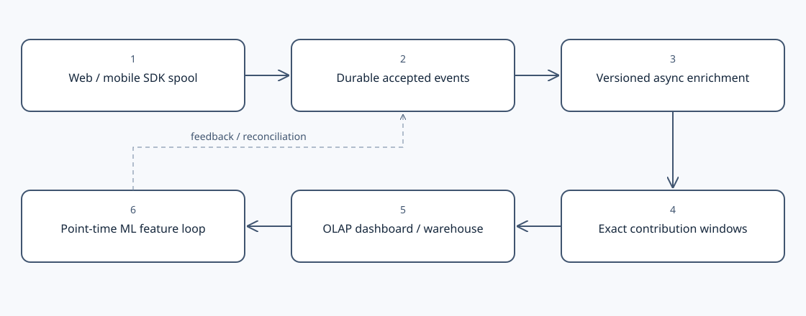

# W280. Design a User Behavior / Metrics Monitoring Aggregator

**Priority group:** Third 100 — broader practice

**Category:** Logs, metrics and observability

**Study position:** 280 of 547

[Group list](../THIRD_100.md) · [All categories](../ALL_CATEGORIES.md) · [Chapter guide](../README.md)

## Question

Design an event monitoring and enrichment platform for product-behavior analytics.

### Requirements

Track user behavior across web and mobile (ad impressions, clicks, app installs, and other product events).
Provide SDKs and API endpoints for data collection.
Support real-time dashboard queries with low (sub-second) latency.
Support complex asynchronous warehouse queries for deeper analytics.
Keep raw events for offline jobs.
Enrich events with data such as reverse geolocation or compliance tags.
Discuss schemas, ingestion, aggregation, enrichment flow, dashboard storage, and efficient query tables.

Scale anchor: handle 100M+ events/day with sub-second dashboard query latency, and treat aggregate counts as requiring full accuracy (no dropped or double-counted events), pinning the design to exactly-once / idempotent semantics rather than best-effort.

Follow-up (ML loop): the same event pipeline becomes a feature source; be ready to design offline feature/label generation, a training pipeline, and a low-latency online serving path for a recommendation model.

## Worked solution

### Define exactly what “full accuracy” covers

Acknowledge accepted events only after replicated durable append; SDKs retain a durable retry spool and stable event IDs until acknowledged. No finite mobile device can guarantee delivery after data is erased or never reconnects, so full accuracy means no dropped/double-counted **accepted** events and explicit reporting of collection gaps. A subsecond query can return a fast result with a completeness watermark; instantaneous globally complete counts are impossible when devices send late/offline.

At 100 million events/day the mean is 1,157/s. Assume tenfold peak and 500 bytes/event: about 11,574/s, 5.79 MB/s peak and 50 GB/day raw before compression/replicas. `POST /events:batch` accepts event_id,user pseudonym,device/session,tenant,event_type,event_time,schema_version and payload; return per-batch ACK/rejection. Store immutable raw events plus schema/consent metadata and a restricted identity mapping. Partition the durable log by user/device for local ordering; hot campaigns can use hash subshards.

### Enrichment and exact aggregates

The diagram's SDK→collector→durable log branches to raw archive, enrichment/stream aggregation and asynchronous warehouse. Reverse geolocation and compliance tags use versioned datasets, with address minimization/access controls; preserve original event and enrich_version so reprocessing is reproducible. Slow enrichment should not indefinitely block basic accepted-event counting: label pending/unknown dimensions and revise when enrichment arrives, rather than discard rows. Avoid raw IP in ordinary logs.

Deduplicate event_id with a retention horizon covering retries/replay, or retain a durable event/contribution ledger. Atomically checkpoint input offsets plus dedup/aggregate changes, or write idempotent per-batch contributions keyed by immutable batch ID. A retry cannot add another click. Event-time buckets keep sum/count by tenant/type/campaign/dimensions; late events or corrected enrichment retract the old contribution and add the new one. Materialized OLAP tables and preaggregated rollups serve subsecond dashboard queries; arbitrary deep joins go to asynchronous warehouse jobs. Raw object events enable backfill into a new aggregate generation, followed by validation and atomic pointer swap, not double addition to live counters.

### APIs, ML loop and operations

`GET /metrics` restricts dimensions/time/step and returns data_as_of/completeness. `POST /queries` creates a warehouse job with status/results APIs. Apply tenant query budgets, dimension cardinality limits, consent deletion and audit trails. SDK/schema versions, invalid records and dropped-spool counters remain observable. Region/consumer failure replays accepted log data; unresolved enrichment can delay dimensional completeness without falsely labeling it exact.

For recommendations, point-in-time joins produce user/item features and mature exposure→click/conversion labels; future events cannot leak into training. Shared transformations publish versioned online features, train a retrieval/ranker on forward-time splits, then canary a model/index package with exposure logging and controlled A/B tests. Online feature updates also deduplicate event IDs; a replay must not double user behavior. Monitor train/serve skew, feature age and eventual label quality separately from ingestion uptime. Validate duplicate mobile batches, out-of-order events, crash between checkpoint/write, enrichment correction, archive backfill and privacy deletion. A precise ledger and versioned corrections cost more than best-effort counters, which is the trade-off required by this prompt.

<!-- architecture:W280:start -->

Read the numbered flow as Web / mobile SDK spool → Durable accepted events → Versioned async enrichment → Exact contribution windows → OLAP dashboard / warehouse → Point-time ML feature loop. The dashed return represents the feedback/reconciliation described above; it does not replace the stated durability, authority or failure contract.
<!-- architecture:W280:end -->

[Batch behavior checks](../test_review_251_300.py). Capacity/SLO estimates are design calculations, not measured production results.

### Further study

- [F094: How do you debug a production latency regression?](../10_debugging_and_interview_reasoning.md#f094)
- [F169: Explain backpressure in a multi-stage data pipeline.](../17_distributed_systems_depth.md#f169)
- [F170: Design a cache without serving incorrect data.](../17_distributed_systems_depth.md#f170)
