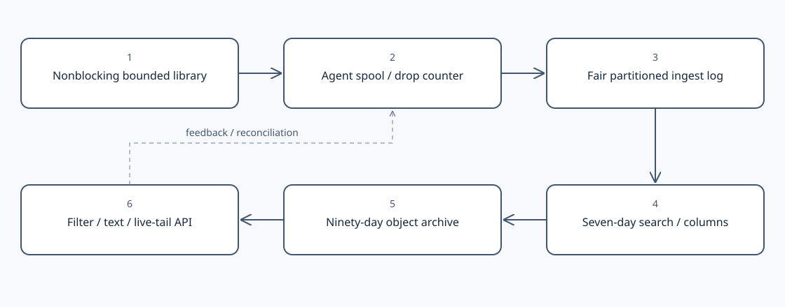

# W281. Design an Observability Logging System (Emit and Query)

**Priority group:** Third 100 — broader practice

**Category:** Logs, metrics and observability

**Study position:** 281 of 547

[Group list](../THIRD_100.md) · [All categories](../ALL_CATEGORIES.md) · [Chapter guide](../README.md)

## Question

Design an observability logging system: services emit structured log events, and engineers query them during incidents and for audits.

Scale and requirements
1. Fleet: 3,000 services. On average they emit 200,000 log events per second in total. Peak traffic is 5 times the average. One service can produce 10% of all traffic.
2. Event: a timestamp, a service name, a host, a level (DEBUG to FATAL), a trace id, free-form key/value labels, and a message. The average encoded size is 400 bytes.
3. Emit path: a client library inside each service sends events. Logging must never block a request or crash the service. Under normal operation, at most 0.1% of events may be lost. During an outage of the logging backend, the system may drop events, but it must count what it dropped.
4. Query path:
Filter by time range, service, level and labels. Results come back newest first. For the last hour of one service, the p95 latency must be under 2 seconds.
Search for a substring or token in the message over the last 7 days, within 30 seconds.
Live tail of one service, with under 5 seconds from emit to display.
5. Retention: 7 days searchable at full speed. 90 days in total for audit, where slower queries are acceptable.
6. Multi-tenancy: one noisy service must not slow down ingestion or queries for the others.
Deliverables
1. The architecture from the client library to storage. Name every component and what it buffers.
2. The storage layout: how events are partitioned, indexed and compressed, and why that layout serves the queries in requirement 4.
3. Capacity estimates for ingest bandwidth, daily storage, hot and cold storage, and the number of partitions in the ingest queue.
4. The failure behaviour: the backend is down, a partition is lagging, a service floods the system, or a query is too expensive.
5. Which requirement you would relax first if the cost had to fall by half, and what users would notice.

## Worked solution

### Client-to-storage path and capacity

The client API enqueues structured events into a bounded lock-efficient RAM ring and returns without blocking the application. A background agent batches, compresses and optionally spools to bounded disk; failures increment drop counters by service/reason outside the overloaded logging path. Validate/redact secrets before export. Under normal operation measure loss≤0.1%; during prolonged backend outage explicitly drop lower-priority events when buffers fill, reserving capacity for ERROR/FATAL. “Never block/crash” and finite buffering preclude unconditional losslessness.

200,000 events/s×400 bytes is **80 MB/s**, **6.912 TB/day** raw average. Fivefold peak is **one million events/s and 400 MB/s**. Seven raw days are **48.384 TB**, and 90 total raw days **622.08 TB** before compression/replicas/indexes. Assuming 4:1 compression, seven hot days are 12.096 TB compressed logical and the remaining 83 days are 143.424 TB compressed logical; hot three-way replication is 36.288 TB, excluding search indexes and archive coding. Benchmark the compression/index multiplier; these are explicit sizing assumptions.

Assume an ingest partition sustains 10 MB/s at safe load: peak needs 40, choose 80 for headroom/skew. Partition by tenant/service plus hash(host/batch), not solely service, since one service is 10% of traffic (40 MB/s peak under proportional load). Replicated queue brokers buffer ingest batches; stream/index workers buffer bounded decode batches; hot columnar/search shards hold indexed chunks; object storage holds immutable compressed audit chunks. Each buffer has a quota, age metric and overflow behavior.

### Layout and query contracts

Event schema includes event_id,tenant,event/ingest times,service,host,level,trace_id,labels,message,source boot/sequence. Partition hot storage by tenant/service/time and hash within very large services; sort chunks by timestamp and build service/level/selected-label indexes. Token inverted indexes accelerate text search; arbitrary substring search needs n-gram indexes or bounded scans, with significantly higher index/storage cost. Specify both because token search alone does not meet substring requirements. Seven days stay on searchable hot shards; days 8–90 use compressed object partitions with catalog/min-max metadata for slower audits.

`POST /logs:batch` authenticates source and returns accepted/rejected IDs; `GET /logs` filters time/service/level/labels with newest-first (time,id) cursors pinned to a high-watermark; `POST /search` runs bounded seven-day message searches; `/tail` uses a reconnectable stream cursor. Last-hour single-service queries target p95<2 s by pruning chunks/indexes, and text search has a 30 s budget with cancellation/partial status. Live tail follows committed ingest offsets and batches under five seconds; slow clients get a gap/resync marker. Access control and redaction apply to live tail and archive as well as search.

### Faults, isolation and cost reduction

Backend down: agents spool then count/drop under policy, never block request threads. Lagging partition: autoscale/rebalance consumers, show completeness lag and retain durable batches. Flooding service: per-service ingest credits, isolated queues/shards and fair query concurrency prevent it consuming every partition. Expensive query: cost estimate, limits, timeout and async export protect other tenants. Duplicate batch IDs deduplicate retried accepted logs if the promised count requires it; diagnostic log loss is separately measured. Retain tombstones and versioned redaction/deletion policies for audits.

If cost must halve, first propose reducing **seven-day full-speed arbitrary substring search** to shorter hot retention or slower archived substring scans, subject to owner agreement. Users notice slower older searches; preserve 90-day audit data and recent incident filters/live tail first. The savings need a measured breakdown—halving one tier does not guarantee halving total spend. Test backend outage, disk-full agent, 10% noisy service burst, lost ACK, stale cursors and multi-tenant queries; monitor normal/outage drop counts, queue lag, searchable freshness, query p95 and archive completeness.

<!-- architecture:W281:start -->

Read the numbered flow as Nonblocking bounded library → Agent spool / drop counter → Fair partitioned ingest log → Seven-day search / columns → Ninety-day object archive → Filter / text / live-tail API. The dashed return represents the feedback/reconciliation described above; it does not replace the stated durability, authority or failure contract.
<!-- architecture:W281:end -->

[Batch behavior checks](../test_review_251_300.py). Capacity/SLO estimates are design calculations, not measured production results.

### Further study

- [F094: How do you debug a production latency regression?](../10_debugging_and_interview_reasoning.md#f094)
- [F169: Explain backpressure in a multi-stage data pipeline.](../17_distributed_systems_depth.md#f169)
- [F170: Design a cache without serving incorrect data.](../17_distributed_systems_depth.md#f170)
