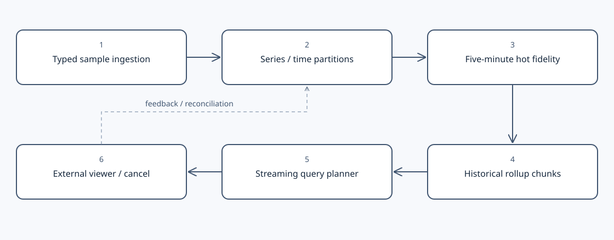

# W282. Metrics and Monitoring Platform

**Priority group:** Third 100 — broader practice

**Category:** Logs, metrics and observability

**Study position:** 282 of 547

[Group list](../THIRD_100.md) · [All categories](../ALL_CATEGORIES.md) · [Chapter guide](../README.md)

## Question

Design a metrics platform that ingests production telemetry at high write throughput, supports arbitrary-granularity range queries (metric, tag-filter, time-range, aggregation), and streams results to an external visualization layer (Grafana-like) that does not own the storage.

Common variant: top-k exceptions by error class in a rolling window; severity histograms over time.

Explicitly out of scope: alerting, on-call paging, ML anomaly detection.

Non-functional: millions of events/sec; sub-second query latency for the recent 5-minute hot window; few-second budgets acceptable for historical; full fidelity recent, downsampled long-term.

## Worked solution

### Scope and aggregation semantics

Build ingestion, tiered time-series storage and a query API for an external Grafana-like viewer. Alerting, paging and ML anomaly detection are explicitly outside scope. Series keys canonicalize tenant, metric/type and tags. Samples retain source/boot/sequence, event_time, ingest_time and values; exceptions have error_class/severity, not an unbounded unique-message label. Define counters versus gauges versus histogram increments before aggregating them.

The diagram's collectors feed a partition log and processors that write full-fidelity recent chunks and rollups. A tag inverted index selects matching series; chunks partition by tenant/series hash/time and compress timestamps/values. The recent five-minute hot window lives in memory/SSD with replicas. Historical partitions move to object/columnar storage and lower resolution. “Arbitrary granularity” means aggregate into requested buckets aligned to documented boundaries; historical one-minute rollups cannot recreate one-second detail. Return the actual source resolution and completeness watermark.

### Query and variants

`POST /query` takes metric, authorized tag filters, [start,end), step, aggregation and timezone/alignment; it streams ordered result chunks with query_id, revision and last cursor. The frontend validates cost, fans out time/series shards, merges sum/count/min/max or compatible histogram buckets and backpressures/cancels on a disconnected slow viewer. The visualization layer renders; it does not own persistence. Cache normalized query+tenant+data-generation keys with short TTL for live windows.

For top-k exceptions, shard counts by (error_class,time bucket,hash partition), sum each class's partials and then select global top-k. Merging only each shard's local top-k can miss a globally frequent class spread across shards; either merge full candidate counts for bounded class cardinality or use an explicitly approximate heavy-hitter algorithm with error bounds. Severity histograms store counts per severity/bin and sum them across windows; averaging host percentiles is wrong.

### Capacity, reliability and validation

Assume two million samples/s×40 compressed bytes for sizing: 80 MB/s; five minutes is 24 GB logical before indexes/replicas, while sustained one day is 6.912 TB. Actual memory depends on active series and chunk overhead. Use distributed hot shards and preaggregate common queries to target subsecond recent queries; historical queries have few-second budgets and bounded fanout, not arbitrary unlimited scan guarantees. Cardinality caps and tenant query credits control cost.

Deduplicate retried deltas, checkpoint offsets with aggregate revisions and replay after failure. Late events correct event-time buckets; publish immutable rollup generations only after completeness checks. Counter reset/boot identity avoids negative rates, and gauges have an explicit last/mean rule. Buffer overflow/rejection is exposed rather than silently returning exact-looking counts. On shard outage return a marked incomplete/failed query or replica result, never treat missing series as zero. Test boundary alignment, sub-rollup requested steps, top-k distributed counterexample, late replay, histogram merges and viewer disconnect. Monitor ingest lag, cardinality/churn, query p99, cache correctness and tier resolution; adding alert services would distract from this prompt's requested contract.

<!-- architecture:W282:start -->

Read the numbered flow as Typed sample ingestion → Series / time partitions → Five-minute hot fidelity → Historical rollup chunks → Streaming query planner → External viewer / cancel. The dashed return represents the feedback/reconciliation described above; it does not replace the stated durability, authority or failure contract.
<!-- architecture:W282:end -->

[Batch behavior checks](../test_review_251_300.py). Capacity/SLO estimates are design calculations, not measured production results.

### Further study

- [F094: How do you debug a production latency regression?](../10_debugging_and_interview_reasoning.md#f094)
- [F169: Explain backpressure in a multi-stage data pipeline.](../17_distributed_systems_depth.md#f169)
- [F170: Design a cache without serving incorrect data.](../17_distributed_systems_depth.md#f170)
