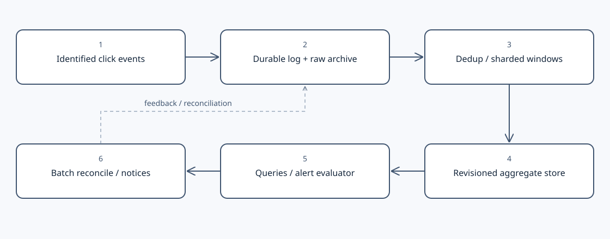

# W283. Metrics Collection, Alerting & Click Counters

**Priority group:** Third 100 — broader practice

**Category:** Logs, metrics and observability

**Study position:** 283 of 547

[Group list](../THIRD_100.md) · [All categories](../ALL_CATEGORIES.md) · [Chapter guide](../README.md)

## Question

Design a real-time metrics, click-counting, or alerting pipeline that supports low-latency queries, offline analysis, deduplication, and reliable counters.

Functional requirements
1. Ingest high-volume events such as clicks, views, impressions, or metric samples.
2. Support near-real-time dashboard queries and alert evaluation.
3. Preserve raw events for offline analysis and backfills.
4. Deduplicate retries and handle late / out-of-order events.
5. Serve counters or aggregates by entity, time window, and dimension.
Scale / constraints
Bursty traffic and hot keys for popular links, campaigns, creators, or metrics.
Alerting should be timely, but offline analytics may need more exact reconciliation.
Raw event retention and aggregate retention have different storage needs.
Design decisions
Durable event log vs direct writes to aggregate storage.
Stream processor for real-time windows vs batch job for correction.
Approximate vs exact counters for hot keys; alert rule storage, evaluator cadence, suppression, and notification fanout.

## Worked solution

### Durable events and counter identity

Assume click/impression analytics with dashboard freshness of seconds and later exact reconciliation. `POST /events:batch` takes event_id,entity_id,kind,event_time,source/boot/sequence and dimensions; ACK follows a replicated durable log append. Retry stable event IDs. Raw event storage is immutable/partitioned by tenant/date for offline analysis, while stream processors maintain entity/time/dimension counters. Cumulative metric readings and individual click increments require different schemas/reset handling.

The diagram's log fans out to raw archive, deduplicating window processors, aggregate storage and alert evaluation. Partition hot entities by an additional deterministic event hash, produce partial counts and sum across shards; one viral link should not serialize every increment on one database row. Exact counts use durable uniqueness/contribution state and transactional offset+output commit or idempotent batch keys. Approximate sketches can support exploratory heavy-hitter/distinct metrics only when their error is disclosed; “hot key” alone is not permission to approximate billing counters.

### Late data, queries and alerts

Store Aggregate(tenant,entity,dimension,bucket,resolution,count,revision,complete_through). Event-time watermarks distinguish provisional live counts from finalized windows, and late data emits corrections. Backfills build an independent generation from raw data, compare totals/checksums and atomically swap the view; adding a replay to existing totals would double count. Dedup retention must cover the replay horizon or the archived event IDs must supply a longer-lived ledger.

`GET /counts` returns range/step aggregates and freshness/completeness, with rollups summing counts and maintaining partial edge buckets. AlertRule specifies query, threshold, duration, cadence, cooldown, no-data policy and destinations. Persist pending/firing/resolved states and enqueue notification outbox records with an incident key so retries do not multiply alerts. Suppression/inhibition prevents a dependency outage from paging every downstream component; resolved notifications close the same incident. Offline corrected counts may revise a past breach without replaying an outdated urgent page unless policy explicitly asks.

### Example and capacity

A link gets one click event retransmitted three times after an ACK timeout: one ledger contribution yields count one. A later event belongs to yesterday's bucket, updates its revision and historical total without pretending it occurred now. Assume 100,000 events/s×200 bytes: 20 MB/s and 1.728 TB/day raw before compression/replication. At a chosen 5,000 events/s safe worker rate, at least 20 active partitions/workers plus headroom are needed; skew and state-store writes must be benchmarked.

A processor crash recovers from committed log/checkpoint, an alert-provider outage retains notifications for retry, and an archive outage does not erase accepted log records before archival confirmation. Client buffers and retention remain bounded, with explicit loss/rejection if full. Separate live and backfill capacity; query quotas protect ingestion. Monitor accept-to-visible delay, missing/duplicate differences versus batch, hot-shard lag, dedup expiry, alert delay and correction volume. Test consumer death at each commit boundary, out-of-order timestamps, repeated backfill, reset counters and an unreachable notification provider. Low latency and exact reconciliation are compatible only when completeness and correction semantics are explicit.

<!-- architecture:W283:start -->

Read the numbered flow as Identified click events → Durable log + raw archive → Dedup / sharded windows → Revisioned aggregate store → Queries / alert evaluator → Batch reconcile / notices. The dashed return represents the feedback/reconciliation described above; it does not replace the stated durability, authority or failure contract.
<!-- architecture:W283:end -->

[Batch behavior checks](../test_review_251_300.py). Capacity/SLO estimates are design calculations, not measured production results.

### Further study

- [F094: How do you debug a production latency regression?](../10_debugging_and_interview_reasoning.md#f094)
- [F169: Explain backpressure in a multi-stage data pipeline.](../17_distributed_systems_depth.md#f169)
- [F170: Design a cache without serving incorrect data.](../17_distributed_systems_depth.md#f170)
