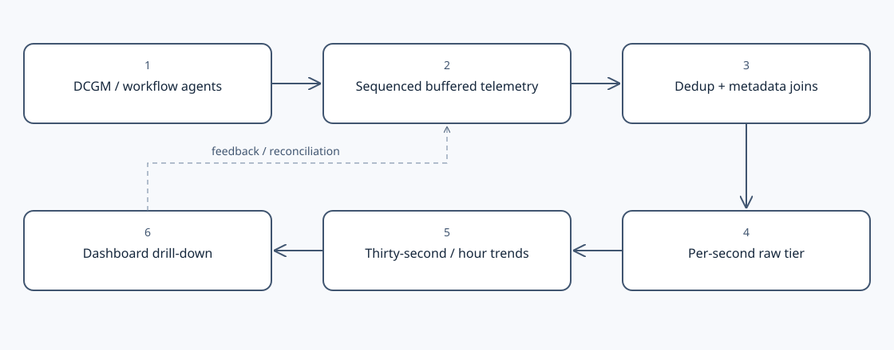

# W286. Telemetry Collector and GPU Utilization Dashboard

**Priority group:** Third 100 — broader practice

**Category:** Logs, metrics and observability

**Study position:** 286 of 547

[Group list](../THIRD_100.md) · [All categories](../ALL_CATEGORIES.md) · [Chapter guide](../README.md)

## Question

Telemetry Collector and GPU Utilization Dashboard

Design a data collector and analytics dashboard for GPU-cluster telemetry. The system must ingest both 30-second and 1-second resolution metrics, show 3-month utilization trends, and allow drill-down to per-GPU per-second data.

### Requirements

Design a collector and dashboard for hardware / GPU telemetry.

Functional requirements:

Collect telemetry from GPU-cluster hosts at both 30-second and 1-second resolution.
Track longer-range utilization trends over roughly three months.
Support dashboard drill-down from aggregate trend views to per-GPU, per-second data.
Use workflow analysis to calculate GPU utilization and compute-resource needs for hardware design teams.
Expose enough metadata for operators to understand cluster, host, GPU, workload, timestamp, and metric type.

Constraints and design points:

The hot path must handle high-cardinality time-series writes.
Storage should separate low-resolution historical aggregates from high-resolution drill-down data.
Dashboard queries need predictable latency despite multi-month retention.
OpenTelemetry-style instrumentation and DCGM-style GPU metrics are relevant interfaces to discuss.
Notes

A strong design usually separates collection, ingestion, storage tiers, and query serving:

Host agents collect local GPU and workflow telemetry, buffer briefly, and push or stream to a central ingestion layer.
The ingestion layer validates schema, deduplicates retry traffic, and writes raw high-resolution data plus downsampled aggregates.
Low-resolution trend data can live in a time-series or analytics store optimized for range scans; high-resolution per-GPU data can use shorter retention or colder partitions.
Dashboard queries should hit pre-aggregated views first, then fetch narrow raw slices for drill-down.
Key trade-offs are resolution vs. retention cost, push vs. pull collection, hot-partition avoidance, and how much aggregation belongs in the collector versus the backend.

## Worked solution

### Two resolutions, one metadata contract

Agents collect DCGM-style GPU utilization, memory, power, temperature, errors and optional process/workflow state, exporting an OpenTelemetry-style schema with cluster/host/GPU UUID, workload/job/attempt, event/ingest timestamp, metric type, source boot_id/sequence and units. GPU index alone is unstable across reboot/replacement; use UUID plus inventory history. Collect one-second data and derive aligned thirty-second aggregates from it where possible, rather than counting independent samplers twice. Gauges retain sum/count/min/max/last, while busy GPU-seconds and allocated GPU-seconds are counters with reset semantics.

The diagram's host buffer feeds a durable partitioned ingest log, schema/dedup/window processors, a high-resolution tier and historical rollups. Partition by cluster/GPU hash/time and batch compressed writes to avoid a hot cluster-wide key. Workload metadata has effective start/end times so attribution uses event time, not whichever job occupies the GPU when a late sample arrives. Deduplicate retries and correct late aggregates with versions/watermarks.

### Trends and drill-down

`GET /utilization?cluster=&from=&to=&step=` serves three-month views from thirty-second/minute/hour rollups, while `/gpus/{uuid}/samples` retrieves a narrow full-resolution slice. The UI begins with cluster/workload summaries, drills to hosts/GPUs and only requests per-second data for a selected interval. Return coverage/sample_count, source resolution and missingness: missing telemetry is unknown, not zero utilization. Merge sum/count across devices/time for means and merge compatible histograms for distributions; averaging percentiles or unequal sample means is wrong.

Clarify per-second retention: if drill-down is required for **any** time in three months, keep the full three months in compressed colder object partitions, accepting slower historical drill-down or caching selected windows. Short high-res retention saves cost but cannot satisfy arbitrary old per-second retrieval; do not promise both without storing it. Publish downsampled partitions atomically and keep raw manifests for repeatable correction.

### Sizing, workflow analysis and failures

Assume 100,000 GPUs×20 metrics×one sample/s=two million samples/s. At assumed 24 encoded bytes/sample this is 48 MB/s, 4.1472 TB/day and about 373.248 TB/90 days logical before replicas/indexes. Thirty-second rollups have roughly 1/30 the points (~12.44 TB over 90 days at equal bytes/point), although actual fields/compression differ. Labels/job churn can dominate series metadata, so separate static inventory from high-cardinality workflow events.

Hardware teams need more than average GPU-busy: compute allocated versus busy GPU-hours, queue time, memory-bandwidth/compute saturation, model/batch mix, idle gaps and peak concurrent demand by workflow. A low utilization percentage may indicate I/O or CPU stalls, not excess GPUs; simulate/measure resource changes on representative workflows rather than dividing demand by a single mean. Account for shared GPUs/MIG and missing samples explicitly.

Agents buffer boundedly, spool/retry with stable IDs and expose drops. Broker/worker recovery replays idempotently; failed historical tiers return delayed/partial marked queries rather than fake zeros. Tenant/RBAC limits prevent workload leakage and expensive drill-down scans from starving ingest. Monitor collector overhead, lag, GPU coverage, clock skew, active-series churn and query percentiles. Test duplicate sources, GPU replacement, late job boundaries, missing telemetry and a three-month query followed by exact per-second drill-down under the stated retention contract.

<!-- architecture:W286:start -->

Read the numbered flow as DCGM / workflow agents → Sequenced buffered telemetry → Dedup + metadata joins → Per-second raw tier → Thirty-second / hour trends → Dashboard drill-down. The dashed return represents the feedback/reconciliation described above; it does not replace the stated durability, authority or failure contract.
<!-- architecture:W286:end -->

[Batch behavior checks](../test_review_251_300.py). Capacity/SLO estimates are design calculations, not measured production results.

### Further study

- [F094: How do you debug a production latency regression?](../10_debugging_and_interview_reasoning.md#f094)
- [F169: Explain backpressure in a multi-stage data pipeline.](../17_distributed_systems_depth.md#f169)
- [F170: Design a cache without serving incorrect data.](../17_distributed_systems_depth.md#f170)
