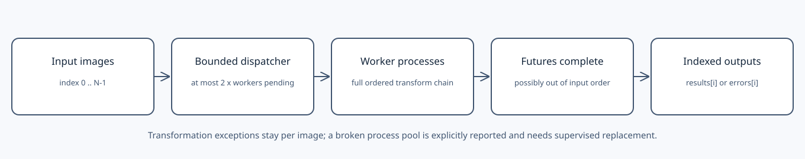

# W288. Parallel Batch Image Transformation Pipeline

**Priority group:** Third 100 — broader practice

**Category:** ML coding and gradients

**Study position:** 288 of 547

[Group list](../THIRD_100.md) · [All categories](../ALL_CATEGORIES.md) · [Chapter guide](../README.md)

<span class="practice-page"></span>

## Question

A data pipeline must apply the same chain of image transformations (resize, grayscale, blur) to thousands of images before training. The work is CPU-bound, so it should run in several worker processes rather than threads. Implement the three transformations on NumPy arrays and a batch processor that runs the chain over many images in parallel. Results must come back in input order, and one bad image must not stop the batch.

An image is a numpy.ndarray of dtype uint8 with shape (H, W) (gray) or (H, W, 3) (RGB). A transformation is a function that takes one image and returns a new image; it never modifies its input.

### What to implement

```text
def resize(img: Image, height: int, width: int) -> Image: ...
    def to_grayscale(img: Image) -> Image: ...
    def box_blur(img: Image) -> Image: ...
    def process_one(image: Image, transformations: Sequence[Transform]) -> Image: ...
```

```text
class BatchImageProcessor:
def __init__(self, transformations: Sequence[Transform], num_workers: Optional[int] = None,
executor_factory: Optional[Callable[[int], Executor]] = None): ...
def process(self, images: Sequence[Image]) -> Tuple[List[Optional[Image]], Dict[int, str]]: ...
```

resize(img, height, width): nearest-neighbour resize to height x width.
to_grayscale(img): RGB to gray.
box_blur(img): 3 x 3 mean filter.
process_one(image, transformations): applies the transformations to one image, in list order. It is a top-level function, so worker processes can receive it.
BatchImageProcessor(transformations, num_workers, executor_factory): transformations is the pipeline. num_workers is the number of worker processes, stored as the attribute num_workers. The default is os.cpu_count(), or 1 if that returns None. executor_factory(n) returns a concurrent.futures.Executor with n workers; None (the default) means concurrent.futures.ProcessPoolExecutor.
process(images) returns (results, errors).

### Rules

1. resize: with img of size H x W, out[i, j] = img[i * H // height, j * W // width] (integer division). Channels are kept. Raise ValueError if height &lt; 1 or width &lt; 1.
2. to_grayscale: for RGB, gray = (299 * R + 587 * G + 114 * B + 500) // 1000, computed in integers, giving shape (H, W). A gray input is returned as an unchanged copy.
3. box_blur: each output pixel is the mean of the 3 x 3 neighbourhood around it, per channel. A neighbour outside the image takes the value of the pixel at the clamped coordinates (edge replication): row -1 reads row 0, row H reads row H - 1, and the same for columns. The mean is rounded to the nearest integer as (sum + 4) // 9. The shape is unchanged.
4. All three return uint8 arrays and leave their input unchanged.
5. process creates one executor with executor_factory(num_workers), runs every image's pipeline inside the executor's tasks (not in the calling process), and shuts the executor down before returning.
6. results[i] is the output for images[i], in input order, whatever order the workers finish in. len(results) == len(images).
7. If any transformation raises an exception for image i, then results[i] is None and errors[i] is "&lt;ExceptionType&gt;: &lt;message&gt;", for example "ValueError: corrupt image". The same applies if the worker running it fails. The other images are still processed. errors has a key for exactly the failed indices.
8. An empty images list returns ([], {}). An empty pipeline returns each image unchanged. Raise ValueError if num_workers &lt; 1.

### Examples

Example 1: the transformations

```text
img = [[[255, 0, 0], [0, 255, 0]],
```

[[0, 0, 255], [255, 255, 255]]]          # 2 x 2 RGB
to_grayscale(img)                  -&gt; [[76, 150], [29, 255]]
resize([[10, 20], [30, 40]], 3, 4) -&gt; [[10, 10, 20, 20],

```text
[10, 10, 20, 20],
[30, 30, 40, 40]]
```

box_blur([[0, 0, 0], [0, 90, 0], [0, 0, 0]])
-&gt; [[10, 10, 10], [10, 10, 10], [10, 10, 10]]

```text
Explanation: pure red gives (299 * 255 + 500) // 1000 = 76. In the resize, row i reads source row i * 2 // 3, which is 0, 0, 1. In the blur, every 3 x 3 window, with the edge pixels repeated, contains the 90 exactly once, so each output pixel is (90 + 4) // 9 = 10.
```

Example 2: a batch with one failure

```python
def fail_on_7(img):
    ...
```

if int(img.flat[0]) == 7:
raise ValueError("corrupt image")

```python
return img
```

```text
def plus_one(img): return (img.astype(int) + 1).clip(0, 255).astype(np.uint8)
    def double(img):   return (img.astype(int) * 2).clip(0, 255).astype(np.uint8)
```

```python
proc = BatchImageProcessor([fail_on_7, plus_one, double], num_workers=4)
```

proc.process([np.full((2, 2), 3, np.uint8), np.full((2, 2), 7, np.uint8), np.full((2, 2), 10, np.uint8)])
-&gt; ([array of 8s, None, array of 22s], {1: "ValueError: corrupt image"})

```text
Explanation: the pipeline runs in list order, so 3 becomes (3 + 1) * 2 = 8 and 10 becomes 22. Image 1 raises, so its result is None and its error is recorded under index 1. The results stay in input order.
```

### Constraints

Up to 10^5 images per batch; each image is at most 4096 x 4096.
Transformations passed to the processor are top-level functions (or functools.partial of them), so they can be pickled.
Follow-up 1: processes versus threads

Why does this workload need processes rather than threads in CPython? What does process-based parallelism cost (start-up, memory, pickling the images in both directions)? When would threads be the better choice?

Follow-up 2: failures and progress

How would you handle a worker that crashes or hangs on one image without losing the rest of the batch? How would you report progress while the batch runs without blocking the workers?

## Worked solution

### Pure transformations and ordered process results

Resize uses exactly floor(iH/outH), floor(jW/outW). Grayscale computes the specified integer weighted sum in int32, preventing uint8 overflow. Blur pads by repeated edges, sums nine neighborhoods in int32 and applies (sum+4)//9 independently per channel. Every transform returns uint8, a fresh array and the required shape. The batch runs the whole ordered chain in worker tasks, never in the calling process, and indexes results by original input position.

```python
"""Pure uint8 transformations and one bounded process executor per batch."""

from concurrent.futures import ProcessPoolExecutor, wait, FIRST_COMPLETED
import os
import numpy as np


def _check(img):
    if not isinstance(img, np.ndarray) or img.dtype != np.uint8:
        raise ValueError("image must be a uint8 NumPy array")
    if (
        img.ndim not in (2, 3)
        or min(img.shape[:2]) < 1
        or (img.ndim == 3 and img.shape[2] != 3)
    ):
        raise ValueError("image must be nonempty gray or RGB")


def resize(img, height, width):
    _check(img)
    if height < 1 or width < 1:
        raise ValueError("positive output dimensions required")
    rows = np.arange(height) * img.shape[0] // height
    cols = np.arange(width) * img.shape[1] // width
    return img[rows[:, None], cols[None, :]].copy()


def to_grayscale(img):
    _check(img)
    if img.ndim == 2:
        return img.copy()
    a = img.astype(np.int32)
    return (
        (299 * a[:, :, 0] + 587 * a[:, :, 1] + 114 * a[:, :, 2] + 500) // 1000
    ).astype(np.uint8)


def box_blur(img):
    _check(img)
    h, w = img.shape[:2]
    padding = ((1, 1), (1, 1)) if img.ndim == 2 else ((1, 1), (1, 1), (0, 0))
    padded = np.pad(img.astype(np.int32), padding, mode="edge")
    total = np.zeros(img.shape, dtype=np.int32)
    for dy in range(3):
        for dx in range(3):
            total += padded[dy : dy + h, dx : dx + w]
    return ((total + 4) // 9).astype(np.uint8)


def process_one(image, transformations):
    result = image.copy()
    for transform in transformations:
        result = transform(result)
    return result


class BatchImageProcessor:
    def __init__(self, transformations, num_workers=None, executor_factory=None):
        self.num_workers = (os.cpu_count() or 1) if num_workers is None else num_workers
        if self.num_workers < 1:
            raise ValueError("num_workers must be positive")
        self.transformations = tuple(transformations)
        self.executor_factory = executor_factory or ProcessPoolExecutor

    def process(self, images):
        if len(images) == 0:
            return [], {}
        results = [None] * len(images)
        errors = {}
        # Bound submitted work: do not serialize 100,000 huge images at once.
        next_index = 0
        pending = {}
        with self.executor_factory(self.num_workers) as executor:
            while next_index < len(images) or pending:
                while next_index < len(images) and len(pending) < 2 * self.num_workers:
                    i = next_index
                    next_index += 1
                    try:
                        future = executor.submit(
                            process_one, images[i], self.transformations
                        )
                        pending[future] = i
                    except Exception as exc:
                        errors[i] = f"{type(exc).__name__}: {exc}"
                if not pending:
                    continue
                done, _ = wait(pending, return_when=FIRST_COMPLETED)
                for future in done:
                    i = pending.pop(future)
                    try:
                        results[i] = future.result()
                    except Exception as exc:
                        errors[i] = f"{type(exc).__name__}: {exc}"
        return results, errors
```

The executor factory is called once for a nonempty batch with `num_workers`, and its context exits before return. Empty input returns ([],{}); empty transformation chains return copied unchanged images. Keep submitted futures bounded to twice the worker count so 100,000 potentially 4096×4096 images are not all copied into the process queue at once. The caller still owns the input list and full result list, so the requested interface itself may require enormous RAM; a separate streaming output interface would be needed to bound that too.

### Example and failure semantics

The supplied primary-color example becomes [[76,150],[29,255]]. A central 90 in a zero 3×3 image produces 10 everywhere under clamped 3×3 windows. With [fail_on_7,plus_one,double], values 3,7,10 yield arrays of 8,None,22 and `{1: "ValueError: corrupt image"}`. A future exception is recorded as its actual type/message and other futures continue; submission exceptions are likewise indexed. Tests use top-level picklable functions/partials, actual process workers, an injected executor and deliberately out-of-order completion.

A hard worker crash can break Python's entire ProcessPoolExecutor. The implementation records BrokenProcessPool errors for every affected/unsubmitted index, preserving already completed results, rather than pretend unaffected pending work succeeded. This is a runtime limitation of the one-executor contract: recovering remaining work requires a supervisor to create a replacement executor/batch and retry only safe unresolved image transforms. If guaranteed survival of arbitrary hard exits in one executor is mandatory, use a custom fault-restarting executor through `executor_factory`. A hung running future cannot be safely killed with `future.cancel()`; a watchdog needs process termination/replacement, timeout classification and restart boundaries. Do not claim the shown class solves these stronger follow-ups automatically.

Processes bypass the GIL for Python CPU work but pay startup, pickling/copying, duplicated memory and result transfer. NumPy kernels often release the GIL, so threads may beat processes when arrays are large and native kernels dominate; benchmark and avoid nested BLAS thread oversubscription. Shared memory/memory-mapped batches can reduce copies with explicit lifetimes. Progress reports from the parent after each completed future can update a bounded queue/UI; workers should not block on progress rendering. Shutdown/cancel policy and a maximum task duration belong in a production supervisor. This distinguishes tested transform-error isolation from the separately explained hard-crash/hang recovery contract.

[Runnable W288 implementation](../review_w288_implementation.py).

[Batch behavior checks](../test_review_251_300.py). Capacity/SLO estimates are design calculations, not measured production results.

### Further study

- [F100: How do you practice an unfamiliar ML coding problem?](../10_debugging_and_interview_reasoning.md#f100)
- [F120: Implement a Gaussian image filter with explicit boundary handling.](../12_gradient_and_loss_depth.md#f120)


<!-- architecture:W288:start -->


The dispatcher holds a bounded number of futures; each worker runs the entire resize/grayscale/blur chain. Completion order can vary, but the parent writes each result or error at its original index. The process-pool hard-crash limitation and replacement strategy are stated above.
<!-- architecture:W288:end -->
