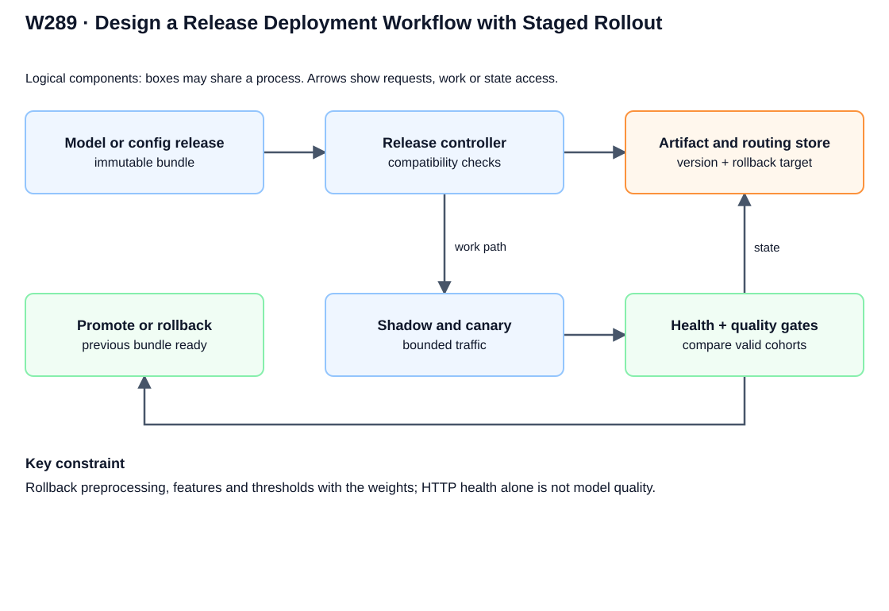

# W289. Design a Release Deployment Workflow with Staged Rollout

**Priority group:** Third 100 — broader practice

**Category:** ML infrastructure and distributed training

**Study position:** 289 of 547

[Group list](../THIRD_100.md) · [All categories](../ALL_CATEGORIES.md) · [Chapter guide](../README.md)

## Question

Design a release deployment workflow with staged rollout, rollback, health checks, and multi-region coordination.

## Worked solution

<!-- architecture:W289:start -->
### Architecture and request flow

[Open the diagram at full size](../diagrams/W289_architecture.svg). This is a baseline component diagram for this question. The boxes describe responsibilities; they do not require a separate microservice for every box.

- **Request and state:** Model or config release — immutable bundle → Release controller — compatibility checks. That component consults or updates **Artifact and routing store — version + rollback target** under the required access and consistency rules.
- **Work and result:** the work path passes through **Shadow and canary — bounded traffic** and **Health + quality gates — compare valid cohorts**, producing **Promote or rollback — previous bundle ready**. Bound waiting and retries where a slow dependency can stall this path.
- **Correctness point:** Rollback preprocessing, features and thresholds with the weights; HTTP health alone is not model quality.

When explaining the drawing, trace one normal request first, then a duplicate request, an unavailable dependency and recovery from saved state. If the question requires stricter guarantees or a different scope, state the change explicitly rather than treating this baseline as the only possible design.
<!-- architecture:W289:end -->

### Solution outline

1. Represent desired state and observed state separately, and reconcile them through an idempotent control loop.
2. Deploy immutable versioned artifacts in stages, with compatibility checks, health probes and a maximum unavailable/surge budget. Wait for the application’s readiness rather than only process creation.
3. For balancing, compute an assignment from resource constraints and current load; avoid oscillation with thresholds, cooldowns and bounded moves.
4. Persist rollout progress and make retries safe. Roll back using a compatible previous bundle when operational or quality guardrails fail.

### Understand why the approach works

#### Follow tensor ownership and the resource bottleneck

For every major tensor, state who owns it before and after each collective. Data parallelism divides examples; tensor parallelism divides operations/weights; pipeline parallelism divides layers. Their communication and memory effects differ, so a diagram saying “use more GPUs” is incomplete.

For $C=AB$, $A\in\mathbb R^{m\times k}$ and $B\in\mathbb R^{k\times n}$, a row partition gives

$$
C_r=A_rB,\qquad C=\operatorname{ConcatRows}(C_0,\ldots,C_{p-1}).
$$

Concatenating output shards is different from summing partial products. Backward communication depends on which variables were replicated and where multiple contributions to the same derivative must be added.

Estimate the bottleneck with a roofline bound:

$$
\text{attainable FLOP/s}\leq
\min\!\left(F_{\rm peak},\;\text{bandwidth}\times\frac{\text{FLOPs}}{\text{bytes moved}}\right).
$$

Then add synchronization, imbalance, launch and checkpoint overhead rather than treating the ideal bound as achieved speed.

For a platform/scheduler, distinguish desired state, observed state and durable job completion. Launching a container or receiving a provider response does not prove the computation succeeded. Checkpoint application state, fence stale owners, publish only complete artifacts and monitor both utilization and tenant wait time. A design that maximizes utilization by starving a large job violates a different important service objective.

### Work a small example

A pod rebalance that moves all replicas simultaneously can cause an outage despite ultimately reaching a better distribution. A staged controller limits disruption per reconciliation step.

### Edge cases and common mistakes

Issuing one imperative command and assuming desired state has been achieved forever.

### Check your reasoning on related cases

**Design an online model rollout with rollback.** Rolling back weights alone fails if the new feature schema is incompatible with the old model.

What is shadow deployment good for? Observing behavior and operational cost without letting the new model drive user decisions.

**Design a fair GPU job scheduler.** An eight-GPU job requiring one fast interconnect group cannot be satisfied by eight isolated single-GPU slots with inadequate network bandwidth.

How do you prevent starvation? Aging priorities, guaranteed shares or reserved capacity, with explicit tradeoffs.

### Further study

- [F087: Design an online model rollout with rollback.](../09_ml_system_design.md#f087)
- [F039: Design a fair GPU job scheduler.](../04_serving_and_training_systems.md#f039)

### Explain it back

Close the answer. State the main invariant or equation, work the example with changed inputs, and explain which assumption would make your solution fail. For a design, walk through a retry or partial failure; for a derivative, check a shape and a finite-difference case.
